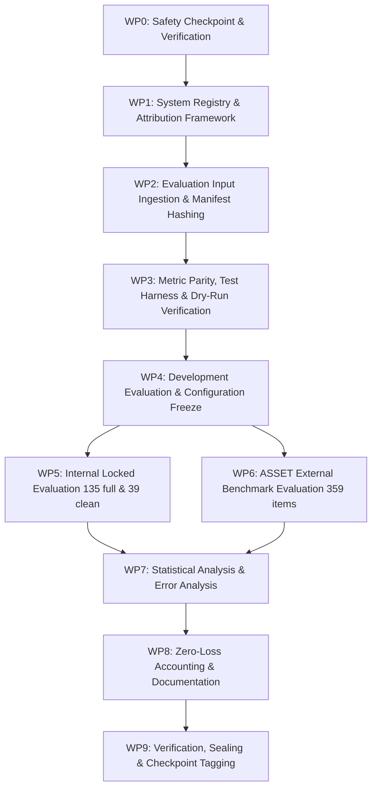

# Stage 28A Implementation Plan — Preliminary English Model and Simplification Comparison

**Component:** Component 3 — AI/NLP-Based Language Simplification  
**Language:** English  
**Target Users:** Children aged 4–8  
**Prerequisite Checkpoint:** `stage-26-complete-v5` and `stage-27-infrastructure-complete-v3` (commit `22eb001`)  
**Stage 27 Human-Validation Status:** Pending ethics clearance  
**Stage 28A Status:** Planned  
**Recommended Branch:** `feature/stage28a-model-comparison`  
**Start Tag:** `stage-28a-start`  
**Completion Tag:** `stage-28a-complete`  
**Future Supplementary Phase:** Stage 28B — Expert-Aligned English Model Comparison  

---

## 1. Purpose & Executive Summary

Stage 28A performs a controlled, reproducible comparison of the English text simplification methods developed during Stages 24–26. It benchmarks deterministic baselines, the Stage 25 controlled engine, Gemini native generation, and the Stage 26 governed hybrid pipeline using frozen automated benchmarks.

Because Stage 27 human expert review is deferred pending institutional ethics clearance, Stage 28A operates strictly as a **preliminary automated research comparison**, not an expert-validated or child-suitability evaluation.

### Primary Objectives:
1. **Identical Input Protocol:** Compare all eligible English simplification approaches using identical evaluation inputs across both internal locked and external benchmarks.
2. **Multi-Dimensional Measurement:** Measure simplification quality, readability reduction, meaning preservation, operational reliability, latency, fallback behaviour, and estimated provider cost.
3. **Strict Generator Attribution:** Preserve strict generator attribution so fallback output is never presented as native model output.
4. **Historical Benchmark Immutability:** Maintain the immutability of Release `0.2.0`, locked test benchmarks, configurations, and previous stage results.
5. **Separation from Expert Evaluation:** Produce a frozen Stage 28A comparison package that can later be supplemented—but never overwritten—by the Stage 28B expert-aligned evaluation once genuine human review is conducted.

---

## 2. Mandatory Governance Boundary

All Stage 28A reports, code exports, and machine-readable ledgers must include the following governance metadata:

```json
{
  "evaluation_phase": "stage_28a_preliminary_automated_comparison",
  "expert_validated": false,
  "approved_for_child_delivery": false,
  "requires_expert_review": true,
  "stage27_human_validation_status": "pending",
  "release_0_3_0_used": false
}
```

### Mandatory Governance Statement:
> Stage 28A compares English simplification methods using automated metrics, frozen historical references, safety-oriented validation gates, and an external benchmark. Human expert suitability and child-delivery appropriateness have not yet been established.

### Strict Governance Prohibitions:
Stage 28A must **not**:
* Claim that automated metrics (SARI, BLEU, FKGL) establish educational or developmental child suitability for learners aged 4–8.
* Claim clinical, diagnostic, therapeutic, or DLD-treatment effectiveness.
* Use simulated Stage 27 ratings or operational mock reviews as human evidence.
* Modify Release `0.2.0`, historical locked-test references, or Stage 24–26 result artifacts.
* Generate, publish, or consume expert-reviewed Release `0.3.0` prior to genuine qualified expert sign-off.
* Tune prompts, thresholds, rules, or model parameters using locked-test results.
* Present fallback outputs as native Gemini, mT5, or mBART outputs.

---

## 3. Stage 28A and Stage 28B Separation

| Evaluation Phase | Execution Timing | Evidence Source | Permitted Conclusion |
| :--- | :--- | :--- | :--- |
| **Stage 28A** | **Current** | Release `0.2.0` historical benchmark, ASSET external benchmark, automated metrics, deterministic safety gates | Preliminary automated model comparison |
| **Stage 28B** | **Future (Post-Stage 27)** | Expert-reviewed Release `0.3.0` reference subset and genuine human ratings | Expert-aligned comparative evaluation |

> [!IMPORTANT]
> **Immutability Invariant:** Stage 28B will be executed as a separately versioned supplementary study upon completion of human expert reviews. It must never overwrite Stage 28A outputs, commits, tags, manifests, ledgers, or conclusions.

---

## 4. Systems Included in the Comparison

| System ID | System Name | Execution Category | Inclusion Rule |
| :---: | :--- | :--- | :--- |
| **B0** | Identity Baseline | Deterministic Reference | Always included (unmodified source text) |
| **B1** | Lexical Substitution | Deterministic Baseline | Frozen Stage 24 implementation |
| **B2** | Sentence Splitting | Deterministic Baseline | Frozen Stage 24 implementation |
| **B3** | Syntactic Rules | Deterministic Baseline | Frozen Stage 24 implementation |
| **B4** | Combined Deterministic | Deterministic Baseline | Frozen Stage 24 implementation |
| **B5** | Offline Deterministic Fallback | Deterministic Fallback Baseline | Reported under its own attribution |
| **C1** | Stage 25 Controlled Simplification | Controlled Rules Engine | Frozen `stage-25-complete-v2` engine |
| **G1** | Gemini Native Simplification | Live External LLM | Only valid native outputs; no fallback contamination |
| **H1** | Stage 26 Gemini + Stage 25 Hybrid | Governed Hybrid Pipeline | Native, repair, safety fallback, and provider fallback outcomes disaggregated |
| **T1** | mT5 Native Simplification | Local Transformer | Included only after genuine native checkpoint inference succeeds |
| **T2** | mBART Native Simplification | Local Transformer | Included only after genuine native checkpoint inference succeeds |

### Transformer Attribution & Reporting Rule:
If local checkpoints for mT5 (`T1`) or mBART (`T2`) are unavailable or fail to produce valid native inference:
```text
native_inference_status: NOT_EVALUATED_0_VALID_NATIVE_OUTPUTS
metrics: N/A
```
Any Stage 25 fallback output invoked due to a transformer execution error must appear in a separate row with `generator_attribution: controlled_stage25`.

---

## 5. Evaluation Datasets

### 5.1 Internal Historical Locked Benchmark
* **Governing Source:** Release `0.2.0` (`data/simplification_corpus/releases/0.2.0/splits/locked_test_manifest.json`).
* **Full Historical Set:** 45 source groups $\times$ 3 support tiers = **135 evaluation items**.
* **Clean Text-Simplification Subset:** 13 source groups $\times$ 3 support tiers = **39 evaluation items** (derived from the frozen Stage 26 clean subset manifest).
* **Integrity Guarantee:** Historical item IDs, source text, references, split assignments, and cryptographic hashes remain strictly immutable.
* **Benchmark Reuse Clarification:** The Release 0.2.0 locked benchmark is a frozen historical project benchmark reused for longitudinal comparison across Stages 24–28. It is not claimed to be a previously unseen final test set in Stage 28A.
* **Reporting Protocol:** The full historical set (135 items) and clean subset (39 items) must be reported separately. The clean subset must not displace or replace full-set results.

### 5.2 ASSET External Benchmark
* **Source:** Official ASSET test split (Alva-Manchego et al., 2020) via the authorized local non-commercial research copy.
* **Volume:** **359 source groups** with 10 multi-reference simplifications per source (total 3,590 reference strings).
* **Redistribution & Rights Gate:** Raw ASSET sentences remain strictly stored locally and are Git-ignored outside public version control. Only rights-compliant aggregate statistics, evaluation metrics, non-reconstructable metadata, and hashes are published.
* **Public Export Safeguard:** A dedicated automated gate test verifies that no raw ASSET source or reference text is present in public/committed release artifacts.
* **Training Restriction:** ASSET data is strictly reserved for evaluation; no model fine-tuning may utilize ASSET content without formal rights registry updates.

### 5.3 Prohibited Evaluation Sources
* Simulated Stage 27 review submissions or synthetic consensus records.
* Unapproved web-scraped corpora (e.g. TurkCorpus, WikiLarge, Newsela, OasisSimp without license tracking).
* Stage 27 Release `0.3.0` draft records prior to authorized human execution.
* Component 3 local adaptation-test activities and fixtures as training data.

---

## 6. Fair-Comparison Protocol & Locked-Run Execution Rules

Every evaluated system must receive the identical source text and declared support-tier request (`Mild`, `Moderate`, `Strong`, or `Generic` where tiers are unsupported).

### Configuration Freeze Invariants:
The evaluation framework must record and freeze:
1. Input manifest path and SHA-256 hash.
2. Reference manifest path and SHA-256 hash.
3. Model identifiers, revisions, and checkpoints.
4. Prompt templates and prompt SHA-256 hashes.
5. Generation parameters (temperature, top_p, max_tokens, stop sequences).
6. Rule catalogue, vocabulary tier dictionaries, and configuration hashes.
7. Metric implementation versions (tokenizers, SacreBLEU signatures).
8. Deterministic random seeds (`seed=42`).
9. Runtime environment (Python version, PyTorch/Numpy/Scipy versions, OS platform).
10. Operational policies (retry limits, timeouts, quota buffers, repair gates).

### Locked-Test Execution Rules:
1. **Verification Before Run:** Complete all dry-run tests and pipeline validations on validation data prior to executing on locked sets.
2. **One-Time Frozen Run:** Execute each newly frozen Stage 28A configuration once across the benchmarks. (This reflects one controlled run of the new configuration, not the first historical project use of the reused Release 0.2.0 benchmark.)
3. **No Post-Hoc Tuning:** Never modify model weights, prompt templates, rule tables, or thresholds after inspecting locked results.
4. **No Hidden Fallbacks:** If native generation fails or is incomplete, record the run as partial or invalid. Never substitute fallback outputs into native result columns.
5. **Ledger Preservation:** Preserve every execution attempt and failure reason in the append-only ledger without deletion or overwriting.

---

## 7. Output Attribution Schema

Every generation and evaluation item must be recorded in an append-only ledger conforming to the following schema:

```json
{
  "evaluation_item_id": "LOCKED-SIMP-001-MILD",
  "source_group_id": "SG-001",
  "support_level": "mild",
  "requested_system": "H1",
  "requested_model": "gemini-3.5-flash-lite",
  "resolved_model": "gemini-3.5-flash-lite",
  "provider_model_version": "gemini-3.5-flash-lite-preview-02-05",
  "discovery_timestamp": "2026-10-14T00:00:00Z",
  "generator_attribution": "native_gemini_repaired",
  "native_output_received": true,
  "repair_used": true,
  "fallback_used": false,
  "fallback_reason": null,
  "http_status": 200,
  "attempt_count": 1,
  "latency_ms": 482.5,
  "input_tokens": 124,
  "output_tokens": 32,
  "currency": "USD",
  "pricing_source": "Google Cloud / Gemini Developer API Public Pricing",
  "pricing_snapshot_date": "2026-10-10",
  "input_price_per_million_tokens": 0.075,
  "output_price_per_million_tokens": 0.30,
  "free_tier_usage": true,
  "estimated_billable_cost": 0.000019,
  "output_sha256": "<64-character-sha256-of-normalized-output>",
  "validation_status": "passed"
}
```

### Strict Non-Empty Invariant:
When `native_output_received = true`:
* `output_text` must be strictly non-empty.
* `output_sha256` must match the canonical 64-character SHA-256 hash of the normalized output text (never the empty string hash `e3b0c44...`).

> [!CAUTION]
> **Data Protection:** API tokens, raw Authorization headers, child identifiers, distractor answer keys, and protected hashes must never appear in output ledgers or public reports.

---

## 8. Metric Framework

### 8.1 Simplification Metrics
* **SARI Overall:** SARI multi-reference score against benchmark references.
* **SARI Add:** Precision, recall, and F1-score on added n-grams.
* **SARI Keep:** Precision, recall, and F1-score on retained n-grams.
* **SARI Delete:** Deletion precision under the pinned Stage 28A EASSE-style implementation (formula, tokenizer, and external parity documented in `stage28a_metric_protocol.md`).
* **Mean Sentence BLEU-4:** Sentence-level smoothed BLEU-4 averaged across items.
* **Corpus SacreBLEU:** Benchmark corpus-level BLEU with explicit SacreBLEU signature string.
* **Readability Metrics:** Flesch-Kincaid Grade Level (FKGL) pre- and post-simplification, and FKGL grade reduction ($\Delta \text{FKGL}$).
* **Surface Metrics:** Compression ratio ($\text{length}_{\text{output}} / \text{length}_{\text{input}}$), character count, word count, and sentence count delta.

> [!NOTE]
> `Mean Sentence BLEU-4` and `Corpus SacreBLEU` must be reported in distinct columns with distinct labels. Their mathematical properties and magnitudes differ.

### 8.2 Meaning & Safety Metrics
* **Protected-Entity Preservation Rate:** Percentage of proper nouns, named entities, and subject nouns preserved.
* **Quantity & Number Preservation Rate:** Integrity of numerical values, quantities, and numerical words.
* **Negation Preservation Rate:** Integrity of logical polarity (`not`, `never`, `no`, `without`).
* **Temporal & Action Order Preservation Rate:** Preservation of temporal sequencing (`before`, `after`, `first`, `then`).
* **Spatial Relation Preservation Rate:** Preservation of spatial relations (`under`, `above`, `next to`, `inside`).
* **Answer Leakage Rate:** Zero-tolerance verification that activity distractor clues or solutions are not leaked.
* **Unsupported Information Rate:** Detection of ungrounded or hallucinated factual propositions.
* **Gate Dispositions:** Meaning-validation pass rate, manual-review-required rate, failed rate, and quarantined rate.

### 8.3 Operational & Efficiency Metrics (with Estimated Cost Reporting)
* **Native Delivery Rate:** Percentage of requests fulfilled by native model without fallback.
* **Controlled-Repair Rate:** Percentage of outputs adjusted by Stage 25 deterministic repair filters.
* **Safety-Gate Fallback Rate:** Percentage diverted to Stage 25 offline rules due to meaning/safety failure.
* **Provider/Quota Fallback Rate:** Percentage diverted due to HTTP timeouts, 429 quota exhaustion, or connectivity drops.
* **Latency Profile:** Mean latency, median latency, and 95th percentile (p95) latency in milliseconds.
* **Provider Cost Modeling:**
  * Currency: USD
  * Pricing source and snapshot date: documented in registry
  * Input & output rates per million tokens: explicitly logged
  * Free tier usage accounting: tracked
  * All cost figures clearly labelled as **estimated costs** rather than exact billed charges.

### 8.4 Statistical Testing & Decision Protocol
To avoid duplicate hypotheses from indiscriminately testing both parametric and non-parametric tests, Stage 28A uses a structured protocol:

1. **Hypothesis Family Definition:** Predefine hypothesis families (e.g. SARI improvements over B0, SARI differences vs C1, FKGL grade reductions) prior to examining locked results.
2. **Primary Inferential Test:** Wilcoxon signed-rank test on paired item differences.
3. **Primary Effect Size:** Matched rank-biserial correlation ($r_{\text{rb}}$).
4. **Secondary Sensitivity Analysis:** Paired t-test and Cohen's $d_z$ reported as sensitivity check for continuous score distributions.
5. **Multiple Testing Correction:** Benjamini–Hochberg False Discovery Rate (FDR) applied separately to each predefined hypothesis family.
6. **Accounting Transparency:** Report exact item denominators ($N$) and count of excluded zero-difference pairs ($N_{\text{zero\_diff}}$).
7. **Bootstrap Confidence Intervals:** Paired stratified bootstrap 95% confidence intervals (2,000 requested iterations, minimum 1,000 valid iterations, seed 42) using complete evaluation records as sampling units. Exclude undefined replicates and track `undefined_reason_counts` rather than coercing to 0 or 1.

---

## 9. Multi-Dimensional Decision Framework

Stage 28A does not declare a single global "winner." Systems are evaluated across distinct operational and linguistic dimensions:

| Decision Dimension | Primary Evaluated Metrics |
| :--- | :--- |
| **Simplification Power** | SARI Overall, SARI Add, SARI Keep, SARI Delete |
| **Reference Proximity** | Mean Sentence BLEU-4, Corpus SacreBLEU |
| **Readability Reduction** | $\Delta \text{FKGL}$, compression ratio, syllable-count change |
| **Meaning Preservation** | Deterministic safety gates, entity/negation/number preservation rates |
| **Operational Reliability** | Native delivery rate, repair rate, fallback rate, failure rate |
| **Computational Efficiency** | p95 latency, token efficiency, estimated cost per 1,000 items |
| **Governance & Safety** | Privacy compliance, attribution accuracy, zero-leakage enforcement |

### Candidate Profile Designations:
The Stage 28A final synthesis will identify:
* **Best Automated Simplification Profile:** Highest multi-reference SARI with acceptable meaning preservation.
* **Best High-Assurance / Zero-Hallucination Profile:** Highest meaning preservation and deterministic safety pass rate.
* **Best Offline Deterministic Baseline:** Highest performing non-LLM system for resource-constrained edge environments.
* **Best Cost-Latency Profile:** Lowest estimated operational cost and sub-second p95 latency.
* **Best Governed Hybrid Candidate:** Optimal trade-off between expressive simplification and deterministic fallback safety for Stage 28B human validation.

---

## 10. Proposed Backend Architecture

```text
backend/app/model_comparison/
├── __init__.py                 # Module exports and version metadata
├── schemas.py                  # Comparison configs, ledgers, metrics, schemas
├── registry.py                 # Frozen system registry (B0-H1, T1-T2) and status
├── input_repository.py         # Internal locked (135/39) and ASSET (359) benchmark loaders
├── execution_runner.py         # Uniform model execution orchestrator with retry/fallback
├── attribution.py              # Native, repair, safety-fallback attribution engine
├── metric_adapter.py           # SARI (EASSE parity), BLEU, SacreBLEU, FKGL, compression
├── safety_evaluator.py         # Protected-element and deterministic validation evaluator
├── statistics.py               # Wilcoxon, rank-biserial, paired bootstrap CIs, FDR correction
├── accounting.py               # Zero-loss execution reconciliation ledger
├── report_builder.py           # Markdown reports, CSV tables, reproducibility records
└── release_builder.py          # Frozen Stage 28A release bundle packager

backend/tests/model_comparison/
├── __init__.py
├── test_registry.py                    # Verify system definitions, models, statuses
├── test_input_hashes.py                # Verify locked test (135/39) and ASSET hashes
├── test_equal_input_protocol.py        # Verify identical source/tier across models
├── test_generator_attribution.py       # Verify native vs repair vs fallback tags
├── test_transformer_native_status.py   # Verify T1/T2 NOT_EVALUATED attribution
├── test_metric_protocols.py            # Verify SARI EASSE parity, FKGL, compression
├── test_bleu_separation.py             # Verify Sentence BLEU vs Corpus SacreBLEU
├── test_safety_accounting.py           # Verify entity, number, negation checks
├── test_latency_and_cost_accounting.py # Verify timing, token count, cost estimation
├── test_bootstrap_statistics.py        # Verify Wilcoxon, rank-biserial, and bootstrap CIs
├── test_locked_run_freeze.py           # Verify configuration freeze enforcement
├── test_asset_rights_gate.py           # Verify zero raw ASSET strings in public export
├── test_zero_loss_accounting.py        # Verify conservation: expected == completed
└── test_stage28a_end_to_end.py         # End-to-end comparison execution pipeline test
```

---

## 11. Implementation Work Packages



### WP0 — Safety Checkpoint & Environment Setup
1. Verify git working tree is clean and uncommitted work is resolved.
2. Confirm prerequisite checkpoint tags: `stage-26-complete-v5` and `stage-27-infrastructure-complete-v3` (`22eb001`).
3. Create feature branch: `feature/stage28a-model-comparison`.
4. Create annotated tag: `stage-28a-start` pointing to `feature/stage28a-model-comparison`.
5. Verify SHA-256 integrity of Release `0.2.0`, Stage 24–27 results, and local ASSET copy.
6. Verify baseline test execution: confirm all collected backend tests pass (baseline: 426/426 passed) and frontend production builds cleanly.

### WP1 — Comparison Protocol & System Registry
1. Implement `backend/app/model_comparison/registry.py` and `schemas.py`.
2. Define systems B0 through B5, C1, G1 (`gemini-3.5-flash-lite`), H1, T1, T2 with frozen identities.
3. Implement attribution schema with explicit `generator_attribution` flags and model discovery fields (`requested_model`, `resolved_model`, `provider_model_version`, `discovery_timestamp`).
4. Implement rule for missing transformer models: output `NOT_EVALUATED_0_VALID_NATIVE_OUTPUTS` with `metrics: N/A` instead of fallback substitution.
5. Unit test registry schemas and attribution invariants in `test_registry.py` and `test_generator_attribution.py`.

### WP2 — Evaluation Input Ingestion & Manifest Hashing
1. Implement `input_repository.py` to ingest:
   * Internal locked full set: 135 items (45 source groups $\times$ 3 tiers).
   * Internal locked clean subset: 39 items (13 source groups $\times$ 3 tiers).
   * ASSET test split: 359 source groups with 10 references each.
2. Verify zero overlap between internal training items and locked benchmarks.
3. Enforce Stage 23 rights gate: verify raw ASSET sentences are loaded locally and protected from public git indexing (Git-ignored).
4. Generate `stage28a_input_manifest.json` with item IDs and cryptographic hashes.

### WP3 — Metric Parity, Test Harness & Dry-Run Verification
1. Implement `metric_adapter.py`:
   * Multi-reference SARI: Overall, Add, Keep, and EASSE-parity Delete precision.
   * Mean Sentence BLEU-4 and Corpus SacreBLEU (strictly separated).
   * Pre- and post-simplification FKGL, grade reduction, compression ratio.
2. Implement `safety_evaluator.py`:
   * Protected entity, number, negation, temporal, spatial checks.
   * Answer leakage prevention and unsupported content detection.
3. Execute non-locked dry runs on validation samples for all available systems.
4. Verify attribution tags and ensure zero leakage of confidential answer tokens.

### WP4 — Development Evaluation & Configuration Freeze
1. Evaluate candidate systems exclusively on non-locked development/validation sets.
2. Resolve any timeout, quota, or JSON parse exceptions in `execution_runner.py`.
3. Freeze all prompts, decoding parameters, validation thresholds, model revisions, and random seeds (`seed=42`).
4. Generate `stage28a_configuration_freeze.json` and compute its canonical SHA-256 hash.

### WP5 — Official Internal Locked Evaluation
1. Execute the frozen configurations once across the 135-item locked set:
   * Run deterministic systems B0–B5.
   * Run Stage 25 controlled engine C1.
   * Run live Gemini G1 (`gemini-3.5-flash-lite`) and hybrid pipeline H1 with quota and retry guards.
   * Evaluate T1/T2 only if native transformer checkpoints are genuinely present.
2. Disaggregate outcomes: native delivery, controlled repair, safety fallback, quota fallback.
3. Compute metrics separately for:
   * Full historical locked set ($N=135$).
   * Clean text-simplification subset ($N=39$).
4. Generate `stage28a_internal_locked_comparison.csv` and `stage28a_clean_subset_comparison.csv`.

### WP6 — ASSET External Benchmark Evaluation
1. Re-verify rights gate authorization for non-commercial benchmark research.
2. Execute the frozen configurations across the 359 official ASSET test sources.
3. Evaluate against 10 reference simplifications per source item.
4. Record latency, token usage, retry counts, and estimated cost.
5. Generate rights-compliant aggregate report: `stage28a_asset_comparison.csv`. Verify no raw text is exposed.

### WP7 — Statistical Analysis & Error Analysis
1. Implement `statistics.py`:
   * Predefine hypothesis families prior to locked result examination.
   * Primary: Wilcoxon signed-rank test and matched rank-biserial correlation ($r_{\text{rb}}$).
   * Secondary sensitivity: paired t-test and Cohen's $d_z$.
   * Benjamini-Hochberg FDR adjustments applied per hypothesis family.
   * Paired stratified bootstrap 95% confidence intervals (2,000 iterations, seed 42) excluding undefined replicates.
2. Conduct systematic error analysis:
   * Meaning shifts, catastrophic deletions, hallucinations, unchanged outputs, over-simplification.
   * Performance breakdown by support tier (`Mild`, `Moderate`, `Strong`) and input complexity.
3. Author `stage28a_statistical_analysis.md` and `stage28a_error_analysis.md`.

### WP8 — Zero-Loss Accounting & Documentation
1. Implement `accounting.py` to enforce strict inventory conservation across all benchmarks:
   $$\text{expected\_items} = \text{native\_success} + \text{repair\_delivered} + \text{fallback\_delivered} + \text{failed} + \text{not\_attempted} + \text{unaccounted}$$
   $$\text{duplicates} = 0, \quad \text{missing\_items} = 0, \quad \text{unaccounted} = 0$$
2. Compile deliverables:
   * `stage28a_governance_and_scope.md`
   * `stage28a_system_registry.csv`
   * `stage28a_safety_and_validation_report.md`
   * `stage28a_latency_cost_report.csv`
   * `stage28a_accounting_summary.md`
   * `stage28a_reproducibility_record.json`
   * `stage28a_completion_record.md`

### WP9 — Verification, Sealing & Checkpoint Tagging
1. Execute Stage 28A unit and integration test suite (`tests/model_comparison/`).
2. Run full backend regression test suite and verify all collected tests pass.
3. Run frontend production build (`npm run build`).
4. Verify historical immutability: zero diff against `stage-26-complete-v5` for Release `0.2.0` files and zero diff against `stage-27-infrastructure-complete-v3` for Stage 27 agreement infrastructure.
5. Compute complete 64-character SHA-256 checksums in `stage28a_manifest.sha256`.
6. Commit all artifacts to `feature/stage28a-model-comparison`.
7. Create immutable tag: `stage-28a-complete`.

---

## 12. Required Deliverables

```text
docs/
├── stage28a_implementation_plan.md          # Comprehensive implementation plan (this document)
├── stage28a_governance_and_scope.md         # Mandatory governance boundaries, disclaimers, ethics status
├── stage28a_system_registry.csv             # Evaluated models B0-H1, T1-T2 with frozen parameters
├── stage28a_metric_protocol.md              # Mathematical formulas, BLEU separation, SARI EASSE parity
├── stage28a_internal_locked_comparison.csv  # 135-item full locked test comparison matrix
├── stage28a_clean_subset_comparison.csv     # 39-item clean text-simplification subset comparison
├── stage28a_asset_comparison.csv            # 359-item external ASSET benchmark comparison (aggregate only)
├── stage28a_safety_and_validation_report.md # Protected entity, number, negation, distractor audit
├── stage28a_latency_cost_report.csv         # Latency percentiles, token usage, cost estimates
├── stage28a_statistical_analysis.md         # Wilcoxon tests, effect sizes, bootstrap CIs, FDR
├── stage28a_error_analysis.md               # Qualitative error taxonomy and tier breakdown
├── stage28a_accounting_summary.md           # Zero-loss item conservation reconciliations
├── stage28a_reproducibility_record.json     # Machine-readable environments, seeds, commit hashes
├── stage28a_completion_record.md            # Final milestone sign-off and stage boundary declaration
└── stage28a_manifest.sha256                 # 64-character SHA-256 checksums of all deliverables

data/model_comparison/stage28a/
├── registry/
│   ├── system_registry.json                 # Machine-readable system registry
│   ├── input_manifest.json                  # Ingested benchmark item manifest and hashes
│   └── stage28a_configuration_freeze.json   # Frozen execution parameters and prompts
├── ledgers/
│   ├── internal_locked/                     # Item-by-item execution and attribution ledgers
│   └── asset/                               # ASSET ledgers (Git-ignored raw text, hashes committed)
├── results/
│   ├── internal_full_results.json           # 135-item raw metric evaluations
│   ├── internal_clean_results.json          # 39-item raw metric evaluations
│   └── asset_results.json                   # 359-item rights-compliant aggregate results
└── manifests/
    └── stage28a_release_manifest.sha256     # Complete data release checksums
```

Raw external benchmark text, API credentials, protected answers, and sensitive operational logs remain strictly outside committed release artifacts.

---

## 13. Automated Verification Commands

```powershell
# 1. Backend Model Comparison & Regression Tests
Push-Location backend
py -3.11 -m pytest tests/model_comparison/ -v
py -3.11 -m pytest tests/model_simplification/ -v
py -3.11 -m pytest tests/baseline_simplification/ -v
py -3.11 -m pytest tests/controlled_simplification/ -v
py -3.11 -m pytest tests/datasets/expert_review/ -v
py -3.11 -m pytest tests/ -q
Pop-Location

# 2. Frontend Production Build
Push-Location frontend
npm run build
Pop-Location

# 3. Immutability Invariant Verification
git diff --exit-code stage-26-complete-v5 -- data/simplification_corpus/releases/0.2.0
git diff --exit-code stage-27-infrastructure-complete-v3 -- backend/app/datasets/expert_review/agreement.py

# 4. Checkpoint Tag Verification
git rev-parse "stage-28a-start^{}"
git rev-parse "stage-28a-complete^{}"
```

---

## 14. Stage 28A Completion Criteria

Stage 28A is complete only when all the following criteria are satisfied:

- [ ] `stage-28a-start` tag created at the start checkpoint on `feature/stage28a-model-comparison`.
- [ ] Every included system (B0–B5, C1, G1, H1, T1, T2) has a frozen identifier, revision, and attribution rule.
- [ ] All systems receive identical evaluation inputs across both internal locked and ASSET benchmarks.
- [ ] Native, repaired, safety-fallback, and provider-fallback outputs are disaggregated and attributed.
- [ ] Unavailable transformer models report `native_inference_status: NOT_EVALUATED_0_VALID_NATIVE_OUTPUTS` with `metrics: N/A` without fallback substitution.
- [ ] Full historical locked set ($N=135$) and clean subset ($N=39$) results are separately reported with longitudinal reuse documented.
- [ ] ASSET benchmark evaluated across all 359 test items against 10 references per source with rights restrictions enforced.
- [ ] An automated test confirms that public/committed exports contain zero raw ASSET source or reference text.
- [ ] SARI component scores (Overall, Add, Keep, EASSE-parity Delete) are reported for all systems.
- [ ] Mean Sentence BLEU-4 and Corpus SacreBLEU are reported in separate columns.
- [ ] Meaning preservation, protected elements, latency, token usage, and estimated costs are evaluated.
- [ ] Primary statistical testing uses Wilcoxon signed-rank tests with matched rank-biserial effect sizes, supplemented by sensitivity t-tests and Cohen's $d_z$, with Benjamini-Hochberg FDR applied per predefined hypothesis family.
- [ ] Paired bootstrap 95% confidence intervals are computed using complete evaluation items as sampling units, tracking and excluding undefined replicates.
- [ ] Zero-loss execution accounting confirms `duplicates = 0`, `missing_items = 0`, and `unaccounted = 0`.
- [ ] Release `0.2.0` files, historical benchmarks, and Stage 24–27 artifacts remain strictly immutable.
- [ ] No simulated Stage 27 review data is used as human evidence.
- [ ] All outputs and reports contain the mandatory governance boundary metadata and disclaimer.
- [ ] All tests in `tests/model_comparison/` pass.
- [ ] Full backend regression test suite passes (all collected backend tests pass; baseline before Stage 28A: 426/426 passed).
- [ ] Frontend production bundle builds cleanly.
- [ ] Complete 64-character SHA-256 manifests are generated and verified.
- [ ] Working tree is clean and `stage-28a-complete` tag is created without moving prior tags.

---

## 15. Stage 28B Deferred Handover Protocol

Following the completion of Stage 28A, when Stage 27 receives institutional ethics clearance and completes genuine qualified human review:

1. **Input Ingestion:** Stage 28B will ingest the expert-reviewed and adjudicated Release `0.3.0` reference subset.
2. **Correlation Analysis:** Automated metrics (SARI, SacreBLEU, FKGL) will be correlated against qualified human expert Likert scores across meaning preservation, grammatical correctness, vocabulary simplicity, sentence simplicity, and age appropriateness.
3. **Disagreement Analysis:** Instances where automated metrics diverge from qualified expert consensus will be analyzed.
4. **Ranking Re-evaluation:** Model rankings will be evaluated using empirical human preference data.
5. **Separate Versioning:** Stage 28B will be published as a distinct, supplementary package referencing Stage 28A as an immutable historical automated baseline.

---

## 16. Final Stage Boundary Declaration

At the conclusion of Stage 28A, the project establishes that English simplification methods have been evaluated reproducibly using automated metrics and frozen benchmarks. It makes no claim of clinical suitability, therapeutic efficacy for DLD, or unsupervised child-delivery approval.

```text
Stage 28A automated comparison: COMPLETE
Stage 27 human expert validation: PENDING
Stage 28B expert-aligned comparison: DEFERRED
Child-delivery approval: FALSE
```
