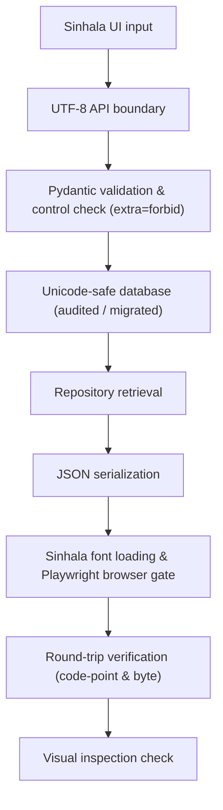

# Stage 29 Implementation Plan — Sinhala Database, UI and Font Support

**Component:** Component 3 — AI/NLP-Based Language Simplification  
**Scope:** Sinhala platform foundation for children aged 4–8  
**Status:** Planned  
**Prerequisites:** Stage 28A complete (`stage-28a-complete-v4` at commit `0e83898`); Stage 27 human review remains pending  
**Implementation branch:** `feature/stage29-sinhala-foundation`  
**Planned start tag:** `stage-29-start`  
**Planned completion tag:** `stage-29-complete`

---

## 1. Purpose

Stage 29 establishes end-to-end Sinhala technical support across the database, backend API and frontend interface. Its purpose is to prove that Sinhala Unicode content can be entered, stored, retrieved, displayed and exported without corruption.

This stage creates infrastructure only. It does **not** perform Sinhala linguistic normalization, ingest external Sinhala datasets, build a Sinhala lexicon, implement Sinhala simplification rules, train models, or approve content for child delivery.

---

## 2. Stage Boundaries

### Included

- Sinhala language and locale registration.
- UTF-8/Unicode-safe database persistence (conditional migration or verified existing schema).
- Sinhala-compatible API request and response handling (`application/json` with valid UTF-8 decoded bytes).
- Separate request (`LocaleSelectionRequest`, `extra="forbid"`) and response (`ResolvedLocaleResponse`) DTOs preventing client tampering.
- Sinhala font selection, commit-pinned licensing evidence, local loading, and automated font availability checks.
- Real-browser integration testing gate (Playwright/Chromium) verifying font requests, `document.fonts`, desktop/mobile viewports, zoom, and fallback.
- Manual visual inspection protocol for glyph shaping, diacritic placement, and tofu absence.
- Sinhala UI labels required for language selection and infrastructure testing with draft translation governance (`authored_by_actor_id`, `reviewed_by: null`).
- Mixed English–Sinhala rendering and input support.
- Language-aware layout, resilient grapheme-aware limits (`Intl.Segmenter` with pinned extended grapheme cluster fallback), validation, and accessibility foundations.
- Non-destructive native grapheme editing verification without custom backspace interceptors.
- Explicit versioned control-character denylist policy rejecting invalid controls in IDs, enums, usernames, and file names.
- Standardized English fallback locale (`en-LK`).
- Database, API, serialization, export and frontend rendering tests.
- Governance flags preventing unvalidated Sinhala content from child delivery.

### Explicitly excluded

- Unicode normalization and Sinhala-specific preprocessing — Stage 30.
- External Sinhala dataset ingestion — Stage 31.
- Sinhala child-friendly vocabulary lexicon — Stage 32.
- Sinhala linguistic simplification rules — Stage 33.
- Sinhala expert annotation and validation — Stage 34.
- Gemini, mT5 and mBART Sinhala comparison — Stage 35.
- Sinhala output validation and fallback pipeline — Stage 36.
- Sinhala TTS/STT — Stage 37 or an optional later stage.
- Clinical diagnosis, DLD classification or modification of Component 1 screening risk.

---

## 3. Mandatory Governance Invariants

1. `screening_risk_level` remains a read-only Component 1 snapshot.
2. Sinhala infrastructure must not introduce diagnostic or clinical claims.
3. All Stage 29 technical fixture records default to:

```json
{
  "source_type": "technical_fixture",
  "validation_status": "draft",
  "research_eligible": false,
  "approved_for_child_delivery": false,
  "requires_expert_review": true
}
```

> **Governance Boundary:** Other Sinhala content introduced in later stages must use its actual governed source type and may not be relabelled as a technical fixture. Before implementation, audit both `SourceType` and `ValidationStatus` in `backend/app/datasets/common/enums.py`. If `technical_fixture` is unsupported, use an existing governed provenance field (e.g., `source_type="team_authored"` with `fixture_type="technical_fixture"`) or document a separately justified schema change. Do not add a new enum value merely for this stage unless it is an established domain category.

4. Stage 29 must not generate synthetic Sinhala simplification pairs.
5. English releases and locked benchmarks remain byte-for-byte immutable.
6. Raw child identifiers, responses and private interaction evidence must not enter public fixtures, logs or frontend local storage.
7. API logs must not expose child text, authentication secrets or protected answers; control characters in logs must be escaped.
8. Font files may be committed only when their licences permit redistribution and binary hashes match the verified registry.
9. Sinhala and English must use explicit, server-verified language metadata; language must not be guessed from interface state alone, and client metadata overrides must be validated against the trusted locale registry.
10. Stage 29 completion does not imply linguistic correctness, age appropriateness or child-delivery approval.

---

## 4. Target Architecture



The canonical round trip is:

```text
Frontend Sinhala input
→ JSON request (LocaleSelectionRequest: extra="forbid")
→ FastAPI/Pydantic DTO (trusted metadata derivation & exact control guard)
→ service/repository
→ SQLite or configured database
→ repository/service
→ JSON response (ResolvedLocaleResponse: application/json, UTF-8 decoded equality)
→ React rendering (DOM text value & Playwright browser gate)
→ export/import verification (exact UTF-8 byte equality)
```

### Code-point versus byte equality contract

- **Database / API round trips:** Compare decoded Unicode scalar / code-point sequences. Exact sequence equality must be preserved across application boundaries.
- **Export files:** Compare exact UTF-8 bytes and SHA-256 hashes.
- **JSON payloads:** Do not require identical serialized bytes because native UTF-8 Sinhala characters and escaped `\uXXXX` representations may decode to the exact same text. Valid Unicode equality after decoding is the required metric.
- **Browser rendering:** Validate the DOM text value, not HTML source serialization.

> **Principle:** Stage 29 requires decoded Unicode-sequence equality across application boundaries and exact byte equality only for governed export artifacts. Canonical normalization is deliberately deferred to Stage 30.

---

## 5. Language and Locale Contract

### 5.1 Language codes and standardized fallback locale

| Purpose | Value | Notes |
|---|---|---|
| Application language code | `si` | Canonical ISO 639-1 code |
| BCP 47 locale | `si-LK` | Primary Sinhala locale |
| Standardized fallback locale | `en-LK` | Governed English default (`language="en"`, `script="Latn"`, `direction="ltr"`) |
| Backward-compatible alias | `en` | Aliased to `en-LK` where legacy components expect plain `en` |
| Sinhala script | `Sinh` | ISO 15924 script code |
| Writing direction | `ltr` | Left-to-right |

The standardized English default contract is:

```json
{
  "language": "en",
  "locale": "en-LK",
  "script": "Latn",
  "direction": "ltr"
}
```

Use `en-LK` consistently across:
- The locale registry.
- `localStorage` preference keys and fallbacks.
- Corrupted-preference recovery logic.
- API response metadata.
- Automated tests and documentation.

If existing components pass plain `en`, retain that as a backward-compatible input alias and document the mapping to `en-LK`.

### 5.2 Separate request/response schemas and metadata protection

The API enforces strict separation between client input and server-derived metadata. Clients may only submit the requested locale; all script and direction metadata is server-derived:

```python
from typing import Literal
from pydantic import BaseModel, ConfigDict

class LocaleSelectionRequest(BaseModel):
    model_config = ConfigDict(extra="forbid")
    locale: Literal["en-LK", "si-LK"]

class ResolvedLocaleResponse(BaseModel):
    language: Literal["en", "si"]
    locale: Literal["en-LK", "si-LK"]
    script: Literal["Latn", "Sinh"]
    direction: Literal["ltr"]
    content_status: str = "draft"
```

Because `extra="forbid"` is enforced on the request DTO, sending `script`, `direction`, or an inconsistent language code triggers an immediate **422 Unprocessable Entity** response. Clients cannot manipulate writing direction or script metadata.

### 5.3 Explicit versioned control-character policy

Preserving zero-width characters is necessary for certain Sinhala ligatures (e.g., Zero-Width Joiner `U+200D` in Yansaya/Rakaransaya) during round-trip testing, but must not be permitted indiscriminately across identifiers or sensitive text fields.

Stage 29 codifies an exact, versioned denylist registry in `data/sinhala_foundation/registry/control_character_policy.json`:

```json
{
  "policy_version": "1.0.0",
  "reject_in_identifiers": [
    "U+200B",
    "U+200C",
    "U+200D",
    "U+200E",
    "U+200F",
    "U+202A",
    "U+202B",
    "U+202C",
    "U+202D",
    "U+202E",
    "U+2066",
    "U+2067",
    "U+2068",
    "U+2069"
  ]
}
```

Field-specific handling rules:

| Field category | Policy | Handling |
|---|---|---|
| **Educational text** | Preserve allowlisted sequences | Preserve ZWJ/ZWNJ in allowlisted fixture sequences while flagging them for later Stage 30 linguistic review; reject unexpected bidirectional or non-printable controls |
| **Technical round-trip fixture** | Preserve exactly | Exact code-point preservation for round-trip fidelity testing |
| **IDs, language codes, enum values** | Reject denylisted controls | Strictly reject any denylisted character from `control_character_policy.json` (422 error) |
| **Usernames / file names** | Reject invalid controls | Deterministically reject invalid controls and non-printable characters |
| **Logs** | Escape control characters | Escape invisible and control characters to prevent log injection or terminal corruption |
| **Stage 30 NLP input** | Future Stage 30 policy | Handled under future Stage 30 normalization specifications |

Stage 29 must **never silently strip** these characters; it must either preserve them explicitly or reject the input with a structured validation error.

---

## 6. Proposed Repository Structure

```text
backend/app/localization/
├── __init__.py
├── enums.py
├── schemas.py
├── locale_registry.py
├── unicode_guards.py
├── invisible_characters.py
└── serialization.py

backend/app/datasets/sinhala_foundation/
├── __init__.py
├── schemas.py
├── repository.py
├── service.py
└── export_service.py

backend/tests/localization/
├── test_language_registry.py
├── test_locale_metadata_consistency.py
├── test_invisible_character_policy.py
├── test_grapheme_aware_limits.py
├── test_no_schema_change_decision.py
├── test_translation_resource_governance.py
├── test_sinhala_schema.py
├── test_unicode_round_trip.py
├── test_api_serialization.py
├── test_database_persistence.py
├── test_mixed_language_content.py
├── test_export_round_trip.py
├── test_logging_privacy.py
└── test_stage29_end_to_end.py

frontend/src/i18n/
├── config.js
├── localeRegistry.js
├── storagePolicy.js
├── graphemeSegmenter.js
├── translations.meta.json
├── en.json
└── si.json

frontend/src/styles/
├── fonts.css
└── language.css

frontend/src/components/language/
├── LanguageSelector.jsx
├── LocalizedText.jsx
└── SinhalaInputProbe.jsx

frontend/src/tests/localization/
├── languageSelector.test.jsx
├── sinhalaRendering.test.jsx
├── sinhalaInput.test.jsx
├── graphemeSegmenter.test.jsx
├── mixedLanguageLayout.test.jsx
├── fontRegistryIntegrity.test.jsx
├── corruptedLocalePreference.test.jsx
└── e2e/
    └── browserFontRendering.spec.js

data/sinhala_foundation/
├── fixtures/
│   ├── unicode_round_trip_cases.json
│   └── mixed_language_cases.json
├── registry/
│   ├── locale_registry.json
│   ├── font_registry.json
│   └── control_character_policy.json
└── manifests/
    └── stage29_fixture_manifest.sha256

scripts/stage29/
├── snapshot_prerequisites.py
├── verify_database_encoding.py
├── verify_unicode_round_trip.py
├── verify_font_licences.py
├── verify_browser_rendering.py
├── verify_stage29_accounting.py
├── generate_stage29_report.py
└── verify_stage29_manifest.py
```

---

## 7. Database Design & Conditional Migration

### 7.1 Database capability and schema audit

Before designing or executing any schema changes:

1. Audit the existing development and test database schemas and engines.
2. Verify whether existing tables and text columns already store UTF-8/Unicode without lossy conversion.
3. Check whether existing models already contain language and locale metadata fields, or if existing text tables can store Sinhala content directly.
4. Record database version, driver version, connection encoding, and collation behavior.
5. Confirm whether parameterized queries preserve Sinhala Unicode characters.

### 7.2 Conditional migration decision

A new database migration is **conditional**:
- **If existing tables already support Unicode and language metadata:** Do **not** add redundant tables or columns merely because an earlier draft suggested them. Produce a formal, auditable developer decision record in `docs/stage29_database_migration_or_no_change_report.md` documenting the `NO_SCHEMA_CHANGE_REQUIRED` decision along with full audit evidence and test queries.
- **If schema changes are genuinely required:** Implement a minimal Alembic migration (e.g., adding `language_code` or a normalized `localized_content` model).

Completion criteria will accept either:
```text
Migration lifecycle: PASSED
```
or:
```text
Schema-change decision: NO_SCHEMA_CHANGE_REQUIRED
Database round-trip verification: PASSED
```

### 7.3 Defining the NO_SCHEMA_CHANGE_REQUIRED evidence record

In this engineering context, "auditable developer decision record" refers to a version-controlled decision document containing explicit environment metadata and SHA-256 evidence. To avoid self-referential circular hashing, the evidence hash references a separate audit evidence file, and the completion commit hash is recorded by the final sealing script:

```json
{
  "decision": "NO_SCHEMA_CHANGE_REQUIRED",
  "decided_by": "<responsible-developer-id>",
  "reviewed_by": null,
  "decision_timestamp": "<UTC timestamp>",
  "database_engine": "SQLite",
  "database_version": "<version>",
  "baseline_commit": "0e83898a1272ecd8af2fc93f607e694ca07954cf",
  "decision_evidence_hash": "<hash of separate evidence artifact>",
  "recorded_in_completion_commit": "<filled by final completion generator>"
}
```

### 7.4 Model guidelines (if migration required)

If a schema extension is required:
- Prefer normalized localization structures over duplicating language columns (avoid `title_sinhala`, `title_english`).
- Include `language_code`, `locale_code`, `text_role`, `text_value`, and appropriate uniqueness constraints.
- Default existing unlabelled records to `language_code="en"` only when provenance confirms English content.
- Ensure deterministic upgrade and downgrade scripts tested on an isolated database copy.

---

## 8. Backend and API Implementation

### 8.1 Common enums and schemas

Extend the existing language enum with Sinhala:

```python
class LanguageCode(str, Enum):
    EN = "en"
    SI = "si"
```

Add or extend DTOs so every localized payload carries explicit language and governance metadata. Verify `ValidationStatus` and `SourceType` against existing domain enums in `backend/app/datasets/common/enums.py`.

### 8.2 API behavior and UTF-8 standards compliance

The API must:
- Accept UTF-8 JSON containing Sinhala text.
- Responses use an `application/json` media type, and their body bytes decode successfully as UTF-8 without corruption. (Allow both `application/json` and `application/json; charset=utf-8` without requiring rigid literal string equality).
- Enforce `LocaleSelectionRequest` with `extra="forbid"`, rejecting extra or manipulated metadata fields with 422.
- Apply the versioned control-character policy (`control_character_policy.json`): preserve legitimate ZWJ/ZWNJ in educational/fixture text; strictly reject denylisted controls in IDs, usernames, and enums; escape them in logs.
- Enforce maximum text lengths using grapheme-aware and Unicode-aware logic.
- Avoid logging raw private learner text.
- Keep protected answers outside child-facing responses.

### 8.3 Unicode guard responsibility

Stage 29 guards detect corruption without performing linguistic normalization:
- Valid Python/JSON Unicode strings.
- No replacement character `U+FFFD` introduced during processing.
- No unexpected encoding/decoding exceptions.
- Exact input/output decoded Unicode code-point sequence equality.
- Exact byte equality for exported files.

Canonical normalization (NFC/NFD) and linguistic preprocessing are strictly deferred to Stage 30.

### 8.4 Export behavior

- Write JSON and CSV as UTF-8.
- For CSV, document whether UTF-8 BOM is used for spreadsheet compatibility.
- Preserve language and provenance metadata.
- Hash exact exported bytes (SHA-256).
- Keep private learner data out of public export fixtures.

---

## 9. Frontend Localization & UI Architecture

### 9.1 Internationalization framework & translation governance

Stage 29 interface labels are technical placeholders for UI functionality and language switching. They must **not** be presented as expert-validated child language.

Each translation resource (`en.json`, `si.json`, `translations.meta.json`) must carry clear governance metadata distinguishing author from reviewer:

```json
{
  "resource_file": "si.json",
  "authoring_method": "technical_translation",
  "authored_by_actor_id": "infrastructure_team",
  "reviewed_by": null,
  "translation_status": "technical_draft",
  "review_status": "unreviewed_by_linguist",
  "approved_for_infrastructure_testing": true,
  "approved_for_child_delivery": false,
  "sha256": "<64-character-hash>"
}
```

Machine translation may be used for technical UI labels during Stage 29, but must be explicitly documented and flagged as `technical_draft`.

### 9.2 Language selection & frontend storage policy

The language selector displays:
```text
English
සිංහල
```

**Storage and state policy:**
- Store **only** the locale identifier (`si-LK` or `en-LK`) in `localStorage`.
- **Never** store learner identifiers, names, responses, or screening data in `localStorage`.
- Validate stored values against the central locale registry upon application startup.
- Fall back safely to standardized English (`en-LK`) if the stored preference is missing, corrupted, or unsupported.
- Do not synchronize language selection with screening risk level, DLD flags, or clinical support settings.
- Apply `lang="si"` / `lang="si-LK"` to the appropriate DOM element.

### 9.3 Resilient grapheme segmentation & native editing verification

Sinhala visible characters often comprise multiple Unicode code points (e.g., base consonant + virama/al-lakuna + zero-width joiner + consonant for Yansaya/Rakaransaya, or base consonant + vowel signs).

**Resilient segmentation architecture (`graphemeSegmenter.js`):**
- Use `Intl.Segmenter` when available. Explicitly detect availability via `typeof Intl !== "undefined" && typeof Intl.Segmenter === "function"`.
- When `Intl.Segmenter` is unavailable (e.g., legacy browser or non-browser environments), fall back to a pinned Unicode grapheme cluster library implementing the Unicode UAX #29 standard.
- **Strict Prohibition:** Falling back to JavaScript `string.length`, raw code-point count (`[...str].length`), or UTF-16 code units is strictly prohibited for visible-character limits.
- Grapheme segmentation is used for:
  - Visible character counters.
  - Maximum-length input validation.
  - Grapheme-aware truncation warnings.

**Native editing verification:**
- Verify that cursor movement, selection, Backspace and Delete do not produce corrupted text or unexpected neighboring-character loss.
- Record platform-specific behavior across browsers and operating systems.
- **Do not implement custom deletion logic** unless a demonstrated defect requires it. Native cursor and deletion behavior depends on the browser, operating system, keyboard and input method (IME composition); intercepting normal keyboard editing may interfere with input methods.

---

## 10. Font Strategy and Real-Browser Verification Gate

### 10.1 Font selection and pinned provenance

- Primary candidate: **Noto Sans Sinhala** (OFL - Open Font License).
- Fallback stack: `"Noto Sans Sinhala", "Nirmala UI", sans-serif`.
- Font files must only be committed if redistribution is explicitly permitted by the licence.
- Provenance details must be documented in `data/sinhala_foundation/registry/font_registry.json`:

```json
{
  "font_family": "Noto Sans Sinhala",
  "source_url": "https://github.com/googlefonts/noto-fonts/tree/<pinned-commit>/hinted/ttf/NotoSansSinhala",
  "upstream_filename": "NotoSansSinhala-Regular.ttf",
  "retrieved_timestamp": "2026-10-14T00:00:00Z",
  "licence_identifier": "OFL-1.1",
  "licence_file_sha256": "<64-character-hash>",
  "font_binary_sha256": "<64-character-hash>",
  "redistribution_allowed": true,
  "is_original_binary": true,
  "subsetting_tool": null,
  "verified_by": "infrastructure_team"
}
```

```css
:lang(si) {
  font-family: "Noto Sans Sinhala", "Nirmala UI", sans-serif;
  line-height: 1.6;
}
```

### 10.2 Multi-Tier Font Verification Protocol

Because jsdom/Vitest mocks cannot verify actual glyph rasterization, font rendering verification is split into three rigorous tiers:

#### Tier 1: Unit & Registry Tests (`fontRegistryIntegrity.test.jsx`, `test_font_registry_integrity.py`)
- Pinned source URL, upstream filename, and license SHA-256 integrity.
- Binary SHA-256 matching the committed web font files.
- CSS font-family declaration syntax and fallback definitions.

#### Tier 2: Real-Browser Integration Gate (`browserFontRendering.spec.js` via Playwright/Chromium)
- Actual font network request returns HTTP `200` with expected `font/woff2` or `font/ttf` MIME type.
- `document.fonts.ready` promise resolves.
- `document.fonts.check("16px 'Noto Sans Sinhala'")` returns `true`.
- Computed `font-family` on rendered elements resolves to `Noto Sans Sinhala`.
- Viewport tests: verify layout on Chromium Desktop (1280x800) and Android mobile simulation (390x844).
- Zoom tests: capture screenshot fixtures at 100%, 200%, and 400% zoom levels without element overflow.
- Offline/disabled test: disable web-font requests; verify system fallback (`Nirmala UI`) renders cleanly.

#### Tier 3: Manual Visual Inspection Protocol (documented in `docs/stage29_ui_rendering_report.md`)
- Absence of tofu boxes (`□` or ``) or missing-glyph symbols in governed fixtures.
- Correct diacritic placement (kombuva, aelepilla, ispilla, papilla aligned to base consonants).
- Correct ligature and conjunct appearance (e.g., Yansaya `ක්‍ය`, Rakaransaya `ක්‍ර`, Bandi akuru `ක්‍ෂ`).
- Human reviewer signs off visual inspection evidence artifact.

---

## 11. Test Fixtures

Fixtures are authored exclusively for technical infrastructure testing and code-point fidelity. They are not simplification data and must not be used for child delivery.

### Fixture governance contract

Every fixture in `data/sinhala_foundation/fixtures/` must contain:

```json
{
  "fixture_id": "FX-SI-001",
  "source_type": "technical_fixture",
  "validation_status": "draft",
  "research_eligible": false,
  "approved_for_child_delivery": false,
  "requires_expert_review": true,
  "intended_test": "combining_sequence_round_trip",
  "expected_code_points": ["U+0D9A", "U+0DCA", "U+200D", "U+0DBB"]
}
```

### Required fixture categories

| Category | Purpose |
|---|---|
| Basic Sinhala text | Database / API / rendering round trip |
| Combining sequences & ligatures | Code-point preservation (combining signs, ZWJ Yansaya/Rakaransaya) |
| Denylisted control characters | Exact policy enforcement (rejection in IDs, usernames, and enums; escaping in logs) |
| Allowlisted fixture sequences | Educational text preservation of legitimate ZWJ/ZWNJ flagged for Stage 30 |
| Sinhala digits and Arabic digits | Mixed numeric rendering |
| Sinhala with English | Mixed-script behavior and directionality (`ltr`) |
| Punctuation | Punctuation serialization and layout wrapping |
| Long UI labels | Responsive wrapping and overflow avoidance |
| Empty / whitespace input | Validation and whitespace boundary handling |
| Invalid language / locale codes | Structured 4xx rejection |
| Client metadata mismatch | Structured 422 rejection (`extra="forbid"` on `LocaleSelectionRequest`) |
| Replacement character detection | Corruption detection (ensuring no `U+FFFD` introduced) |
| Grapheme cluster cases | Grapheme counter limits via `Intl.Segmenter` & fallback, non-destructive editing |
| Real-browser visual cases | Desktop, mobile, and zoom screenshot fixtures |
| CSV / JSON export | Byte-level UTF-8 integrity and SHA-256 validation |

---

## 12. Implementation Work Packages

### WP0 — Safety checkpoint, ancestry verification & prerequisite snapshot

1. Verify authoritative Stage 28A ancestry and prerequisites:
   ```powershell
   git merge-base --is-ancestor "stage-28a-complete-v4^{commit}" "HEAD"
   git merge-base --is-ancestor "stage-26-complete-v5^{commit}" "HEAD"
   git merge-base --is-ancestor "stage-27-infrastructure-complete-v3^{commit}" "HEAD"
   ```
2. Confirm clean working tree.
3. Create branch `feature/stage29-sinhala-foundation` from `stage-28a-complete-v4` commit (`0e83898a1272ecd8af2fc93f607e694ca07954cf`).
4. Create annotated tag `stage-29-start`.
5. Verify start tag exact commit matches `stage-28a-complete-v4`:
   ```powershell
   git rev-parse "stage-28a-complete-v4^{commit}"
   git rev-parse "stage-29-start^{commit}"
   # Both must resolve to 0e83898a1272ecd8af2fc93f607e694ca07954cf
   ```
6. Snapshot English dataset hashes and existing database record counts into `data/sinhala_foundation/snapshots/`.
7. Run baseline regression: full backend test suite and frontend build.

### WP1 — Unicode and storage capability audit

1. Inventory all text-bearing database columns, tables, and API DTOs.
2. Run non-mutating Sinhala probe script against database and storage layers.
3. Audit text column types, collation, and driver connection encodings.
4. Identify ASCII-only constraints, sanitizers, or length limit assumptions.
5. Generate `docs/stage29_unicode_storage_audit.md`.

### WP2 — Language, locale & trusted metadata registry

1. Register canonical `si`, `si-LK`, and standardized fallback `en-LK` (with legacy alias `en`) in central backend and frontend registries.
2. Implement separate `LocaleSelectionRequest` (`extra="forbid"`) and `ResolvedLocaleResponse` DTOs.
3. Implement versioned control-character denylist policy (`control_character_policy.json`).
4. Author tests: `test_language_registry.py`, `test_locale_metadata_consistency.py`, `test_invisible_character_policy.py`.
5. Generate `docs/stage29_locale_contract.md`.

### WP3 — Database capability decision & conditional migration

1. Evaluate audit findings from WP1.
2. Determine whether existing schema supports required Unicode and language fields:
   - If sufficient: Produce auditable developer decision record `docs/stage29_database_migration_or_no_change_report.md` documenting `NO_SCHEMA_CHANGE_REQUIRED` with supporting test queries and SHA-256 evidence.
   - If insufficient: Author minimal Alembic migration (e.g. `localized_content`), test upgrade/downgrade cycle on an isolated database copy, and document in the report.
3. Implement repository methods for language-tagged storage and retrieval.
4. Author tests: `test_database_persistence.py`, `test_no_schema_change_decision.py`.

### WP4 — Backend API, grapheme limits & serialization

1. Implement Sinhala-safe DTOs with Pydantic validation.
2. Implement grapheme-aware length validation using extended grapheme clusters.
3. Verify API response behavior: responses use an `application/json` media type, and their body bytes decode successfully as UTF-8 without corruption.
4. Implement UTF-8 JSON and CSV export services with exact SHA-256 byte hashing.
5. Ensure privacy-safe logging (no child text, control characters escaped).
6. Author tests: `test_sinhala_schema.py`, `test_unicode_round_trip.py`, `test_grapheme_aware_limits.py`, `test_api_serialization.py`, `test_export_round_trip.py`, `test_logging_privacy.py`.
7. Generate `docs/stage29_api_round_trip_report.md`.

### WP5 — Font acquisition, licensing & provenance governance

1. Acquire OFL-licensed Noto Sans Sinhala web fonts (WOFF2/TTF) from commit-pinned upstream.
2. Verify primary licence file allowing redistribution; compute licence SHA-256 and binary SHA-256.
3. Record complete provenance metadata in `font_registry.json`.
4. Configure local font loading and fallback stack in `fonts.css`.
5. Author test: `test_font_registry_integrity.py`.
6. Generate `docs/stage29_font_and_licence_record.md`.

### WP6 — Frontend localization, translation governance & storage policy

1. Establish i18n structure with `en.json`, `si.json`, and `translations.meta.json`.
2. Apply draft governance metadata (`authored_by_actor_id`, `reviewed_by: null`, `translation_status: "technical_draft"`).
3. Implement `LanguageSelector.jsx` with accessible announcements and DOM `lang` attributes.
4. Implement frontend storage policy (store only `si-LK` or `en-LK`; safe fallback to `en-LK` on corruption; no learner data in storage).
5. Author tests: `languageSelector.test.jsx`, `corruptedLocalePreference.test.jsx`, `test_translation_resource_governance.py`.

### WP7 — UI rendering, resilient grapheme segmentation & real-browser verification gate

1. Implement test probe `SinhalaInputProbe.jsx` and resilient `graphemeSegmenter.js` (`Intl.Segmenter` with pinned fallback).
2. Author unit tests for grapheme counting: `Intl.Segmenter` present, fallback activated, count equivalence, mixed script & emoji (`graphemeSegmenter.test.jsx`).
3. Verify non-destructive native editing: cursor movement, selection, Backspace and Delete without custom interceptors.
4. Implement real-browser test suite (`browserFontRendering.spec.js`): network font request, `document.fonts.check()`, desktop/mobile viewports, zoom levels (100%, 200%, 400%), and fallback.
5. Conduct manual visual inspection protocol (absence of tofu, diacritic positioning, ligatures).
6. Author tests: `sinhalaRendering.test.jsx`, `sinhalaInput.test.jsx`, `mixedLanguageLayout.test.jsx`.
7. Document findings in `docs/stage29_ui_rendering_report.md` and `docs/stage29_accessibility_report.md`.

### WP8 — Automated testing, regression protection & immutability

1. Run newly implemented localization test modules.
2. Run full backend test regression suite.
3. Run frontend unit tests, browser tests, and production build.
4. Verify byte-for-byte immutability of English releases (`data/simplification_corpus/releases/`) and Stage 28A artifacts.

### WP9 — Accounting, documentation & sealing

1. Reconcile all text boundaries (`unaccounted = 0`).
2. Reconcile all technical fixtures (`unaccounted = 0`).
3. Compile all 12 required documentation deliverables.
4. Generate `docs/stage29_manifest.sha256` and verify with `verify_stage29_manifest.py`.
5. Confirm clean working tree.
6. Commit changes and create annotated tag `stage-29-complete`.

---

## 13. Automated Test Plan

### Backend localization tests

```powershell
Push-Location backend
python -m pytest tests/localization/ -v
Pop-Location
```

Target test suite includes:
- `test_language_registry.py`: Canonical `si`, `si-LK`, and `en-LK` registration, legacy alias handling, and rejection of non-canonical codes.
- `test_locale_metadata_consistency.py`: Rejection of client-controlled metadata injection (`extra="forbid"` on `LocaleSelectionRequest`).
- `test_invisible_character_policy.py`: Verification of versioned denylist (`control_character_policy.json`) and exact rejection/preservation rules.
- `test_grapheme_aware_limits.py`: Extended grapheme cluster length validation vs byte/code-point limits.
- `test_no_schema_change_decision.py`: Verification of schema-change or no-change decision criteria.
- `test_translation_resource_governance.py`: Integrity and metadata check of UI translation resource files (`authored_by_actor_id`, `reviewed_by: null`).
- `test_unicode_round_trip.py`: Decoded Unicode code-point sequence preservation across service boundaries.
- `test_api_serialization.py`: Standards-compliant UTF-8 JSON serialization and headers.
- `test_database_persistence.py`: Unicode persistence without silent loss or corruption.
- `test_export_round_trip.py`: UTF-8 JSON and CSV export byte integrity and SHA-256 verification.
- `test_logging_privacy.py`: Privacy protection, no child text, and escaped control characters.

### Schema lifecycle (conditional)

If migration was required:
```powershell
Push-Location backend
python -m alembic current
python -m alembic heads
python -m alembic upgrade head
python -m alembic downgrade -1
python -m alembic upgrade head
Pop-Location
```
If schema change was not required, verify via `test_no_schema_change_decision.py`.

### Frontend localization & browser tests

```powershell
Push-Location frontend
npm run test -- --run
npx playwright test
npm run build
Pop-Location
```

Target test suite includes:
- `languageSelector.test.jsx`: Language switching, DOM `lang` updates, accessible announcements.
- `corruptedLocalePreference.test.jsx`: Storage policy, corruption recovery to `en-LK`, and absence of learner data.
- `graphemeSegmenter.test.jsx`: `Intl.Segmenter` detection, pinned fallback activation, equivalent counts, mixed script & emoji.
- `sinhalaRendering.test.jsx`: Font availability (`document.fonts.check()`), CSS font-family, and DOM-text integrity.
- `sinhalaInput.test.jsx`: Native non-destructive editing, paste, and character counting.
- `mixedLanguageLayout.test.jsx`: Mixed Sinhala-English text, LTR layout, responsive wrapping.
- `fontRegistryIntegrity.test.jsx`: Integrity of font registry definitions and local fallback.
- `browserFontRendering.spec.js` (Playwright): Real-browser font HTTP request (200 OK), `document.fonts.ready`, desktop/mobile viewports, 100%/200%/400% zoom screenshots, and offline fallback.

### Full regression & manifest verification

```powershell
Push-Location backend
python -m pytest tests/ -q
Pop-Location

python scripts/stage29/verify_stage29_manifest.py
```

---

## 14. Manual Verification Checklist

1. Verify git ancestry and clean start SHA: `stage-29-start` matches `stage-28a-complete-v4` at commit `0e83898a1272ecd8af2fc93f607e694ca07954cf`.
2. Select Sinhala in UI selector; verify preference persists as `si-LK` in `localStorage` without storing learner data.
3. Corrupt the `localStorage` key manually; verify UI falls back gracefully to default `en-LK` without crashing.
4. Real-browser check: font HTTP request succeeds with status 200 and expected MIME type.
5. `document.fonts.check()` returns true in browser console for Noto Sans Sinhala.
6. Conduct visual inspection: no tofu boxes (`□` / ``), correct diacritic placement, and proper ligature rendering (ක්‍ෂ, ශ්‍රී).
7. Type multi-code-point Sinhala characters; verify native cursor movement, selection, Backspace and Delete operate without text corruption or unexpected neighboring loss (without custom keyboard interceptors).
8. Verify visible character counters rely on `graphemeSegmenter.js` (`Intl.Segmenter` with pinned fallback, never `string.length`).
9. Paste mixed Sinhala-English text into probe; retrieve and confirm identical decoded code points.
10. Submit extra metadata via API probe (`{"locale": "si-LK", "script": "Sinh"}`); verify structured 422 rejection (`extra="forbid"`).
11. Submit denylisted control characters in an ID or username; verify rejection. Submit allowlisted ZWJ in educational text; verify preservation.
12. Verify API responses use an `application/json` media type, and their body bytes decode successfully as UTF-8 without corruption.
13. Verify JSON and CSV exports decode as UTF-8 and match expected SHA-256 hashes.
14. Check responsive layout at 100%, 200%, and 400% zoom; confirm no overlapping or truncated labels.
15. Inspect backend logs; verify no learner text appears and control characters are escaped.
16. Confirm all Stage 29 technical fixtures carry `source_type: "technical_fixture"`, `validation_status: "draft"` and `approved_for_child_delivery: false`.
17. Confirm UI translations are labelled as `translation_status: "technical_draft"` with `reviewed_by: null`.
18. Confirm pre-existing English releases in `data/simplification_corpus/releases/` are byte-for-byte identical.
19. If migration was created, confirm upgrade/downgrade passes on an isolated DB copy; if not, verify auditable `NO_SCHEMA_CHANGE_REQUIRED` developer record.

---

## 15. Accounting Requirements

### Inventory accounting

```text
Inventoried text boundaries
= Unicode-compatible boundaries
+ intentionally unchanged boundaries
+ blocked/manual-remediation boundaries
+ unaccounted boundaries
```

Target: `unaccounted boundaries = 0`.

### Fixture accounting

```text
Submitted fixtures
= passed round-trip
+ failed
+ manual review
+ excluded
+ unaccounted
```

Target: `unaccounted fixtures = 0`.

### Schema and dataset immutability accounting

Record before and after:
- Schema migration status or auditable `NO_SCHEMA_CHANGE_REQUIRED` record.
- Learner count, activity count, session count.
- Dataset record counts.
- SHA-256 hashes of English releases (`data/simplification_corpus/releases/`).
- SHA-256 hashes of Stage 28A governed artifacts.

---

## 16. Required Documentation Deliverables

1. `docs/stage29_implementation_plan.md`
2. `docs/stage29_unicode_storage_audit.md`
3. `docs/stage29_locale_contract.md`
4. `docs/stage29_database_migration_or_no_change_report.md`
5. `docs/stage29_font_and_licence_record.md`
6. `docs/stage29_api_round_trip_report.md`
7. `docs/stage29_ui_rendering_report.md`
8. `docs/stage29_accessibility_report.md`
9. `docs/stage29_accounting_summary.md`
10. `docs/stage29_reproducibility_record.json`
11. `docs/stage29_completion_record.md`
12. `docs/stage29_manifest.sha256`

Sensitive raw text, credentials, private learner data, and protected answers must not appear in any document.

---

## 17. Completion Criteria

Stage 29 is complete only when all criteria below pass:

- [ ] Authoritative prerequisite tag `stage-28a-complete-v4` and clean git ancestry verified (`stage-28a-complete-v4`, `stage-26-complete-v5`, `stage-27-infrastructure-complete-v3`).
- [ ] Clean start commit `0e83898a1272ecd8af2fc93f607e694ca07954cf` and immutable `stage-29-start` tag verified via `git rev-parse`.
- [ ] Sinhala `si` and `si-LK` registered centrally along with standardized fallback `en-LK` (and alias `en`).
- [ ] Separate request DTO (`LocaleSelectionRequest`, `extra="forbid"`) and response DTO (`ResolvedLocaleResponse`) prevent client tampering (422 on extra fields).
- [ ] Versioned control-character denylist policy (`control_character_policy.json`) enforced and tested.
- [ ] Database stores and retrieves Sinhala fixtures without corruption.
- [ ] Either: Alembic migration passes upgrade/downgrade, OR auditable `NO_SCHEMA_CHANGE_REQUIRED` developer decision report approved with test evidence.
- [ ] API round trips preserve exact decoded Unicode code points.
- [ ] Responses use an `application/json` media type, and their body bytes decode successfully as UTF-8 without corruption.
- [ ] JSON and CSV exports pass UTF-8 byte integrity and SHA-256 checks.
- [ ] Sinhala font redistribution licence, pinned commit provenance, and binary hashes verified in `font_registry.json`.
- [ ] Real-browser Playwright gate passes on Chromium desktop and mobile simulation (network 200, `document.fonts.ready`, computed font-family, 100%/200%/400% zoom, offline fallback).
- [ ] Manual visual inspection confirms absence of tofu boxes, proper diacritic placement, and ligature shaping.
- [ ] Resilient grapheme segmentation passes tests (`Intl.Segmenter` + fallback, never `string.length`); native editing operates non-destructively.
- [ ] Frontend language selector implemented with safe storage policy (store only locale, graceful fallback to `en-LK` on corruption, no learner data).
- [ ] UI translations governed as `technical_draft` with `authored_by_actor_id` and `reviewed_by: null`.
- [ ] No child-facing risk, answer, or clinical data leakage detected.
- [ ] All Stage 29 technical fixtures carry `source_type: "technical_fixture"`, `validation_status: "draft"`, `approved_for_child_delivery: false`.
- [ ] English releases and historical benchmarks remain byte-for-byte immutable.
- [ ] All Stage 29 automated tests pass.
- [ ] Full backend regression passes.
- [ ] Frontend tests, real-browser tests, and production build pass.
- [ ] Accounting reports zero unaccounted boundaries and fixtures.
- [ ] All 12 governed documentation artifacts pass full SHA-256 manifest verification.
- [ ] Working tree is clean.
- [ ] Final commit and new annotated tag `stage-29-complete` recorded without altering historical tags.

---

## 18. Completion Record Template

```text
================================================================
Stage 29: SINHALA DATABASE, UI AND FONT SUPPORT
================================================================

Prerequisite commit:                         0e83898a1272ecd8af2fc93f607e694ca07954cf
Start tag:                                  stage-29-start
Final commit:                               <full SHA>
Completion tag:                             stage-29-complete

Ancestry verification:                      PASSED
Start commit verification:                  PASSED (0e83898a1272ecd8af2fc93f607e694ca07954cf)
Language registry & fallback (en-LK):       PASSED / FAILED
Metadata tamper protection (extra=forbid):   PASSED / FAILED
Versioned control character policy:         PASSED / FAILED
Database Unicode round trip:                PASSED / FAILED
Schema lifecycle:                           MIGRATION PASSED / NO_SCHEMA_CHANGE_REQUIRED
API Unicode round trip:                     PASSED / FAILED
JSON/CSV export integrity:                  PASSED / FAILED
Font licence & provenance verification:     PASSED / FAILED
Playwright real-browser rendering gate:     PASSED / FAILED
Visual glyph shaping & tofu check:          PASSED / FAILED
Resilient grapheme limits & native editing: PASSED / FAILED
Language selector & storage policy:         PASSED / FAILED
Translation resource governance:            PASSED / FAILED
Accessibility verification:                PASSED / FAILED
English release immutability:              PASSED / FAILED
Stage 28A artifact immutability:            PASSED / FAILED
Privacy and child-safe boundaries:          PASSED / FAILED
Stage 29 tests:                             <passed>/<collected>
Full backend tests:                         <passed>/<collected>
Frontend localization tests:               <passed>/<collected>
Playwright browser tests:                   PASSED / FAILED
Frontend production build:                 PASSED / FAILED
Manifest verification:                     PASSED / FAILED
Unaccounted boundaries:                     0
Unaccounted fixtures:                       0

Sinhala normalization/preprocessing:        DEFERRED TO STAGE 30
External Sinhala datasets:                  DEFERRED TO STAGE 31
Sinhala lexicon:                            DEFERRED TO STAGE 32
Sinhala simplification rules:               DEFERRED TO STAGE 33
Human expert validation:                    NOT ESTABLISHED
Approved for child delivery:                FALSE

================================================================
```

---

## 19. Recommended Execution Order

```text
WP0  Safety checkpoint, ancestry & start commit verification
 ↓
WP1  Unicode/storage capability audit
 ↓
WP2  Locale registry, metadata protection (extra=forbid) & versioned control policy
 ↓
WP3  Database capability decision & conditional migration
 ↓
WP4  API, grapheme limits & export serialization
 ↓
WP5  Font provenance, licensing & registry
 ↓
WP6  Frontend localization, storage policy & translation governance
 ↓
WP7  UI rendering, resilient grapheme segmentation, Playwright gate & visual check
 ↓
WP8  Automated testing & regression protection
 ↓
WP9  Accounting, documentation & sealing
```

No Stage 30 normalization work should begin until Stage 29 round-trip integrity is demonstrated and sealed.
