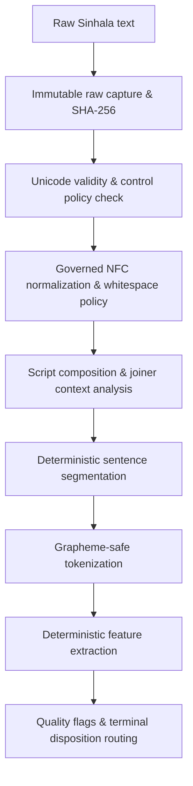

# Stage 30 Implementation Plan — Sinhala Unicode Normalization and Preprocessing

**Project:** AI-Powered Adaptive Child-Friendly Language Simplification System  
**Component:** Component 3 — AI/NLP-Based Language Simplification  
**Scope:** Sinhala (`si`, `si-LK`, script `Sinh`), children aged 4–8  
**Status:** Approved for Implementation  
**Authoritative prerequisite:** `stage-29-complete-v2` at commit `89a253c452ea85664f988f31d357d6d9ee72b464`  
**Implementation branch:** `feature/stage30-sinhala-preprocessing`  
**Planned start tag:** `stage-30-start`  
**Planned completion tag:** `stage-30-complete`

---

## 1. Purpose

Stage 30 implements a deterministic and auditable Sinhala Unicode normalization and linguistic-preprocessing foundation. It transforms technically valid Sinhala text from Stage 29 into a governed canonical representation suitable for later dataset integration (Stage 31), child lexicon construction (Stage 32), and rule-based simplification (Stage 33).

The stage preserves the exact original raw input while producing a separate derived canonical representation. It detects unsafe or malformed input, records every transformation in an audit trace, and routes uncertain or ambiguous cases to manual review.

Stage 30 establishes technical preprocessing correctness only. It does **not** establish Sinhala grammatical correctness, child suitability, DLD accessibility, simplification quality or approval for child delivery.

---

## 2. Stage Boundaries

### Included

- Exact preservation and SHA-256 hashing of raw Sinhala text.
- Unicode validity checking and replacement-character (`U+FFFD`) detection with explicit fidelity classification.
- Governed Unicode normalization (primary form: NFC).
- Independent byte-level, code-point, and extended grapheme-cluster accounting.
- Sinhala-script, Latin-script, numeric and mixed-script analysis.
- Governed treatment of ZWJ, ZWNJ, and control characters in allowlisted fixture contexts.
- Whitespace and punctuation handling in a derived canonical representation.
- Deterministic Sinhala-aware sentence segmentation with abbreviation and decimal protection.
- Deterministic Sinhala-aware, grapheme-safe tokenization.
- Non-authoritative structural and orthographic feature extraction.
- Transformation provenance, zero-based half-open code-point offset mappings (`[start_code_point, end_code_point)`), and audit records.
- Quality flags, review routing, and mutually exclusive terminal dispositions.
- Property, fixture, integration and regression test suites.
- Reproducibility registry, zero-unaccounted reconciliation, and release sealing.

### Explicitly excluded

- External Sinhala dataset acquisition — Stage 31.
- Sinhala child-vocabulary lexicon construction — Stage 32.
- Sinhala simplification rules — Stage 33.
- Expert linguistic annotation and validation — Stage 34.
- Sinhala model/LLM comparison — Stage 35.
- Sinhala output-validation and fallback pipeline — Stage 36.
- TTS/STT or speech preprocessing.
- Difficulty classification or age-band prediction.
- POS tagging, dependency parsing, stemming or lemmatization presented as authoritative.
- Synthetic Sinhala simplification-pair generation.
- Any clinical or diagnostic inference.
- Approval of content for unsupervised child delivery.

---

## 3. Mandatory Governance Invariants

1. `screening_risk_level` remains an immutable Component 1 snapshot and is not modified or inferred.
2. Raw input is immutable. Normalization must write to a separate derived field `normalized_text`.
3. No normalization operation may silently change meaning or invent characters.
4. ZWJ (`U+200D`) and ZWNJ (`U+200C`) are preserved in allowlisted, governed fixture contexts. Unexpected contexts are preserved in raw text and routed to manual review. Stage 30 does not automatically determine linguistic validity.
5. Unknown, ambiguous, or suspicious Sinhala sequences must be flagged and routed to review, not automatically “corrected.”
6. Every output must identify its configuration version, configuration hash, and transformation provenance.
7. Stage 29 locale, font, API and storage artifacts remain unchanged.
8. English corpus releases, locked benchmarks and Stage 28A artifacts remain byte-for-byte immutable.
9. Technical fixtures are not training data, expert references or child-facing content.
10. Logs contain identifiers, hashes, operation codes and dispositions—never raw learner text.
11. All outputs retain:

```json
{
  "validation_status": "draft",
  "research_eligible": false,
  "approved_for_child_delivery": false,
  "requires_expert_review": true
}
```

12. Completion of Stage 30 means only that the text is technically prepared for governed downstream NLP work.

---

## 4. Target Architecture



Canonical flow:

```text
Raw input
→ preserve exact Unicode sequence and UTF-8 SHA-256 hash
→ validate Unicode, replacement characters, and security control policy
→ create NFC-derived text
→ apply governed whitespace/punctuation policy
→ calculate script composition and joiner context
→ segment sentences (with decimal/abbreviation protection)
→ tokenize (grapheme-safe, offset-mapped)
→ calculate deterministic technical features
→ validate governance invariants
→ assign single mutually exclusive final disposition (first matching condition wins)
→ store hashes, versions, offset mappings and operation trace
```

---

## 5. Core Data Contract

The output contract maintains strict separation between raw input and derived canonical representation:

```json
{
  "record_id": "SI-PRE-000001",
  "language": "si",
  "locale": "si-LK",
  "script": "Sinh",
  "raw_text": "<exact input>",
  "raw_text_sha256": "<64-character SHA-256>",
  "raw_utf8_byte_count": 0,
  "raw_code_point_count": 0,
  "raw_grapheme_count": 0,
  "normalized_text": "<derived NFC text>",
  "normalized_text_sha256": "<64-character SHA-256>",
  "normalized_utf8_byte_count": 0,
  "normalized_code_point_count": 0,
  "normalized_grapheme_count": 0,
  "normalization_form": "NFC",
  "normalization_changed": true,
  "operations": [],
  "sentences": [],
  "tokens": [],
  "features": {},
  "quality_flags": [],
  "final_disposition": "PASSED_WITH_NORMALIZATION",
  "disposition_reason_code": null,
  "configuration_version": "1.0.0",
  "configuration_sha256": "<64-character SHA-256>",
  "validation_status": "draft",
  "research_eligible": false,
  "approved_for_child_delivery": false,
  "requires_expert_review": true
}
```

### Half-Open Offset Intervals and Complex Mapping Schema

All code-point offsets are zero-based, code-point-based, half-open intervals:
\[
[\text{start\_code\_point}, \text{end\_code\_point})
\]

NFC transformations and whitespace operations can be one-to-one, many-to-one, one-to-many, or reordered. The operation schema captures these mappings explicitly:

```json
{
  "operation_id": "OP-0001",
  "operation_type": "UNICODE_NFC",
  "raw_spans": [
    {
      "start_code_point": 0,
      "end_code_point": 2
    }
  ],
  "normalized_spans": [
    {
      "start_code_point": 0,
      "end_code_point": 1
    }
  ],
  "before_sha256": "<hash>",
  "after_sha256": "<hash>",
  "changed": true,
  "mapping_status": "many_to_one",
  "mapping_exact": true,
  "rule_version": "1.0.0"
}
```

Allowed `mapping_status` values:
- `one_to_one`
- `many_to_one`
- `one_to_many`
- `reordered`
- `non_local`
- `unmapped`

If an exact local span mapping cannot be established for a complex transformation, the before/after hashes are preserved and the operation sets:
```json
{
  "mapping_status": "non_local",
  "mapping_exact": false
}
```
Misleading or synthetic offsets must never be invented.

Token and sentence offsets explicitly refer to the derived `normalized_text` representation using `[start_code_point, end_code_point)` intervals.

Raw text must never be reconstructed from normalized text. Both representations are retained independently.

---

## 6. Sinhala Unicode Policy

### 6.1 Unicode Forms

- Preserve the exact raw Unicode sequence.
- Use NFC as the primary derived canonical form.
- Compute NFD only for diagnostics and equivalence testing; do not store it as the production canonical text unless justified later.
- Record whether normalization changed the sequence (`normalization_changed: bool`).
- Verify normalization idempotence:
\[
NFC(NFC(x)) = NFC(x)
\]

### 6.2 Character and Number Inventory

The character inventory distinguishes the distinct Unicode blocks and numerical systems associated with Sinhala:

1. **Sinhala Unicode Block (`U+0D80–U+0DFF`):**
   - Independent vowels (`U+0D85–U+0D96`)
   - Consonants (`U+0D9A–U+0DC6`)
   - Dependent vowel signs (`U+0DCF–U+0DF3`)
   - Al-lakuna/virama (`U+0DCA`)
   - Anusvara (`U+0D82`) and Visarga (`U+0D83`)
   - Sinhala punctuation: Kunddaliya (`U+0DF4`)
   - Sinhala Lith digits (`U+0DE6–U+0DEF`)
2. **Sinhala Archaic Numbers Block (`U+111E1–U+111F4`):**
   - Historical Sinhala numbers (e.g., Sinhala Archaic Digit One `U+111E1` to Number One Thousand `U+111F4`). Must not be conflated with the `U+0D80–U+0DFF` block.
3. **Arabic / ASCII Digits (`U+0030–U+0039`):**
   - Standard Arabic numerals `0–9` commonly used in modern contemporary Sinhala text.
4. **Format & Control Characters:**
   - ZWJ (`U+200D`) and ZWNJ (`U+200C`)
   - Whitespace: Space (`U+0020`), NBSP (`U+00A0`), Line Feed (`U+000A`), Carriage Return (`U+000D`)

The character inventory is recorded in `data/sinhala_preprocessing/registry/character_inventory.json` and `docs/stage30_sinhala_character_inventory.csv` with schema:
- `code_point`
- `unicode_name`
- `unicode_category`
- `script_or_block`
- `token_category`
- `allowed_context`
- `normalization_behavior`
- `review_behavior`
- `unicode_version`

### 6.3 ZWJ/ZWNJ Policy

- ZWJ (`U+200D`) and ZWNJ (`U+200C`) are preserved in allowlisted, governed fixture contexts (e.g., Yansaya, Rakaransaya, Bandi-akuru conjuncts, Repaya).
- Unexpected or unverified contexts are preserved in raw text and routed to manual review (`MANUAL_REVIEW_REQUIRED`).
- Stage 30 does not automatically determine linguistic validity without future Sinhala expert review.
- Never silently strip or insert a joiner character.

### 6.4 Sequence Classification & U+FFFD Replacement Character Policy

`U+FFFD` is a valid Unicode scalar value, but its presence indicates prior decoding loss or text corruption. Therefore, rejection under `REJECTED_INVALID_UNICODE` is accompanied by an exact reason code:

```json
{
  "final_disposition": "REJECTED_INVALID_UNICODE",
  "disposition_reason_code": "PREEXISTING_REPLACEMENT_CHARACTER",
  "unicode_scalar_valid": true,
  "text_fidelity_compromised": true
}
```

> **Governance Principle:** The record is rejected because source-text fidelity cannot be established, not because `U+FFFD` itself is an invalid Unicode scalar.

Pipeline accounting distinguishes:
- `PREEXISTING_REPLACEMENT_CHARACTER`: input text already contained `U+FFFD` (routed to `REJECTED_INVALID_UNICODE`).
- `REPLACEMENT_CHARACTER_INTRODUCED_BY_PIPELINE`: must **always be zero**; any instance is treated as a fatal pipeline defect.

### 6.5 Fail-Closed Routing Table

| Condition | Final Disposition | Reason Code / Flag |
|---|---|---|
| Prohibited security/control character (null bytes, C0/C1, bidi overrides) | `REJECTED_INVALID_UNICODE` | `PROHIBITED_CONTROL_CHARACTER` |
| Replacement character `U+FFFD` in raw input | `REJECTED_INVALID_UNICODE` | `PREEXISTING_REPLACEMENT_CHARACTER` |
| Unpaired surrogates | `REJECTED_INVALID_UNICODE` | `UNPAIRED_SURROGATE` |
| Unexpected combining-mark sequence (e.g. mark without base character) | `MANUAL_REVIEW_REQUIRED` | `COMBINING_SEQUENCE_REVIEW` |
| Excessive repeated combining marks | `MANUAL_REVIEW_REQUIRED` | `COMBINING_SEQUENCE_REVIEW` |
| Unexpected ZWJ/ZWNJ context | `MANUAL_REVIEW_REQUIRED` | `UNEXPECTED_JOINER_CONTEXT` |
| Unsupported or additional non-allowlisted script present | `MANUAL_REVIEW_REQUIRED` | `UNSUPPORTED_SCRIPT_PRESENT` |
| Empty text or whitespace-only input | `MANUAL_REVIEW_REQUIRED` | `EMPTY_AFTER_DERIVED_WHITESPACE` |
| No trusted Sinhala provenance AND no Sinhala content found | `EXCLUDED_NON_SINHALA` | `NO_SINHALA_CONTENT` |
| Allowlisted governed fixture sequence with NFC transformation | `PASSED_WITH_NORMALIZATION` | `NORMALIZATION_APPLIED` |
| Allowlisted governed fixture sequence already in canonical NFC | `PASSED` | `CANONICAL_NFC` |

### 6.6 Whitespace Policy

Raw text remains unchanged. The derived view:
- Converts CRLF (`\r\n`) and CR (`\r`) to LF (`\n`).
- Collapses horizontal whitespace runs to a single ordinary space (`U+0020`).
- Trims leading and trailing whitespace.
- Preserves paragraph/line breaks when the text role requires them.
- Records every whitespace operation with code-point offset mappings.

---

## 7. Sentence Segmentation Specification

The sentence segmenter is deterministic and rule-based.

Boundaries evaluated:
- Full stop `.` (`U+002E`)
- Question mark `?` (`U+003F`)
- Exclamation mark `!` (`U+0021`)
- Kunddaliya `෴` (`U+0DF4`) where present
- Governed newline / paragraph boundaries

Protected false boundaries (never split on):
- Decimal numbers (e.g., `12.5`, `3.14`).
- Initials and governed abbreviations (e.g., `වෛ.`, `මහා.`, `පෙ.ව.`, `ප.ව.`, `e.g.`, `i.e.`).
- Mixed English–Sinhala abbreviations.
- Repeated punctuation runs (e.g., `...`, `?!`).

Every sentence object records:

```json
{
  "sentence_index": 0,
  "text": "<sentence text>",
  "start_code_point": 0,
  "end_code_point": 24,
  "boundary_rule": "FULL_STOP",
  "sha256": "<hash>"
}
```

Offsets refer to normalized text code points using `[start_code_point, end_code_point)`.

---

## 8. Tokenization Specification

Tokenization is deterministic, non-semantic, and grapheme-safe.

### Token Categories

- `SINHALA_WORD`
- `LATIN_WORD`
- `MIXED_SCRIPT_TOKEN`
- `ARABIC_NUMBER`
- `SINHALA_NUMBER`
- `PUNCTUATION`
- `SYMBOL`
- `UNKNOWN`

### Required Tokenization Behavior

- **Grapheme Integrity:** A token boundary must never split an extended grapheme cluster.
- **Offsets:** Token start and end offsets are recorded in code points relative to normalized text using `[start_code_point, end_code_point)`.
- **Punctuation:** Punctuation marks are preserved as discrete tokens.
- **Mixed Scripts:** Words containing both Sinhala and Latin scripts are categorized as `MIXED_SCRIPT_TOKEN` without being rejected.
- **Reconstruction:** Normalized tokens plus recorded whitespace reconstruct the normalized sentence text losslessly.

```json
{
  "token_index": 0,
  "surface": "<surface>",
  "normalized": "<normalized>",
  "token_type": "SINHALA_WORD",
  "start_code_point": 0,
  "end_code_point": 6,
  "grapheme_count": 3,
  "script_profile": {
    "Sinh": 1.0,
    "Latn": 0.0
  }
}
```

---

## 9. Grapheme Segmentation Policy

### Implementation Pinning

- **Primary Backend Implementation:** Python `regex` package using `\X` (Unicode extended grapheme clusters).
- **Required Frozen Metadata:**
  - `regex` package version (e.g. `2024.x`)
  - Python runtime version
  - `unicodedata.unidata_version`
  - Unicode test-data version
  - Implementation & configuration SHA-256

### Conformance Scope

- Governed fixture parity: **VERIFIED** (against Stage 29 frontend `Intl.Segmenter` fixtures).
- Full UAX #29 conformance: **NOT ESTABLISHED** unless the official Unicode `GraphemeBreakTest.txt` suite is executed.

### Measurement Unit Clarification

> UTF-8 byte count, Unicode code-point count, and grapheme-cluster count are separately defined and must be calculated and reported independently. Numerical equality for a particular string does not make the measurement units equivalent.

---

## 10. Script Analysis and Governed Non-Sinhala Exclusion Rules

### Mixed-Script Handling

Mixed Sinhala–English text is squarely within Stage 30’s scope (e.g., educational sentences with English loanwords, abbreviations, or scientific terms).
- When Latin script is present alongside Sinhala:
  - Text is preserved.
  - Flag `MIXED_SCRIPT_PRESENT` is assigned.
  - Tokens are categorized as `LATIN_WORD` or `MIXED_SCRIPT_TOKEN`.
  - Processing continues normally.
- When an unsupported or additional script is present (e.g., Arabic, Cyrillic, Tamil, Devanagari):
  - Text is preserved.
  - Flag `UNSUPPORTED_SCRIPT_PRESENT` is assigned.
  - The record is routed to `MANUAL_REVIEW_REQUIRED` (not automatically excluded).

### Governed `EXCLUDED_NON_SINHALA` Rule

`EXCLUDED_NON_SINHALA` is assigned **only** when both of the following conditions are met:
1. Trusted input metadata (locale/language provenance) does **not** identify Sinhala (`si` or `si-LK`), AND
2. The frozen script-evidence rule detects no meaningful Sinhala content (zero Sinhala graphemes or tokens).

Short inputs (e.g. a single Sinhala word or label) with trusted Sinhala metadata are never excluded, regardless of percentage denominators.

---

## 11. Deterministic Technical Feature Set

Features computed are purely technical and structural:
- `raw_utf8_byte_count`
- `raw_code_point_count`
- `raw_grapheme_count`
- `normalized_utf8_byte_count`
- `normalized_code_point_count`
- `normalized_grapheme_count`
- `sentence_count`
- `token_count`
- `sinhala_token_count`
- `latin_token_count`
- `mixed_script_token_count`
- `numeric_token_count`
- `punctuation_token_count`
- `mean_graphemes_per_token`
- `mean_tokens_per_sentence`
- `max_token_grapheme_length`
- `normalization_operation_count`
- `whitespace_operation_count`

These features are structural metrics for downstream stages; they do **not** represent reading difficulty, child developmental stages, or clinical diagnoses.

---

## 12. Quality Flags and Terminal Dispositions

### Quality Flags

- `NORMALIZATION_CHANGED`
- `MIXED_SCRIPT_PRESENT`
- `JOINER_PRESENT`
- `UNEXPECTED_JOINER_CONTEXT`
- `PROHIBITED_CONTROL_PRESENT`
- `REPLACEMENT_CHARACTER_PRESENT`
- `UNSUPPORTED_SCRIPT_PRESENT`
- `COMBINING_SEQUENCE_REVIEW`
- `EMPTY_AFTER_DERIVED_WHITESPACE`
- `TOKENIZATION_UNCERTAIN`
- `SENTENCE_BOUNDARY_UNCERTAIN`

### Frozen Terminal Disposition Precedence

Evaluate from left to right; the first matching terminal condition wins:

```text
REJECTED_INVALID_UNICODE
→ MANUAL_REVIEW_REQUIRED
→ EXCLUDED_NON_SINHALA
→ PASSED_WITH_NORMALIZATION
→ PASSED
```

Every record receives exactly one mutually exclusive terminal disposition.

---

## 13. Proposed Repository Structure

```text
backend/app/sinhala_preprocessing/
├── __init__.py
├── schemas.py
├── config.py
├── unicode_inventory.py
├── validator.py
├── normalizer.py
├── graphemes.py
├── script_analyzer.py
├── sentence_segmenter.py
├── tokenizer.py
├── feature_builder.py
├── quality_router.py
├── pipeline.py
├── audit.py
└── serialization.py

backend/tests/sinhala_preprocessing/
├── test_unicode_inventory.py
├── test_unicode_validation.py
├── test_normalization.py
├── test_normalization_idempotence.py
├── test_raw_text_immutability.py
├── test_joiner_policy.py
├── test_control_characters.py
├── test_grapheme_segmentation.py
├── test_sentence_segmentation.py
├── test_tokenization.py
├── test_script_analysis.py
├── test_feature_builder.py
├── test_quality_router.py
├── test_determinism.py
├── test_privacy_audit.py
└── test_stage30_end_to_end.py

data/sinhala_preprocessing/
├── fixtures/
│   ├── normalization_cases.json
│   ├── grapheme_cases.json
│   ├── sentence_cases.json
│   ├── tokenization_cases.json
│   ├── mixed_script_cases.json
│   └── invalid_unicode_cases.json
├── registry/
│   ├── character_inventory.json
│   ├── normalization_rules.json
│   ├── sentence_rules.json
│   ├── tokenization_rules.json
│   └── stage30_configuration.json
├── results/
│   └── fixture_evaluation_summary.json
└── manifests/
    ├── fixture_manifest.sha256
    └── configuration_manifest.sha256

scripts/stage30/
├── snapshot_stage29.py
├── build_character_inventory.py
├── run_fixture_evaluation.py
├── verify_determinism.py
├── verify_stage29_immutability.py
├── verify_stage30_accounting.py
├── generate_stage30_manifest.py
└── verify_stage30_manifest.py
```

---

## 14. Implementation Work Packages

### WP0 — Prerequisite Checkpoint & Immutable Baseline

1. Verify authoritative prerequisite:
   - `git rev-parse "stage-29-complete-v2^{commit}"` must resolve to `89a253c452ea85664f988f31d357d6d9ee72b464`.
   - `git rev-parse "stage-30-start^{commit}"` must resolve to `89a253c452ea85664f988f31d357d6d9ee72b464`.
   - `git merge-base --is-ancestor "stage-29-complete-v2^{commit}" "stage-30-start^{commit}"` must exit with `0`.
2. Verify Stage 28A, Stage 27 infrastructure, and Stage 26 tags are ancestors.
3. Verify clean working tree.
4. Create feature branch `feature/stage30-sinhala-preprocessing`.
5. Snapshot Stage 29 governed hashes and test counts into `data/sinhala_preprocessing/snapshots/stage29_prerequisite_snapshot.json`.

### WP1 — Unicode Research, Expanded Inventory & Policy Freeze

1. Inventory Sinhala block `U+0D80–U+0DFF`, Sinhala Archaic Numbers `U+111E1–U+111F4`, Arabic digits `U+0030–U+0039`, and format/control characters.
2. Produce `data/sinhala_preprocessing/registry/character_inventory.json` and `docs/stage30_sinhala_character_inventory.csv`.
3. Freeze normalization, joiner, control, whitespace, and punctuation policies in `docs/stage30_unicode_normalization_policy.md`.

### WP2 — Schemas, Configuration & Provenance

1. Implement Pydantic v2 models in `backend/app/sinhala_preprocessing/schemas.py`.
2. Implement configuration management with SHA-256 sealing in `data/sinhala_preprocessing/registry/stage30_configuration.json`.
3. Enforce dual representation (`raw_text` vs `normalized_text`), half-open offset interval mappings, and governance metadata.

### WP3 — Unicode Validation & NFC Normalization

1. Implement Unicode validator in `validator.py` (prohibiting nulls, C0/C1 controls, bidi overrides, unpaired surrogates; routing unattached combining marks and pre-existing `U+FFFD` with explicit reason codes).
2. Implement normalizer in `normalizer.py` with idempotent NFC derivation: $NFC(NFC(x)) = NFC(x)$.
3. Implement role-aware whitespace normalization with full span offset tracking.
4. Record operation trace for every code-point change.

### WP4 — Grapheme Segmentation & Script Analysis

1. Pin backend extended grapheme cluster segmentation using Python `regex` package (`\X`).
2. Record pinned runtime metadata (`regex` version, Python version, `unicodedata.unidata_version`).
3. Verify parity with Stage 29 frontend `Intl.Segmenter` fixtures.
4. Implement script analyzer in `script_analyzer.py` handling mixed scripts and unsupported scripts.

### WP5 — Sentence Segmentation

1. Implement deterministic rule-based sentence segmenter in `sentence_segmenter.py`.
2. Protect decimals, initials, abbreviations, and mixed abbreviations from false splits.
3. Record sentence offsets on normalized text using `[start, end)` and assign boundary rule IDs.
4. Build positive, negative, and ambiguous boundary fixtures.

### WP6 — Tokenization

1. Implement grapheme-safe tokenizer in `tokenizer.py`.
2. Categorize tokens into Sinhala, Latin, mixed, numeric, punctuation, symbol, and unknown.
3. Ensure no grapheme cluster is split and provide lossless token reconstruction.

### WP7 — Feature Builder & Quality Router

1. Implement technical feature extractor in `feature_builder.py`.
2. Implement quality router enforcing the frozen 5-level terminal disposition precedence in `quality_router.py`.

### WP8 — Fixture Evaluation & Error Analysis

1. Run evaluation suite against all governed fixtures in `data/sinhala_preprocessing/fixtures/`.
2. Reconcile every fixture to its expected disposition with 100% accuracy on frozen fixtures.
3. Produce `docs/stage30_fixture_evaluation_report.md` and `docs/stage30_error_analysis.md`.

### WP9 — Regression, Accounting & Release Sealing

1. Run Stage 30 unit, property, and integration tests.
2. Run full backend regression suite and frontend production build.
3. Verify Stage 29, English release, and Stage 28A artifact immutability.
4. Execute zero-unaccounted reconciliation.
5. Generate `docs/stage30_manifest.sha256` and verify using strictly read-only script with negative tamper test.
6. Commit and create immutable annotated tag `stage-30-complete`.

---

## 15. Automated Test Plan & Invariant Properties

### Required Test Invariants & Property Tests

1. **NFC Idempotence:**
   \[
   NFC(NFC(x)) = NFC(x)
   \]
2. **Raw Text Immutability:**
   \[
   \text{raw\_text\_before} == \text{raw\_text\_after} \quad \text{and} \quad \text{SHA256}(\text{raw\_text\_before}) == \text{SHA256}(\text{raw\_text\_after})
   \]
3. **Repeated-Run Determinism:**
   \[
   \text{Pipeline}(x, \text{config}) == \text{Pipeline}(x, \text{config})
   \]
4. **No Pipeline-Introduced Replacement Characters:**
   \[
   \text{REPLACEMENT\_CHARACTER\_INTRODUCED\_BY\_PIPELINE} = 0
   \]
5. **Grapheme Integrity in Tokenization:**
   Tokens must never split an extended grapheme cluster.
6. **Offset Validity:**
   Token and sentence offsets must be monotonic, non-overlapping, and strictly bounded within text length using half-open intervals `[start, end)`.
7. **Lossless Sentence Reconstruction:**
   Normalized tokens plus inter-token whitespace must reconstruct the normalized sentence string exactly.
8. **Single Terminal Disposition:**
   Every input must receive exactly one mutually exclusive disposition based on first-matching-rule precedence.
9. **Zero Unaccounted Records:**
   \[
   \text{Unaccounted} = 0
   \]

### Test Execution Commands

```powershell
# Stage 30 unit & property tests
Push-Location backend
python -m pytest tests/sinhala_preprocessing/ -v
Pop-Location

# Full regression
Push-Location backend
python -m pytest tests/ -q
Pop-Location

# Frontend build & parity
Push-Location frontend
npm run test -- --run
npm run build
Pop-Location

# Read-only manifest verification
python scripts/stage30/verify_stage30_manifest.py
```

---

## 16. Required Fixture Categories

| Category | Required Purpose |
|---|---|
| NFC text | No-change canonical baseline |
| Non-NFC equivalent sequences | Normalization modification verification |
| Sinhala combining signs | Grapheme boundary preservation |
| Al-lakuna / virama sequences | Grapheme-safe processing |
| ZWJ / ZWNJ sequences | Preserve in allowlisted contexts, flag unexpected |
| Mixed Sinhala–English | Script composition and token classification |
| Arabic digits (0–9) | Standard numeric classification |
| Sinhala Lith digits | Lith digit classification |
| Sinhala Archaic numbers | Archaic block distinction |
| Punctuation & Kunddaliya | Sentence and token boundary rules |
| Whitespace variations | Derived whitespace normalization |
| Empty / whitespace-only input | Validation routing to review |
| Replacement character (U+FFFD) | Rejection / fidelity classification |
| Security / control characters | Rejection of nulls, C0/C1, bidi overrides |
| Abbreviations & decimals | Sentence boundary protection |
| Long text | Processing latency and resource limit handling |

---

## 17. Accounting Requirements

### Input Record Accounting Equation

\[
\text{Total Inputs} = \text{Passed} + \text{PassedWithNormalization} + \text{ManualReviewRequired} + \text{RejectedInvalidUnicode} + \text{ExcludedNonSinhala} + \text{Unaccounted}
\]

Target:
\[
\text{Unaccounted} = 0
\]

### Transformation & Linguistic Element Reconciliation

Every run reconciles:
- Total operations (NFC + whitespace + control policy)
- Total sentences
- Total tokens by category
- Total grapheme clusters
- Offset mapping failures (Target: 0)
- Reconstruction failures (Target: 0)
- Records containing joiners
- Records containing mixed scripts
- Records with unsupported scripts routed to review

### Immutability Verification

Verify SHA-256 hashes against prerequisite snapshots for:
- Stage 29 documentation, registry, and font artifacts
- English corpus releases
- Stage 28A model comparison artifacts

---

## 18. Privacy, Security and Logging

- Logs contain identifiers, hashes, rule IDs, counts, and dispositions only.
- Raw learner or child text is never written to log files.
- Control characters in diagnostics are strictly escaped.
- Maximum input sizes are enforced fail-closed.
- Protected fixtures are stored exclusively in governed development paths.

---

## 19. Required Documentation Deliverables (12 Deliverables)

1. `docs/stage30_implementation_plan.md`
2. `docs/stage30_unicode_normalization_policy.md`
3. `docs/stage30_sinhala_character_inventory.csv`
4. `docs/stage30_tokenization_specification.md`
5. `docs/stage30_sentence_segmentation_specification.md`
6. `docs/stage30_quality_and_review_policy.md`
7. `docs/stage30_fixture_evaluation_report.md`
8. `docs/stage30_error_analysis.md`
9. `docs/stage30_accounting_summary.md`
10. `docs/stage30_reproducibility_record.json`
11. `docs/stage30_completion_record.md`
12. `docs/stage30_manifest.sha256`

### Manifest Accounting Formula

\[
12 \text{ documentation deliverables} = 11 \text{ manifest-controlled artifacts} + 1 \text{ checksum manifest}
\]

The verification script `scripts/stage30/verify_stage30_manifest.py` is strictly read-only, checks before/after manifest hash equality (`manifest_modified: false`), and includes an automated negative tamper test.

---

## 20. Completion Criteria

Stage 30 is complete only when:

- [ ] `stage-29-complete-v2` resolves to `89a253c452ea85664f988f31d357d6d9ee72b464`.
- [ ] `stage-30-start` is an annotated tag at the exact Stage 29 v2 commit.
- [ ] Existing Stage 29, English, and Stage 28A artifacts remain immutable.
- [ ] Raw text is preserved exactly and independently hashed.
- [ ] NFC normalization is deterministic and idempotent.
- [ ] Zero replacement characters introduced by the pipeline.
- [ ] Pre-existing `U+FFFD` rejected with explicit fidelity reason codes.
- [ ] ZWJ/ZWNJ policy is explicit, non-destructive, and routes unexpected contexts to review.
- [ ] Prohibited security controls are rejected.
- [ ] Byte, code-point, and grapheme counts are independently reported.
- [ ] Pinned grapheme implementation metadata is recorded.
- [ ] Full UAX #29 conformance is marked "NOT ESTABLISHED" unless official test suite passes.
- [ ] Sinhala Lith digits and Archaic numbers are properly distinguished.
- [ ] Raw-to-normalized offset mappings use zero-based half-open intervals `[start, end)`.
- [ ] Mixed Sinhala–English text is preserved and supported.
- [ ] Unsupported non-allowlisted scripts route to `MANUAL_REVIEW_REQUIRED`.
- `EXCLUDED_NON_SINHALA` strictly requires no Sinhala provenance and no Sinhala content.
- [ ] Sentence segmentation fixtures pass with protected false boundaries.
- [ ] Tokenization fixtures pass without grapheme splitting or offset loss.
- [ ] Terminal disposition precedence is strictly enforced with zero unaccounted records.
- [ ] Privacy-safe logging contains no raw text.
- [ ] All Stage 30 tests pass.
- [ ] Full backend regression passes.
- [ ] Frontend build and parity tests pass.
- [ ] All 11 controlled deliverables match `docs/stage30_manifest.sha256`.
- [ ] Negative manifest tamper test passes without modifying the manifest.
- [ ] Clean working tree.
- [ ] Final commit and immutable annotated tag `stage-30-complete` are created.
- [ ] `approved_for_child_delivery` remains `false`.

---

## 21. Completion Record Template

```text
================================================================
Stage 30: SINHALA UNICODE NORMALIZATION AND PREPROCESSING
================================================================

Prerequisite tag:                           stage-29-complete-v2
Prerequisite commit:                        89a253c452ea85664f988f31d357d6d9ee72b464
Start tag:                                  stage-30-start
Final commit:                               <full SHA>
Completion tag:                             stage-30-complete

Ancestry and start checkpoint:              PASSED
Raw-text immutability:                      PASSED
Unicode validation:                         PASSED
NFC normalization:                          PASSED
Normalization idempotence:                  PASSED
Joiner/control policy:                      PASSED
Grapheme segmentation:                     PASSED
Full UAX #29 conformance:                   NOT ESTABLISHED (Verified on governed fixtures)
Script analysis:                            PASSED
Sentence segmentation:                      PASSED
Tokenization:                               PASSED
Feature extraction:                         PASSED
Quality routing & precedence:               PASSED
Raw-to-normalized offset mappings:          PASSED
Zero pipeline-introduced U+FFFD:            PASSED
Privacy-safe audit logging:                 PASSED
Stage 29 immutability:                      PASSED
English release immutability:               PASSED

Stage 30 tests:                             <passed>/<collected>
Full backend tests:                         <passed>/<collected>
Frontend parity tests:                      <passed>/<collected>
Frontend production build:                 PASSED
Read-only manifest verification:            PASSED
Negative manifest tamper test:              PASSED

Total input records:                        <N>
Passed:                                     <N>
Passed with normalization:                  <N>
Manual review required:                     <N>
Rejected invalid Unicode:                   <N>
Excluded non-Sinhala:                       <N>
Unaccounted records:                        0
Unaccounted operations:                     0
Unaccounted sentences/tokens:               0

External Sinhala datasets:                  DEFERRED TO STAGE 31
Sinhala child vocabulary:                   DEFERRED TO STAGE 32
Sinhala simplification rules:               DEFERRED TO STAGE 33
Sinhala expert validation:                  DEFERRED TO STAGE 34
Approved for child delivery:                FALSE

================================================================
```

---

## 22. Execution Order

```text
WP0  Prerequisite checkpoint, ancestry check & immutable baseline snapshot
 ↓
WP1  Unicode research, expanded character inventory & policy freeze
 ↓
WP2  Pydantic v2 schemas, configuration sealing & provenance
 ↓
WP3  Unicode validation, NFC normalizer & offset mapping
 ↓
WP4  Grapheme segmentation pinning & script analysis
 ↓
WP5  Deterministic sentence segmentation & false-boundary protection
 ↓
WP6  Grapheme-safe tokenization & token reconstruction
 ↓
WP7  Technical feature extraction & quality disposition routing
 ↓
WP8  Fixture evaluation, disposition reconciliation & error analysis
 ↓
WP9  Regression suites, zero-unaccounted accounting, manifest verification & release sealing
```
