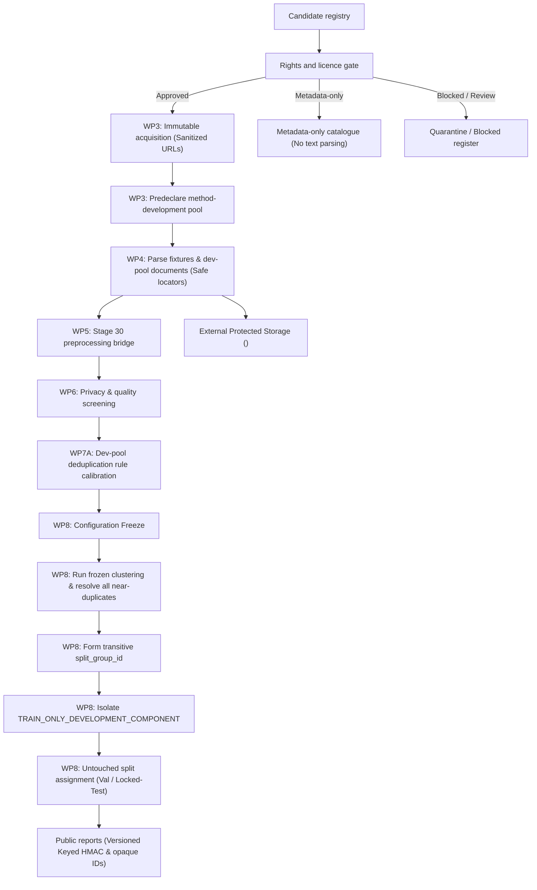

# Stage 31 Implementation Plan — Sinhala External Dataset Ingestion and Pilot Corpus Creation

**Project:** AI-Powered Adaptive Child-Friendly Language Simplification System  
**Component:** Component 3 — AI/NLP-Based Language Simplification  
**Scope:** Sinhala (`si`, `si-LK`, script `Sinh`) dataset acquisition, ingestion, provenance, quality screening, and pilot-corpus construction  
**Status:** Planned — governance review required before execution  
**Authoritative prerequisite:** `stage-30-complete-v3` at commit `ef95667b53dddfb032e71fc51d6c524aff7a22a2`  
**Implementation branch:** `feature/stage31-sinhala-pilot-corpus`  
**Planned start tag:** `stage-31-start`  
**Planned completion tag:** `stage-31-complete` (or `stage-31-pipeline-complete-insufficient-data` if $<150$ records qualify)

---

## 1. Purpose

Stage 31 establishes a rights-reviewed, reproducible, privacy-safe, and auditable pipeline for acquiring external Sinhala text datasets and constructing a governed pilot corpus. Every accepted record must retain verifiable source provenance, licence evidence, immutable raw-source identity, Stage 30 preprocessing evidence, quality dispositions, and split membership.

The stage produces a **research pilot corpus**, not a child-approved dataset and not a Sinhala simplification dataset. It does not claim that acquired text is developmentally appropriate, linguistically correct, clinically suitable, or safe for unsupervised child delivery. Technical governance review assesses adherence to declared terms and risks; it does not constitute a formal legal opinion.

### Primary outcomes

1. A frozen registry of candidate external Sinhala data sources with explicit primary decision statuses, a unified `acquisition_policy` object (tracking `robots.txt` compliance without property duplication), and independent, versioned permission profiles (`rights_profile_version`, `rights_profile_effective_at`, `rights_profile_review_due_at`).
2. A documented rights review decision for every candidate source, separating acquisition permissions from intellectual property licences.
3. Immutable snapshots or retrieval receipts with sanitized URLs across all fields (`canonical_url_sanitized`, `licence_url_sanitized`, `terms_url_sanitized`, `resolved_url_sanitized`) with stripped sensitive query parameters.
4. Physical decoupling of protected text storage (`<configured-protected-root>/sinhala_external/`) strictly outside the Git repository with OS-level least-privilege access controls.
5. Strict protection against guessable content hashes in Git: plain unkeyed SHA-256 for short text is restricted to external protected storage, while Git tracks only opaque IDs or versioned keyed HMAC digests. Unkeyed text hashes are strictly excluded from logs, error traces, CI artifacts, and test snapshots.
6. A deterministic ingestion pipeline using the sealed Stage 30 preprocessor.
7. Record-level provenance, safe source locators (`source_offset_or_locator` preventing filename/key leakage), rights obligations (`rights_profile_id`), multi-source duplicate provenance preservation, quality, exclusion, and deduplication evidence.
8. Early predeclaration of the method-development pool (in WP3 / start of WP4) with immutable designation after first use: all method-development records and their transitively connected components are marked `TRAIN_ONLY_DEVELOPMENT_COMPONENT` and barred from validation or locked test.
9. A unified transitive `split_group_id` (connected components of document, duplicate, and resolved near-duplicate linkages) with zero unresolved near-duplicate candidate pairs at split sealing and protected audit trails for manual decisions.
10. Explicit distinction between pipeline verification and corpus completion, preventing a verified pipeline from claiming corpus completion if fewer than 150 eligible records qualify.
11. Exact accounting from downloaded source units to final corpus records.

---

## 2. Stage Boundaries

### 2.1 Included

- Discovering candidate Sinhala text datasets and public corpora.
- Verifying source ownership, licences, terms, access conditions, `robots.txt` directives (as an acquisition/crawling constraint), and redistribution rights.
- Sanitizing all source and receipt URLs (`canonical_url_sanitized`, `licence_url_sanitized`, `terms_url_sanitized`, `resolved_url_sanitized`) so signed query parameters and credentials are never stored.
- Recording retrieval timestamps, source URLs, source versions, file names, sizes, and whole-file SHA-256 hashes.
- Preserving immutable raw source snapshots in external protected storage outside the Git repository.
- Recording retrieval receipts without redistributing raw content when redistribution is restricted.
- Predeclaring the method-development record pool in WP3 before parser implementation.
- Developing and testing parsers in WP4 using technical fixtures and predeclared development records only.
- Parsing supported source formats into a common staging schema using leak-safe locators.
- Running Stage 30 Unicode validation, NFC normalization, sentence segmentation, tokenization, script analysis, and disposition routing.
- Calibrating deduplication/quality thresholds exclusively on development records (WP7A).
- Freezing all configuration parameters before final corpus clustering and split assignment (WP8).
- Resolving all near-duplicate candidate pairs with protected audit records (or conservatively unioning unresolved pairs) before split generation.
- Forming unified transitive `split_group_id` clusters over all connected document and duplicate relationships.
- Enforcing `TRAIN_ONLY_DEVELOPMENT_COMPONENT` on all split groups containing development records, ensuring validation and locked test draw exclusively from untouched components.
- Screening for privacy risks, unsafe content, boilerplate, corruption, and unsuitable document structures.
- Separating accepted, manual-review, rejected, excluded, and licence-blocked records.
- Constructing a pilot corpus with deterministic, group-safe splits based exclusively on `split_group_id`.
- Producing protected internal artifacts and sanitized public governance artifacts protected with versioned, keyed HMAC digests.
- Generating reproducibility records, accounting reports, and checksum manifests.

### 2.2 Explicitly excluded

- Creating Sinhala child-vocabulary levels — Stage 32.
- Creating Sinhala simplification rules — Stage 33.
- Human linguistic or child-development validation — Stage 34.
- Training or fine-tuning Gemini, mT5, mBART, or other models.
- Generating synthetic Sinhala simplification pairs.
- Translating English simplification references into Sinhala and treating them as human references.
- Inferring DLD status, clinical severity, cognition, or diagnosis.
- Publishing copyrighted or licence-restricted raw or normalized text.
- Storing raw or normalized text inside the Git repository working tree.
- Committing unkeyed text-derived hashes (`title_hash`, `text_hash`, `raw_text_sha256`, `normalized_text_sha256`) to Git, CI artifacts, logs, or exception traces.
- Exposing real local filesystem paths in repository metadata (`protected://` URIs must be abstract).
- Permitting method-development records or their transitive clusters to enter validation or locked-test splits.
- Retroactively altering method-development designations after results have been inspected.
- Sealing splits while any cross-component near-duplicate candidate remains unresolved.
- Ingesting text from sources whose rights profiles have expired or passed `review_due_at`.
- Treating `robots.txt` as a copyright licence (it is an acquisition/crawling signal only).
- Running text preprocessing on `METADATA_ONLY` sources.
- Approving any corpus item for child delivery.

---

## 3. Mandatory Governance Invariants

1. **Licence before ingestion:** No candidate source may enter corpus processing until its legal and licence decision is recorded.
2. **No licence inference:** Absence of a licence is not permission. Unclear, missing, conflicting, or unverifiable terms route to `REVIEW_REQUIRED` or `BLOCKED`.
3. **Rights expiration enforcement:** If a source rights profile has expired or passed its `rights_profile_review_due_at` date, ingestion of new text from that source is immediately blocked pending formal re-review.
4. **Terms, licences, and crawling signals are separate:** Dataset licence, website terms of service, API terms, and `robots.txt` crawling directives must be assessed independently. Acquisition policies are unified in an `acquisition_policy` object without duplicating `robots_txt_status` in permission objects. `DISALLOWED` rejects crawler-based acquisition; direct repository downloads and APIs use `NOT_APPLICABLE` and remain governed by their own terms.
5. **URL sanitization across all entities:** All recorded URLs (`canonical_url_sanitized`, `licence_url_sanitized`, `terms_url_sanitized`, `resolved_url_sanitized`) must be scrubbed of authentication tokens, API keys, credentials, and signed query parameters.
6. **Leak-safe source locators:** The `source_offset_or_locator` field must use opaque identifiers, line/byte offsets, or normalized sequence indexes. It must never reveal restricted filenames, private database keys, internal file paths, or signed query fragments.
7. **Normalized text remains subject to source rights:** Technical normalization or preprocessing (NFC normalization, tokenization, segmentation, script filtering) does not extinguish copyright, attribution, share-alike, non-commercial, contractual, or redistribution restrictions inherited from the source. Every derived record must carry its source obligations via a versioned `rights_profile_id` and `rights_profile_version`.
8. **Most restrictive permission rule:** When exact duplicates or combinations originate from multiple sources, preserve all provenance and applicable attribution obligations. In the absence of a legally confirmed combined redistribution licence, the system must apply the most restrictive relevant export policy.
9. **Raw-source immutability:** Acquired source bytes are never edited in place. Any transformation creates a derived artifact linked to the raw whole-file SHA-256 hash.
10. **Physical storage decoupling & least privilege:** Raw and normalized text must reside exclusively in external protected storage configured via server-side environment variables (`SINHALA_EXTERNAL_PROTECTED_ROOT`), which must actively validate and reject paths resolving inside the Git repository tree. Storage must be protected by operating system least-privilege permissions and governed by an approved backup policy.
11. **No unkeyed text-derived hashes in Git, CI, or logs:** To prevent offline dictionary and guessing attacks on short text sentences, unkeyed SHA-256 hashes of text fragments (`title_hash`, `text_hash`, `raw_text_sha256`, `normalized_text_sha256`) must reside exclusively in external protected storage or private databases. They must be actively filtered and excluded from Git metadata, exception backtraces, application logs, CI artifacts, and test snapshots.
12. **Abstract protected URIs:** Metadata stored in Git must use abstract URIs (e.g., `protected://sinhala_external/normalized/SI-PILOT-000001.txt`) and must never expose host-specific local filesystem paths.
13. **HMAC security and linkability caveat:** Keyed HMAC digests (`hmac_key_id`, domain separation) provide cryptographic resistance against offline dictionary and guessing attacks, but they are stable pseudonymous linkable identifiers across records—not true mathematical anonymization. The HMAC key must remain strictly server-side and outside Git.
14. **Stage 30 immutability:** The Stage 30 implementation, configuration, and authoritative tag (`stage-30-complete-v3`) remain frozen during Stage 31 ingestion.
15. **No child-delivery approval:** Every Stage 31 record defaults to `approved_for_child_delivery: false` and `requires_expert_review: true`.
16. **No expert-validation claim:** Automated quality checks cannot establish Sinhala linguistic correctness, child-age suitability, cultural appropriateness, or clinical safety.
17. **Privacy by default:** Personal data, learner data, contact details, account identifiers, and private communications are excluded or quarantined.
18. **Early development-pool declaration & immutability:** Eligible source/document units for method development are declared in WP3. Parsers in WP4 and rules in WP6/WP7A are developed using technical fixtures and predeclared development records only. Method-development designation is **immutable after first use**; records cannot be retroactively marked as development records after results have been inspected.
19. **Development pool component isolation:** Records used to develop or calibrate parsers, privacy rules, quality thresholds, or deduplication parameters—and every record transitively connected to them—must be marked `TRAIN_ONLY_DEVELOPMENT_COMPONENT` and assigned to train only or excluded from formal evaluation. They must never enter validation or locked test.
20. **Fail-closed near-duplicate resolution & audit trail:** Final split generation is blocked while any cross-component near-duplicate candidate remains unresolved. Alternatively, unresolved candidate links must be conservatively unioned into the same `split_group_id`. Every manual resolution must log an immutable protected audit record (reviewer ID, timestamp, similarity score, decision, rationale). Required invariant: `Unresolved near-duplicate candidates at split sealing = 0`.
21. **Transitive split isolation via `split_group_id`:** Document groups, exact-duplicate clusters, and confirmed near-duplicate clusters must be unified into a single transitive connected component (`split_group_id`). Splitting is performed exclusively on `split_group_id` ensuring `Cross-split split_group_id overlap = 0`.
22. **Metadata-only isolation:** A `METADATA_ONLY` source catalogue entry must not enter text preprocessing pipelines.
23. **Provisional domain labeling:** Domain and genre labels (e.g., "educational", "narrative", "informational") are automated provisional metadata until human review.
24. **Corpus vs. pipeline completion distinction:** Reaching `stage-31-complete` requires achieving $\ge 150$ accepted records. A verified pipeline with $< 150$ accepted records must report `INSUFFICIENT_ELIGIBLE_DATA` and may only receive an intermediate pipeline checkpoint tag.
25. **Zero-loss accounting:** Every candidate source, file, document, segment, and record must have exactly one primary governed outcome.
26. **Historical tag immutability:** Existing Stage 26–30 tags must not be moved. Corrections receive new versioned tags.

---

## 4. Governance Status Contract

Every pilot-corpus record must include:

```json
{
  "language": "si",
  "locale": "si-LK",
  "script": "Sinh",
  "validation_status": "draft",
  "expert_validated": false,
  "research_eligible": false,
  "approved_for_child_delivery": false,
  "approved_for_unsupervised_child_delivery": false,
  "requires_expert_review": true
}
```

`research_eligible` remains `false` until the Stage 31 eligibility gates pass. Passing those technical gates may set `research_eligible: true`, but it must never change either child-delivery flag.

---

## 5. Dataset Source Classification

Candidate sources must be classified before retrieval.

| Source class | Examples of content type | Default posture |
|---|---|---|
| Government/open institutional text | Public notices, educational pages, open publications | Licence review required |
| Open research corpus | Repository dataset with explicit licence and dataset card | Candidate if terms permit intended use |
| Open educational resource | Lessons, stories, graded materials | Licence and attribution review required |
| Encyclopedic/reference text | Articles and descriptions | Use only under compatible licence and attribution rules |
| News or commercial publishing | Articles and archives | Metadata-only unless explicit permission permits ingestion and redistribution |
| Web-crawled text | Mixed public web content | High-risk; blocked unless collection and use are clearly permitted |
| OCR-derived text | Scanned books or documents | Source copyright and OCR provenance both required |
| Machine-translated/generated text | Model or translation output | Segregated; not accepted as natural human-authored reference text |
| User/child-generated text | Responses, messages, assignments | Prohibited without approved ethics, consent, and protected handling |
| Unknown-provenance text | Unverifiable origin | Blocked or quarantined |

Candidate names may be registered for investigation, but registration does not imply acceptance.

---

## 6. Licence and Rights Decision Framework

### 6.1 Primary Source Decision Statuses

Every candidate source must be assigned exactly **one mutually exclusive primary decision status**:

```text
APPROVED
METADATA_ONLY
REVIEW_REQUIRED
BLOCKED
SOURCE_UNAVAILABLE
```

*Note on `SOURCE_UNAVAILABLE`:* This represents an access or retrieval failure outcome (e.g., dead link, decommissioned repository, persistent network block), distinct from a legal rights rejection (`BLOCKED`).

### 6.2 Consolidated Acquisition Policy & Robots.txt Handling

To eliminate conflicting property values, web crawling compliance and access mechanisms are maintained exclusively within an `acquisition_policy` object:

```json
{
  "acquisition_policy": {
    "access_method": "direct_download",
    "robots_txt_status": "NOT_APPLICABLE",
    "robots_txt_checked_at": null,
    "crawl_delay_seconds": null
  }
}
```

`robots_txt_status` Enum Values:
```text
PERMITTED                       # Explicitly allowed or no restrictive disallow
DISALLOWED                      # Blocked by robots.txt directive (rejects crawler acquisition)
NOT_APPLICABLE                  # Direct download, repository archive, or API (governed by own terms)
UNAVAILABLE_REVIEW_REQUIRED     # robots.txt unreachable / status uncertain
```

### 6.3 Independent and Versioned Source Permission Attributes

In addition to the primary decision, approved sources must record an explicit, version-pinned permission profile:

```json
{
  "rights_profile_id": "RP-SRC-SI-001",
  "rights_profile_version": 1,
  "rights_evidence_sha256": "4b8a7c2e...<64-char hash>",
  "supersedes_version": null,
  "rights_profile_effective_at": "2026-10-15T10:00:00Z",
  "rights_profile_review_due_at": "2027-10-15T10:00:00Z",
  "reviewed_by": "REV-GOV-01",
  "reviewed_at": "2026-10-15T10:00:00Z",
  "permissions": {
    "internal_research_use_allowed": true,
    "download_allowed": true,
    "local_storage_allowed": true,
    "modification_allowed": true,
    "derived_processing_allowed": true,
    "raw_redistribution_allowed": false,
    "derived_text_redistribution_allowed": false,
    "commercial_use_allowed": false,
    "attribution_required": true,
    "share_alike_required": false
  }
}
```

*Expiration Rule:* If `current_time > rights_profile_review_due_at`, ingestion is blocked immediately until a new version (`rights_profile_version: 2`) is approved. Historical records retain the version active when acquired.

### 6.4 Mandatory Evidence per Source

- Canonical source name and publisher/maintainer.
- Sanitized canonical source URL (`canonical_url_sanitized`).
- Licence name, version, and sanitized licence URL (`licence_url_sanitized`).
- Exact licence text or immutable licence snapshot hash (`rights_evidence_sha256`).
- Sanitized terms-of-service URL (`terms_url_sanitized`).
- Unified `acquisition_policy` object (Section 6.2).
- Independent permissions, effective dates, and review due date (Section 6.3).
- Access-control or account requirements.
- Personal-data or sensitive-content risk assessment.
- Reviewer ID and decision timestamp.

### 6.5 Decision Rule

Downloading publicly accessible text does not establish a right to reuse, process, or redistribute it. When evidence is incomplete, ambiguous, or unverifiable, the system must fail closed and record `REVIEW_REQUIRED` or `BLOCKED`. A source categorized as `METADATA_ONLY` may have its catalogue metadata retained, but must be barred from text ingestion and preprocessing.

---

## 7. Target Architecture



---

## 8. Physical Storage Architecture & Decoupling

To prevent accidental repository exposure, backups, or leakage, raw and normalized text must reside **physically outside the Git repository**:

```text
Repository (Git tracked):
Language_Simplification_MVP/
├── backend/app/datasets/sinhala_external/
├── data/sinhala_external/
│   ├── registry/               # Candidate & approved source metadata (Sanitized URLs)
│   ├── receipts/               # Sanitized retrieval receipts (Whole-file SHA-256 only)
│   ├── deduplication/          # Sanitized cluster mappings (Opaque IDs only)
│   ├── pilot_corpus/           # Metadata-only split manifests & corpus card
│   └── manifests/              # Repository documentation checksum manifests
└── docs/                       # Implementation reports & accounting summaries

External Protected Storage (Strictly Outside Git Repository):
<SINHALA_EXTERNAL_PROTECTED_ROOT>/
└── sinhala_external/
    ├── raw/<source_id>/<retrieval_id>/
    ├── normalized/<record_id>.txt
    ├── quarantine/<quarantine_id>.txt
    ├── deduplication/
    │   ├── internal_hashes.jsonl       # Internal unkeyed text-hash ledger
    │   └── manual_review_audit.jsonl   # Protected audit records for near-duplicate reviews
    └── manifests/
        └── internal_text_manifest.sha256
```

> [!CRITICAL]
> **Storage Path & Access Security Invariant:**
> 1. `SINHALA_EXTERNAL_PROTECTED_ROOT` is read from the environment. On startup, the path is checked: if it resolves within the Git repository working tree (`Path.resolve().is_relative_to(REPO_ROOT)`), startup must fail immediately with `SecurityError`.
> 2. Operating system permissions must restrict directory read/write access to the execution identity only (least privilege).
> 3. An approved external backup and retention policy must govern the protected root.

---

## 9. Public vs. Protected Hash and Identifier Boundaries

Plain SHA-256 hashes of short sentences can be guessed using dictionary or corpus attacks. Stage 31 strictly decouples internal integrity verification from public transparency reporting:

| Context | Text Exposure | Permitted Identifier | Storage Location |
|---|---|---|---|
| **External raw source** | Literal raw bytes | Whole-file SHA-256 | External protected storage |
| **External normalized text**| Normalized sentences | Internal unkeyed SHA-256 | External protected storage |
| **Internal deduplication ledger** | Internal cluster mappings | Internal unkeyed SHA-256 | External protected storage |
| **Git-tracked receipts** | Whole-file metadata only | Whole-file SHA-256 (archive-level) | Repository `receipts/` |
| **Git-tracked deduplication**| Cluster mappings | Opaque cluster & record IDs only | Repository `deduplication/` |
| **Corpus metadata records** | Abstract ref (`protected://...`)| Opaque Record ID + Keyed HMAC | Staging database / JSONL |
| **Public corpus card** | Zero text | Aggregate counts + Keyed HMAC | Public repository |
| **Public accounting report**| Zero text | Aggregate integer counts only | Public repository |
| **Public error analysis** | Permitted synthetic text only | Opaque Error IDs (No guessable hashes)| Public repository |

### Versioned Keyed HMAC Scheme

Public record digests use HMAC-SHA-256 with domain separation:
```python
# Digest input schema: sinhala-pilot-record:v1
digest = hmac.new(
    key=SECRET_HMAC_KEY,
    msg=f"sinhala-pilot-record:v1:{record_id}:{normalized_text}".encode("utf-8"),
    digestmod=hashlib.sha256
).hexdigest()
```
The public corpus card exposes `hmac_key_id: "HMAC-2026-V1"`, `hmac_key_version: 1`, and `digest_input_schema: "sinhala-pilot-record:v1"`. The secret key remains server-side and is never committed to Git.

---

## 10. Core Data Contracts

### 10.1 Source Registry Record

```json
{
  "source_id": "SRC-SI-001",
  "source_name": "<canonical name>",
  "publisher": "<publisher>",
  "canonical_url_sanitized": "https://example.org/dataset",
  "source_class": "open_research_corpus",
  "language_claim": "si",
  "primary_decision": "APPROVED",
  "licence_name": "<verified licence or null>",
  "licence_version": "<version or null>",
  "licence_url_sanitized": "https://example.org/licence",
  "terms_url_sanitized": "https://example.org/terms",
  "rights_profile_id": "RP-SRC-SI-001",
  "rights_profile_version": 1,
  "rights_profile_effective_at": "2026-10-15T10:00:00Z",
  "rights_profile_review_due_at": "2027-10-15T10:00:00Z",
  "rights_evidence_sha256": "<64-char hash>",
  "acquisition_policy": {
    "access_method": "direct_download",
    "robots_txt_status": "NOT_APPLICABLE",
    "robots_txt_checked_at": null,
    "crawl_delay_seconds": null
  },
  "permissions": {
    "internal_research_use_allowed": true,
    "download_allowed": true,
    "local_storage_allowed": true,
    "modification_allowed": true,
    "derived_processing_allowed": true,
    "raw_redistribution_allowed": false,
    "derived_text_redistribution_allowed": false,
    "commercial_use_allowed": false,
    "attribution_required": true,
    "share_alike_required": false
  },
  "reviewed_by": "<pseudonymous reviewer id>",
  "reviewed_at": "<ISO-8601 timestamp>",
  "notes": "<non-sensitive notes>"
}
```

### 10.2 Sanitized Acquisition Receipt

```json
{
  "retrieval_id": "RET-SI-001-001",
  "source_id": "SRC-SI-001",
  "retrieved_at": "<ISO-8601 timestamp>",
  "retrieval_method": "https_direct_download",
  "resolved_url_sanitized": "https://example.org/dataset.zip",
  "redirect_chain_sanitized": [
    "https://example.org/download-redirect"
  ],
  "sensitive_query_parameters_removed": true,
  "http_status": 200,
  "content_type": "<media type>",
  "file_name": "<name>",
  "byte_size": 0,
  "sha256": "<64-character whole-file digest>",
  "etag": "<value or null>",
  "last_modified": "<value or null>",
  "raw_storage_ref": "protected://sinhala_external/raw/SRC-SI-001/RET-SI-001-001/data.bin",
  "redistribution_allowed": false
}
```

### 10.3 Staged Document Record (Git-Safe Contract)

```json
{
  "document_id": "DOC-SI-000001",
  "source_id": "SRC-SI-001",
  "retrieval_id": "RET-SI-001-001",
  "rights_profile_id": "RP-SRC-SI-001",
  "rights_profile_version": 1,
  "raw_file_sha256": "<whole-file hash>",
  "source_document_key": "<source-native opaque key>",
  "document_group_id": "GRP-SI-000001",
  "source_offset_or_locator": "seq_idx:000042",
  "authoring_origin": "human_authored_claimed",
  "is_method_development_unit": true,
  "provisional_domain": "narrative_provisional",
  "parsing_status": "PARSED",
  "raw_text_storage_ref": "protected://sinhala_external/raw/SRC-SI-001/RET-SI-001-001/doc_000001.txt"
}
```
*Note:* `source_offset_or_locator` uses abstract sequence offsets rather than leaking local filesystem paths or database keys. Unkeyed text hashes reside exclusively in external protected storage.

### 10.4 Pilot-Corpus Record (Decoupled, Safe-Hash & Transitive Split Contract)

```json
{
  "record_id": "SI-PILOT-000001",
  "public_record_digest": "<keyed HMAC-SHA-256>",
  "hmac_key_id": "HMAC-2026-V1",
  "hmac_key_version": 1,
  "digest_input_schema": "sinhala-pilot-record:v1",
  "source_id": "SRC-SI-001",
  "retrieval_id": "RET-SI-001-001",
  "rights_profile_id": "RP-SRC-SI-001",
  "rights_profile_version": 1,
  "document_id": "DOC-SI-000001",
  "document_group_id": "GRP-SI-000001",
  "duplicate_cluster_id": "DUP-SI-000001",
  "near_duplicate_cluster_id": "NDUP-SI-000001",
  "split_group_id": "SPLIT-GRP-SI-000001",
  "is_method_development_record": true,
  "split_component_type": "TRAIN_ONLY_DEVELOPMENT_COMPONENT",
  "all_contributing_sources": [
    {
      "source_id": "SRC-SI-001",
      "rights_profile_id": "RP-SRC-SI-001",
      "rights_profile_version": 1,
      "attribution_text": "<required attribution if applicable>"
    }
  ],
  "effective_export_policy": "PROTECTED_INTERNAL_ONLY",
  "normalized_text_storage_ref": "protected://sinhala_external/normalized/SI-PILOT-000001.txt",
  "literal_text_redistributable": false,
  "stage30_configuration_hash": "<frozen hash>",
  "stage30_disposition": "PASSED",
  "stage31_disposition": "ACCEPTED_PILOT_CANDIDATE",
  "quality_flags": [],
  "provisional_domain": "educational_provisional",
  "split": "train",
  "language": "si",
  "locale": "si-LK",
  "script": "Sinh",
  "validation_status": "draft",
  "expert_validated": false,
  "research_eligible": true,
  "approved_for_child_delivery": false,
  "approved_for_unsupervised_child_delivery": false,
  "requires_expert_review": true
}
```

---

## 11. Acquisition Protocol

1. Register candidate in `candidate_sources.json` without downloading corpus text.
2. Capture source description, maintainer, sanitized endpoints (`canonical_url_sanitized`), format, and `acquisition_policy`.
3. Save licence and terms evidence where legally permitted.
4. Record primary decision (`APPROVED`, `METADATA_ONLY`, `REVIEW_REQUIRED`, `BLOCKED`, `SOURCE_UNAVAILABLE`) and versioned permission profile (`rights_profile_version`, `rights_profile_effective_at`, `rights_profile_review_due_at`).
5. Require `APPROVED` status before initiating file retrieval. Verify rights profile has not expired.
6. Retrieve text through a deterministic, rate-limited client honoring crawl delays.
7. Record redirects and final resolved endpoint, sanitizing URL parameters to ensure tokens and signed credentials are never stored (`sensitive_query_parameters_removed: true`).
8. Hash received bytes before parsing.
9. Store raw bytes immutably in external protected storage; write sanitized receipt JSON to repository `data/sinhala_external/receipts/`.
10. Ensure repeated retrieval matches the frozen hash or creates a new versioned retrieval ID.
11. Never overwrite historical raw files or receipts.

---

## 12. Stage 30 Preprocessing Integration

The Stage 31 bridge must call the frozen Stage 30 pipeline without altering Stage 30 rules, inventory, or configuration.

### Required Evidence per Record

- Stage 30 code/tag identity (`stage-30-complete-v3`).
- Stage 30 configuration SHA-256.
- Raw-text and normalized-text storage references (`protected://...`).
- Internal unkeyed SHA-256 stored in external protected integrity ledger (never committed to Git or logs).
- Keyed HMAC digest in repository metadata.
- Stage 30 terminal disposition.
- Reason codes and quality flags.
- Operation count.
- Sentence count and token count.
- Pipeline-introduced `U+FFFD` count (must remain exactly zero).
- Determinism check result for sampled or complete pilot records.

### Routing Table

| Stage 30 outcome | Stage 31 handling |
|---|---|
| `PASSED` | Continue to Stage 31 gates |
| `PASSED_WITH_NORMALIZATION` | Continue with operation trace retained |
| `MANUAL_REVIEW_REQUIRED` | Stage 31 quarantine/review queue |
| `REJECTED_INVALID_UNICODE` | Reject from pilot corpus |
| `EXCLUDED_NON_SINHALA` | Exclude from Sinhala corpus |

Stage 31 must not silently override a stricter Stage 30 disposition.

---

## 13. Privacy and Sensitive-Content Screening

Automated scanning is a risk-reduction mechanism, not proof that personal data is absent.

### Flag Categories

- Email addresses and phone numbers.
- National identifiers, account numbers, and precise addresses.
- Personal names combined with contact or sensitive context.
- Health, disability, diagnosis, or therapy information linked to an identifiable person.
- Child-authored or school-record content.
- Credentials, access tokens, or secrets.
- Assessment answer keys or protected responses.
- Harassment, explicit sexual content, graphic violence, or other unsafe material.

### Routing

```text
CONFIRMED_PERSONAL_OR_PRIVATE_DATA      -> REJECTED_PRIVACY
POSSIBLE_PERSONAL_DATA                 -> MANUAL_REVIEW_REQUIRED
PROTECTED_ANSWER_OR_SECRET             -> REJECTED_SECURITY
NO_AUTOMATED_PRIVACY_FLAG              -> Continue, without claiming privacy proof
```

Flagged raw text must remain in external protected quarantine storage and must never be copied into public documentation or issue trackers.

---

## 14. Quality and Eligibility Gates

### 14.1 Technical Acceptance Criteria

- Rights status permits intended internal processing (`internal_research_use_allowed: true`).
- File hash and provenance are complete.
- Parser completes without silent record loss.
- Stage 30 outcome is `PASSED` or `PASSED_WITH_NORMALIZATION`.
- Sinhala content is present according to frozen script thresholds.
- No prohibited privacy or security outcome is present.
- Text is not empty, corrupt, or only boilerplate.
- Record is assigned to exact duplicate, near-duplicate, and `split_group_id` clusters.
- Required governance fields and versioned `rights_profile_id` are complete.

### 14.2 Review Flags

- High Latin or unsupported-script ratio.
- OCR noise or repeated replacement-like artifacts.
- Abnormal punctuation or token repetition.
- Extremely short or long segments.
- Metadata/content language conflict.
- Suspected machine translation or generation.
- Near-duplicate similarity above the frozen review threshold.
- Possible unsafe or age-inappropriate subject matter.
- Uncertain document boundary or authoring origin.

### 14.3 Terminal Dispositions & Precedence Order

```text
REJECTED_RIGHTS
→ REJECTED_SECURITY
→ REJECTED_PRIVACY
→ REJECTED_INVALID_UNICODE
→ QUARANTINED_SOURCE_ERROR
→ MANUAL_REVIEW_REQUIRED
→ EXCLUDED_NON_SINHALA
→ EXCLUDED_DUPLICATE
→ EXCLUDED_OUT_OF_SCOPE
→ REJECTED_QUALITY
→ ACCEPTED_PILOT_CANDIDATE
```

Evaluation is strictly first-matching fail-closed.

---

## 15. Deduplication, Development Pool Isolation & Transitive Split Grouping

### 15.1 Multi-Source Duplicate Provenance Preservation

When exact duplicates originate from multiple distinct sources:
1. One canonical record is selected deterministically as `ACCEPTED_PILOT_CANDIDATE`.
2. Duplicate records receive `EXCLUDED_DUPLICATE`.
3. The retained candidate's `all_contributing_sources` array aggregates every contributing source's `source_id`, `rights_profile_id`, `rights_profile_version`, and attribution terms.
4. The retained record adopts the **most restrictive** export permission among all contributing sources.

### 15.2 Deduplication Method Development on Predeclared Pool (WP7A)

To prevent data snooping and threshold tuning on evaluation data:
1. The method-development record pool is predeclared in WP3 (`is_method_development_record: true`) and is **immutable after first use**.
2. Token shingle MinHash/LSH and exact hashing methods are calibrated exclusively on this development pool.
3. Candidate similarity threshold ($\ge 0.80$) and review threshold ($\ge 0.90$) are finalized and frozen.
4. **No final production clusters or split assignments are produced in WP7A.**

### 15.3 Fail-Closed Near-Duplicate Resolution & Protected Audit Trail (WP8)

Before final split assignment, all near-duplicate candidate pairs must be audited:
- Every candidate pair must be either formally **confirmed** as an edge in clustering, or **rejected** as distinct.
- Every manual review must write a protected audit record to `<protected-root>/sinhala_external/deduplication/manual_review_audit.jsonl` recording:
  ```json
  {
    "candidate_pair": ["SI-PILOT-000012", "SI-PILOT-000085"],
    "similarity_score": 0.884,
    "decision": "CONFIRMED_NEAR_DUPLICATE",
    "rationale": "Same educational sentence with single morphological inflection variation",
    "reviewed_by": "REV-NLP-02",
    "reviewed_at": "2026-10-15T12:00:00Z"
  }
  ```
- If any near-duplicate candidate remains unresolved when splits are generated, split generation is blocked, or the unresolved pair is conservatively unioned into the same `split_group_id`.

```text
Required invariant: Unresolved near-duplicate candidates at split sealing = 0
```

### 15.4 Unified Transitive `split_group_id` Construction

Document groups, exact duplicates, and confirmed near-duplicates overlap transitively:
$$\text{Record } A \stackrel{\text{doc}}{\sim} B \quad \land \quad B \stackrel{\text{exact}}{\sim} C \quad \land \quad C \stackrel{\text{near}}{\sim} D$$
Relationships are modeled as an undirected graph:
- **Vertices:** All eligible and duplicate records.
- **Edges:** Same `document_group_id`, same `duplicate_cluster_id`, and confirmed `near_duplicate_cluster_id`.
- **Connected Components:** Transitive closure forms unique `split_group_id` clusters (e.g., `SPLIT-GRP-SI-000001`).

### 15.5 Development Pool Component Quarantine from Evaluation Splits

```text
Invariant:
If ANY record in a connected component has is_method_development_record: true,
the entire component is classified as:
  split_component_type = "TRAIN_ONLY_DEVELOPMENT_COMPONENT"

It is permanently restricted to the 'train' split or excluded from the pilot.
It must NEVER enter 'validation' or 'locked_test'.
```

Validation and locked-test splits are sampled exclusively from:
`split_component_type = "UNTOUCHED_EVAL_ELIGIBLE_COMPONENT"`

```text
Required invariant: Cross-split split_group_id overlap = 0
```

### 15.6 Cross-Stage Contamination Checks

Check pilot records against:
- Stage 30 governed fixtures (32 fixtures).
- Stage 29 technical UI fixtures.
- English Release 0.2.0 and locked-test hashes where comparable.
- Stage 28A locked comparison inputs and outputs.
- Stage 26 Gemini evaluation ledgers and protected outputs.
- Any future Stage 31 held-out test manifest.

---

## 16. Pilot Corpus Design, Split Protocol & Completion Qualification

### 16.1 Operational Pilot-Size Targets & Completion Status Differentiation

```text
Preferred accepted pilot size: 300–1,000 records
Minimum viable accepted pilot: 150 records
Maximum Stage 31 pilot: 2,000 records
```

> [!IMPORTANT]
> **Pilot-Size Qualification Boundary:**
> Pilot-size thresholds are engineering targets for validating the ingestion pipeline. They do not establish linguistic representativeness, model-training sufficiency, domain coverage, or statistical power.

To prevent an ambiguous declaration where a working pipeline is mistaken for a completed pilot corpus, Stage 31 defines two distinct terminal outcomes:

| Outcome Status | Condition | Completion Tag Action | Stage 31 Disposition |
|---|---|---|---|
| **`STAGE31_COMPLETE`** | $\ge 150$ accepted records and all verification gates pass | Create `stage-31-complete` tag | Fully sealed and ready for Stage 32 |
| **`INSUFFICIENT_ELIGIBLE_DATA`** | Pipeline passes all tests, but $< 150$ accepted records qualify | Create `stage-31-pipeline-complete-insufficient-data` tag (optional) | Pipeline verified; corpus construction incomplete; overall IN PROGRESS |

Stage 31 must **never** pad the corpus with synthetic, translated, duplicated, or licence-uncertain text merely to reach 150 records.

### 16.2 Diversity Tracking (Provisional)

Subject to lawful source availability, track—not guarantee—coverage across:
- Narrative prose (`provisional_domain: narrative_provisional`).
- Informational/explanatory prose (`provisional_domain: informational_provisional`).
- Procedural or instructional text (`provisional_domain: procedural_provisional`).
- Dialogue or conversational text (`provisional_domain: dialogue_provisional`).
- Educational text (`provisional_domain: educational_provisional`).
- Public-information text (`provisional_domain: public_info_provisional`).
- Mixed Sinhala–English content.
- Sentence length bands (short: $\le 10$ tokens, medium: 11–25 tokens, long: $> 25$ tokens).

### 16.3 Configuration Freeze & Split Protocol

The split procedure follows a strict, irreversible sequence:

1. **Acquire and parse** lawful approved sources.
2. **WP3 / WP4 Early Predeclared Tuning:** Predeclare development documents in WP3; calibrate parsers in WP4 and rules in WP7A exclusively on development records.
3. **WP8 Configuration Freeze:** Freeze all parsers, quality thresholds, deduplication rules, and Stage 31 configuration in `data/sinhala_external/registry/stage31_configuration.json`.
4. **WP8 Final Clustering:** Run frozen exact and near-duplicate detection over the full eligible population.
5. **WP8 Near-Duplicate Resolution:** Audit and resolve all near-duplicate candidate pairs, writing protected audit records (`Unresolved near-duplicate candidates at split sealing = 0`).
6. **WP8 Transitive Split Grouping:** Compute transitive closure to assign `split_group_id`.
7. **WP8 Component Type Assignment:**
   - Mark split groups containing development records as `TRAIN_ONLY_DEVELOPMENT_COMPONENT` $\rightarrow$ assign to train.
   - Mark untouched split groups as `UNTOUCHED_EVAL_ELIGIBLE_COMPONENT`.
8. **WP8 Split Assignment:** Assign untouched split groups atomically to validation (~15%) and locked test (~15%), with remaining allocated to train (~70% nominal total).
   *Split Ratio Flexibility:* Ratios may vary slightly around 70/15/15 because complete transitive components cannot be severed across split boundaries.
9. **Seal locked test:** Compute and freeze `data/sinhala_external/pilot_corpus/split_manifest.json`.
10. **Execute locked test evaluation:** Evaluate without adjusting any frozen thresholds.

*Invariant:* Under no circumstances may statistics from the locked-test split be used to choose or adjust privacy, quality, length, script-ratio, or near-duplicate thresholds.

---

## 17. Implementation Work Packages

### WP0 — Prerequisite verification, clean checkpoint & external storage isolation
1. Verify:
   ```powershell
   git rev-parse "stage-30-complete-v3^{commit}"
   # ef95667b53dddfb032e71fc51d6c524aff7a22a2
   ```
2. Confirm Stage 29 v2 and Stage 28A v4 remain in ancestry.
3. Confirm a clean working tree.
4. Create `feature/stage31-sinhala-pilot-corpus` from Stage 30 v3.
5. Create annotated tag `stage-31-start` at the unchanged prerequisite commit.
6. Verify `SINHALA_EXTERNAL_PROTECTED_ROOT` resolves outside Git repository and has least-privilege ACLs.
7. Snapshot prerequisite tags, files, configurations, corpus counts, and hashes.
8. Run baseline backend tests, frontend tests, and production build.

### WP1 — Candidate discovery and source registry
1. Define source selection criteria.
2. Register candidates in `candidate_sources.json` without downloading corpus text.
3. Record publisher, sanitized URLs (`canonical_url_sanitized`), source class, language claims, format, and `acquisition_policy`.
4. Produce `docs/stage31_candidate_source_register.csv`.
5. Do not describe a candidate as approved before WP2.

### WP2 — Rights, licence, and terms gate
1. Retrieve and hash licence/terms evidence where permitted (`rights_evidence_sha256`).
2. Assess `acquisition_policy.robots_txt_status` enum (`PERMITTED`, `DISALLOWED`, `NOT_APPLICABLE`, `UNAVAILABLE_REVIEW_REQUIRED`).
3. Assign single primary decision (`APPROVED`, `METADATA_ONLY`, `REVIEW_REQUIRED`, `BLOCKED`, `SOURCE_UNAVAILABLE`).
4. Record independent, versioned permission profile (`rights_profile_id`, `rights_profile_version: 1`, `rights_profile_effective_at`, `rights_profile_review_due_at`).
5. Obtain second-person review for every accepted source.
6. Freeze `data/sinhala_external/registry/approved_sources.json`.
7. Produce `docs/stage31_licence_and_rights_report.md`.

### WP3 — Immutable acquisition, sanitized receipts, external storage & development pool predeclaration
1. Implement rate-limited acquisition for approved sources only. Verify rights profile has not expired.
2. Capture exact raw bytes, HTTP metadata, hashes, timestamps, and resolved endpoints.
3. Sanitize URLs (`resolved_url_sanitized`, `redirect_chain_sanitized`) removing all tokens and query secrets.
4. Store raw text exclusively in external protected storage (`<protected-root>/sinhala_external/raw/`).
5. Write retrieval receipts to repository `data/sinhala_external/receipts/`. Prevent overwrite of prior retrieval versions.
6. Predeclare source and document units eligible for method development (`is_method_development_unit: true`); lock designation immutably.
7. Verify raw-source manifest (`data/sinhala_external/manifests/raw_source_manifest.sha256`).
8. Produce `docs/stage31_acquisition_and_provenance_report.md`.

### WP4 — Common schemas and format parsers (Development Pool Only)
1. Implement Pydantic v2 source, sanitized receipt, staged document, and corpus schemas with abstract `protected://` storage references and safe locators (`source_offset_or_locator`).
2. Implement schema test proving that `acquisition_policy` and `permissions` cannot contain conflicting duplicate `robots_txt_status` entries.
3. Implement deterministic parsers for formats actually encountered (JSON/JSONL/CSV/TXT/XML).
4. Develop and test parsers using format-specific technical fixtures and predeclared development documents only.
5. Ensure `METADATA_ONLY` sources are barred from parsing pipelines.
6. Record parser name, version, configuration, and safe sequence locator for each output.
7. Reconcile parsed, failed, skipped, and quarantined source units.
8. Preserve source document grouping (`document_group_id`) and provisional domain tags.

### WP5 — Stage 30 preprocessing bridge
1. Call frozen Stage 30 pipeline (`stage-30-complete-v3`).
2. Verify configuration and implementation hashes.
3. Store normalized text in external protected storage (`<protected-root>/sinhala_external/normalized/`).
4. Maintain internal unkeyed SHA-256 in external ledger; filter out unkeyed hashes from logs, exceptions, and CI. Expose only versioned keyed HMAC digests in Git metadata.
5. Enforce zero pipeline-introduced `U+FFFD`.
6. Route Stage 30 manual/rejected/excluded outcomes correctly.
7. Verify deterministic repeated execution.
8. Produce `docs/stage31_preprocessing_integration_report.md`.

### WP6 — Privacy, quality, and scope routing
1. Implement privacy and security risk scanning.
2. Implement boilerplate, corruption, script-ratio, repetition, and length checks.
3. Consume the predeclared method-development pool records; calibrate preliminary thresholds on development pool only.
4. Preserve reason codes and mutually exclusive terminal dispositions.
5. Quarantine flagged raw text in external protected storage; keep it out of public reports.
6. Produce `docs/stage31_quality_and_exclusion_report.md`.

### WP7A — Deduplication method development (Development Pool Only)
1. Calibrate token-shingle MinHash/LSH and exact hashing methods on predeclared development pool only.
2. Calibrate candidate and review thresholds on development records.
3. Test multi-source duplicate provenance aggregation rules and most-restrictive export logic.
4. Test transitive closure connected component algorithm for `split_group_id`.
5. **Do not** generate final production clusters or split assignments.
6. Produce `docs/stage31_deduplication_and_contamination_report.md` (interim development section).

### WP8 — Configuration freeze, near-duplicate resolution, final clustering, and split generation
1. **Freeze Configuration:** Freeze all parsers, quality thresholds, deduplication parameters, and Stage 31 settings in `stage31_configuration.json`.
2. **Execute Frozen Clustering:** Run frozen exact and near-duplicate detection over the full eligible population.
3. **Resolve Near-Duplicates:** Audit and resolve all near-duplicate candidate pairs, writing protected audit records; verify `Unresolved near-duplicate candidates at split sealing = 0`.
4. **Form Transitive Split Groups:** Compute connected components across document groups, exact-duplicate clusters, and confirmed near-duplicate clusters to establish `split_group_id`.
5. **Isolate Development Components:** Assign `split_component_type = "TRAIN_ONLY_DEVELOPMENT_COMPONENT"` to any component containing development records; restrict to train split.
6. **Assign Untouched Splits:** Assign complete untouched `split_group_id` units atomically to validation (~15%), locked test (~15%), and remaining train (~70% nominal).
7. **Freeze Manifest:** Seal `data/sinhala_external/pilot_corpus/split_manifest.json`.
8. Verify zero cross-split `split_group_id`, document, exact-duplicate, near-duplicate, or development-pool leakage.
9. Produce protected pilot corpus references (`protected://...`) and sanitized public corpus card with versioned keyed HMAC digests (`hmac_key_id: "HMAC-2026-V1"`, `hmac_key_version: 1`, `digest_input_schema: "sinhala-pilot-record:v1"`).
10. Produce `docs/stage31_pilot_corpus_report.md`.

### WP9 — Verification, accounting, documentation, and sealing
1. Run Stage 31 tests and complete backend regression suite.
2. Run frontend regression tests and production build.
3. Verify Stage 30 v3, Stage 29, English releases, and Stage 28A artifacts remain unchanged within declared scope.
4. Reconcile candidate-, file-, parsed-unit-, record-, and split-level accounting equations (all unaccounted = 0).
5. Verify corpus completion status ($\ge 150$ accepted records $\rightarrow$ `STAGE31_COMPLETE`; $< 150$ records $\rightarrow$ `INSUFFICIENT_ELIGIBLE_DATA`).
6. Generate documentation checksum manifest with write-only generator.
7. Verify with separate read-only verifier and negative tamper test.
8. Commit changes and create appropriate immutable annotated tag (`stage-31-complete` or `stage-31-pipeline-complete-insufficient-data`).

---

## 18. Accounting Requirements

### 18.1 Candidate-Source Accounting

Every candidate source belongs to exactly one mutually exclusive primary decision status:

$$
\text{Candidates}
=
\text{Approved}
+
\text{MetadataOnly}
+
\text{ReviewRequired}
+
\text{Blocked}
+
\text{SourceUnavailable}
+
\text{Unaccounted}
$$

Target: $\text{Unaccounted} = 0$.

### 18.2 Retrieved-File Accounting

$$
\text{ExpectedFiles}
=
\text{DownloadedVerified}
+
\text{Failed}
+
\text{NotAttempted}
+
\text{Quarantined}
+
\text{Unaccounted}
$$

### 18.3 Parsed-Unit Accounting

$$
\text{SourceUnits}
=
\text{Parsed}
+
\text{SkippedByPolicy}
+
\text{ParseFailed}
+
\text{Quarantined}
+
\text{Unaccounted}
$$

### 18.4 Record-Disposition Accounting

$$
\text{CandidateRecords}
=
\text{Accepted}
+
\text{ManualReview}
+
\text{Rejected}
+
\text{Excluded}
+
\text{Quarantined}
+
\text{Unaccounted}
$$

Detailed terminal categories must sum exactly to their parent category:
- $\text{Rejected} = \text{RejectedRights} + \text{RejectedSecurity} + \text{RejectedPrivacy} + \text{RejectedInvalidUnicode} + \text{RejectedQuality}$
- $\text{Excluded} = \text{ExcludedNonSinhala} + \text{ExcludedDuplicate} + \text{ExcludedOutOfScope}$

### 18.5 Component & Split Accounting

$$
\text{AcceptedPilotRecords}
=
\text{Train}
+
\text{Validation}
+
\text{LockedTest}
$$

$$
\text{TotalSplitGroups}
=
\text{TrainOnlyDevelopmentComponents}
+
\text{UntouchedSplitEligibleComponents}
$$

Required invariants:
```text
Method-development records in Validation = 0
Method-development records in LockedTest = 0
Train-only development components in Validation = 0
Train-only development components in LockedTest = 0
Unresolved near-duplicate candidates at split sealing = 0
Cross-split split_group_id overlap = 0
Cross-split document-group overlap = 0
Cross-split duplicate-cluster overlap = 0
Cross-split near-duplicate-cluster overlap = 0
Duplicate record IDs = 0
Missing record IDs = 0
Unaccounted records = 0
```

---

## 19. Automated Test Plan

### Stage 31 Tests

```powershell
Push-Location backend
python -m pytest tests/datasets/sinhala_external/ -v
Pop-Location
```

Minimum required tests:
- Protected storage path rejects any path inside the Git repository working tree.
- Candidate sources cannot be acquired before primary `APPROVED` decision.
- Expired rights profile past `review_due_at` automatically blocks acquisition.
- `METADATA_ONLY` sources are blocked from entering text preprocessing pipelines.
- Missing or ambiguous licence evidence fails closed to `REVIEW_REQUIRED` or `BLOCKED`.
- Schema test validates that `acquisition_policy` and `permissions` cannot have duplicate or conflicting `robots_txt_status`.
- `robots.txt` `DISALLOWED` status rejects crawler-based acquisition; direct repository downloads and APIs use `NOT_APPLICABLE` and remain governed by their own terms.
- Source registry and receipt URLs are sanitized (no credentials, API tokens, or signed query secrets).
- Source locators (`source_offset_or_locator`) do not leak host filesystem paths or database keys.
- Raw file SHA-256 hash mismatch aborts parsing.
- Interrupted downloads never receive verified status.
- Historical raw retrievals cannot be overwritten.
- Parser output reconciles exactly to source units.
- Parsers in WP4 only execute on predeclared development records or technical fixtures.
- Stage 30 configuration hash mismatch aborts preprocessing bridge.
- Stage 30 manual-review and rejection outcomes are preserved.
- Pipeline-introduced `U+FFFD` remains strictly zero.
- Privacy-confirmed records cannot enter the pilot corpus.
- Exact duplicates preserve contributing source attribution and adopt the most restrictive export policy.
- All near-duplicate candidates are resolved before split generation (unresolved count = 0), and manual reviews produce protected audit records.
- Transitive closure correctly unifies overlapping document, duplicate, and near-duplicate links into `split_group_id`.
- Method-development records and their transitive clusters cannot enter validation or locked-test splits.
- Same `split_group_id` cannot cross splits.
- Locked-test membership remains frozen after configuration freeze.
- Git repository, logs, CI artifacts, and test snapshots contain zero unkeyed text-derived SHA-256 hashes.
- Public exports contain only versioned keyed HMAC digests or opaque IDs, never plain text or plain/guessable content hashes.
- Every accepted record retains full provenance and versioned `rights_profile_id`.
- Child-delivery flags remain false for all records.
- All accounting equations reconcile with zero unaccounted items.

### Full Regression

```powershell
Push-Location backend
python -m pytest tests/ -q
Pop-Location

Push-Location frontend
npm run test -- --run
npm run build
Pop-Location
```

### Manifest Verification

```powershell
python scripts/stage31/generate_stage31_manifest.py
python scripts/stage31/verify_stage31_manifest.py
```

The verifier must be read-only, prove that manifest bytes did not change during verification, and detect mismatches using a temporary tampered copy.

---

## 20. Manual Review Checklist

1. Confirm `SINHALA_EXTERNAL_PROTECTED_ROOT` resolves outside the Git repository with least-privilege permissions.
2. Confirm every candidate source has a completed primary decision (`APPROVED`, `METADATA_ONLY`, `REVIEW_REQUIRED`, `BLOCKED`, `SOURCE_UNAVAILABLE`).
3. Confirm accepted-source licence snapshots match recorded hashes (`rights_evidence_sha256`) and profiles are not expired.
4. Confirm `acquisition_policy.robots_txt_status` was verified as an acquisition crawling signal without schema duplication.
5. Confirm candidate and receipt URLs are sanitized without credentials or signed query parameters.
6. Confirm raw and normalized text files are stored exclusively in external protected storage.
7. Confirm Git repository, logs, exceptions, and CI artifacts contain zero unkeyed text-derived hashes (`title_hash`, `text_hash`, `raw_text_sha256`, `normalized_text_sha256`).
8. Confirm Stage 30 v3 code and configuration are unchanged.
9. Inspect samples from every source and every terminal disposition.
10. Inspect suspected OCR, machine-translated, generated, and mixed-script samples.
11. Review possible personal-data flags in the protected environment.
12. Confirm exact duplicates preserve all contributing source rights profiles and adopt most restrictive export rules.
13. Confirm all near-duplicate candidate pairs were resolved before split sealing (unresolved count = 0) with protected audit records logged.
14. Confirm `split_group_id` was computed via transitive closure over document, duplicate, and near-duplicate links.
15. Confirm all method-development records were predeclared in WP3, locked immutably, marked `TRAIN_ONLY_DEVELOPMENT_COMPONENT`, and absent from validation and locked test.
16. Confirm zero cross-split `split_group_id` overlap.
17. Confirm configuration was frozen (WP8) before locked-test split selection.
18. Confirm the locked test manifest was generated once and never tuned.
19. Confirm public reports contain only versioned keyed HMAC digests (`hmac_key_id: "HMAC-2026-V1"`, `digest_input_schema: "sinhala-pilot-record:v1"`) or aggregate counts.
20. Confirm every derived record carries a valid, versioned `rights_profile_id`.
21. Confirm all records retain draft and expert-review governance flags.
22. Confirm no document claims child-age suitability, clinical safety, or linguistic completeness.
23. Confirm pilot-corpus size meets minimum viable threshold ($\ge 150$) or completion explicitly reports `INSUFFICIENT_ELIGIBLE_DATA`.
24. Confirm all accounting equations resolve with zero unaccounted units.
25. Confirm historical tags remain unchanged.

---

## 21. Required Documentation Deliverables

1. `docs/stage31_implementation_plan.md`
2. `docs/stage31_candidate_source_register.csv`
3. `docs/stage31_licence_and_rights_report.md`
4. `docs/stage31_acquisition_and_provenance_report.md`
5. `docs/stage31_preprocessing_integration_report.md`
6. `docs/stage31_quality_and_exclusion_report.md`
7. `docs/stage31_deduplication_and_contamination_report.md`
8. `docs/stage31_pilot_corpus_report.md`
9. `docs/stage31_accounting_summary.md`
10. `docs/stage31_reproducibility_record.json`
11. `docs/stage31_completion_record.md`
12. `docs/stage31_manifest.sha256`

Accounting convention:
```text
12 documentation deliverables
= 11 manifest-controlled artifacts
+ 1 checksum manifest
```

---

## 22. Completion Criteria

Stage 31 is complete only when:

- [ ] `stage-30-complete-v3` resolves exactly to `ef95667b53dddfb032e71fc51d6c524aff7a22a2`.
- [ ] `stage-31-start` points to the unchanged Stage 30 v3 prerequisite commit.
- [ ] `SINHALA_EXTERNAL_PROTECTED_ROOT` is validated to reside strictly outside the Git repository with least-privilege ACLs.
- [ ] Candidate-source discovery and selection criteria are frozen.
- [ ] Every candidate source has exactly one primary decision and zero missing decisions.
- [ ] Approved sources have versioned permission profiles (`rights_profile_version`, `rights_profile_effective_at`), verified licence snapshots, and unexpired review dates.
- [ ] `METADATA_ONLY` sources are excluded from text preprocessing.
- [ ] `acquisition_policy.robots_txt_status` is tracked via the 4-state enum without schema duplication.
- [ ] No blocked, review-required, or unavailable source enters ingestion.
- [ ] All source registry and acquisition receipt URLs are sanitized.
- [ ] Raw and normalized text files are stored exclusively in external protected storage.
- [ ] Git repository, logs, CI artifacts, and test snapshots contain zero unkeyed text-derived SHA-256 hashes; public reports use versioned keyed HMAC-SHA-256 digests (`hmac_key_id`).
- [ ] Exact duplicates preserve all contributing source provenances and apply the most restrictive export policy.
- [ ] Derived records carry inherited source rights obligations via versioned `rights_profile_id`.
- [ ] Parser accounting reports zero missing or silently dropped source units.
- [ ] Stage 30 v3 preprocessing runs without configuration drift.
- [ ] Pipeline-introduced `U+FFFD` count is zero.
- [ ] Privacy/security rejections cannot enter the pilot corpus.
- [ ] WP3 predeclares the method-development pool immutably before parser development.
- [ ] WP4 develops parsers exclusively on technical fixtures and predeclared development records.
- [ ] WP7A calibrates deduplication on predeclared development pool without producing production splits.
- [ ] WP8 freezes configuration before final clustering and split generation.
- [ ] All near-duplicate candidate pairs are resolved before split sealing (unresolved count = 0) with protected audit records logged.
- [ ] Unified transitive `split_group_id` is computed across document, duplicate, and near-duplicate links.
- [ ] All method-development records and their transitive clusters are marked `TRAIN_ONLY_DEVELOPMENT_COMPONENT` and barred from validation or locked test.
- [ ] Cross-split `split_group_id` overlap is zero.
- [ ] Cross-stage technical-fixture and generated-output contamination checks pass.
- [ ] Corpus completion criteria are satisfied:
  - If $\ge 150$ eligible records qualify: `STAGE31_COMPLETE` $\rightarrow$ tag `stage-31-complete`.
  - If $< 150$ eligible records qualify: `INSUFFICIENT_ELIGIBLE_DATA` $\rightarrow$ tag `stage-31-pipeline-complete-insufficient-data` (corpus incomplete, stage overall in progress).
- [ ] Pilot-size thresholds are qualified as engineering validation targets rather than statistical sufficiency claims.
- [ ] All corpus records retain complete record-level provenance, safe sequence locators, and abstract storage references (`protected://...`).
- [ ] All records remain `validation_status: draft`.
- [ ] `approved_for_child_delivery` is false for every record.
- [ ] `approved_for_unsupervised_child_delivery` is false for every record.
- [ ] Stage 31 tests pass.
- [ ] Full backend regression passes.
- [ ] Frontend tests and production build pass.
- [ ] Declared historical-artifact immutability checks pass.
- [ ] All five accounting levels report zero unaccounted units.
- [ ] Read-only manifest verification and negative tamper testing pass.
- [ ] Working tree is clean.
- [ ] The appropriate annotated completion tag is created.

---

## 23. Completion Record Template

```text
================================================================
STAGE 31 — SINHALA DATASET ACQUISITION AND PILOT CORPUS
================================================================

Prerequisite tag:                           stage-30-complete-v3
Prerequisite commit:                        ef95667b53dddfb032e71fc51d6c524aff7a22a2
Start tag:                                  stage-31-start
Final commit:                               <full SHA>
Pipeline verification status:               PASSED
Pilot corpus construction status:           STAGE31_COMPLETE / INSUFFICIENT_ELIGIBLE_DATA
Stage 31 overall outcome:                   COMPLETE / IN_PROGRESS
Completion tag:                             stage-31-complete / stage-31-pipeline-complete-insufficient-data

Ancestry verification:                      PASSED / FAILED
Protected storage isolation:                PASSED (External root verified, non-repo path)
Candidate source accounting:                <count>, 0 unaccounted
Primary source decisions completed:         <count>/<count>
Approved sources:                           <count>
Metadata-only sources:                      <count>
Review-required sources:                    <count>
Blocked sources:                            <count>
Source unavailable:                         <count>
Expired rights profiles blocked:            <count>
Raw acquisition integrity:                  PASSED / FAILED
Receipt URL sanitization:                   PASSED (0 raw query secrets)
Stage 30 configuration match:               PASSED / FAILED
Parsed source units:                        <count>, 0 unaccounted
Candidate records:                          <count>, 0 unaccounted
Accepted pilot records:                     <count> (Minimum required: 150)
Manual-review records:                      <count>
Rejected records:                           <count>
Excluded records:                           <count>
Quarantined records:                        <count>
Exact duplicate clusters:                   <count>
Near-duplicate clusters:                    <count>
Unresolved near-duplicate candidates:       0
Protected near-duplicate audit records:     <count> logged
Transitive split groups:                    <count>
Method-development records:                 <count> (Predeclared in WP3)
Method-development split groups:            <count>
Train-only development components:          <count>
Untouched split-eligible components:        <count>
Development records in Validation / Test:   0
Cross-stage contamination:                  0 unresolved
Configuration frozen before split:          PASSED / FAILED
Train records:                              <count>
Validation records:                         <count>
Locked-test records:                        <count>
Cross-split split_group_id overlap:         0
Cross-split document-group overlap:         0
Cross-split duplicate-cluster overlap:      0
Cross-split near-duplicate overlap:         0
Pipeline-introduced U+FFFD:                 0
Restricted text in public artifacts:        0
Unkeyed text hashes in Git/CI/logs:         0
Plain/guessable hashes in public:           0
Stage 31 tests:                             <passed>/<collected>
Full backend tests:                         <passed>/<collected>
Frontend tests:                             <passed>/<collected>
Frontend production build:                 PASSED / FAILED
Manifest-controlled artifacts:              11/11
Read-only manifest verification:            PASSED / FAILED
Negative tamper test:                       PASSED / FAILED

Sinhala vocabulary grading:                 DEFERRED TO STAGE 32
Sinhala simplification rules:               DEFERRED TO STAGE 33
Human expert validation:                    NOT ESTABLISHED
Approved for child delivery:                FALSE

================================================================
```

---

## 24. Recommended Execution Order

```text
WP0   Prerequisite, clean start checkpoint & external protected storage validation
 ↓
WP1   Candidate source discovery and registry (sanitized URLs, acquisition_policy)
 ↓
WP2   Licence, rights, terms decisions and versioned permission profiles (unexpired)
 ↓
WP3   Immutable acquisition, sanitized receipts, external storage & development pool predeclaration
 ↓
WP4   Schemas (with duplicate robots_txt_status prevention) & deterministic parsers (dev pool only)
 ↓
WP5   Frozen Stage 30 preprocessing bridge
 ↓
WP6   Privacy, quality, scope routing (consuming predeclared dev pool)
 ↓
WP7A  Deduplication method development (development pool only)
 ↓
WP8   Configuration freeze, near-duplicate resolution (with audit), transitive split groups (train-only dev isolation) & pilot corpus
 ↓
WP9   Regression, accounting, documentation, completion qualification & sealing
```

No Stage 32 lexicon work should begin until the Stage 31 pilot corpus, provenance, rights decisions, split isolation, and zero-unaccounted accounting are independently verified and sealed under `stage-31-complete`.
