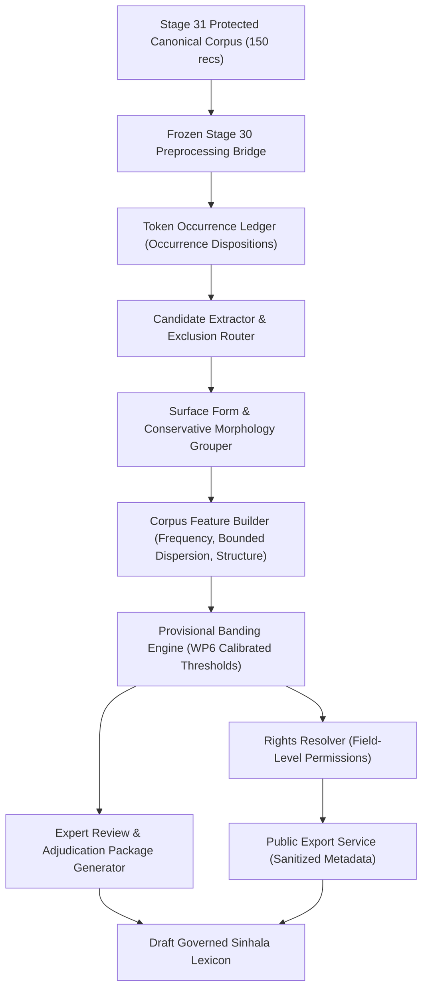

# Stage 32 Implementation Plan — Sinhala Child-Vocabulary Lexicon Construction

**Project:** AI-Powered Adaptive Child-Friendly Language Simplification System  
**Component:** Component 3 — AI/NLP-Based Language Simplification  
**Scope:** Sinhala (`si`, `si-LK`, script `Sinh`) candidate-vocabulary extraction, lexical evidence, provisional vocabulary bands, and expert-review preparation for children aged 4–8  
**Status:** APPROVED FOR IMPLEMENTATION — WP0 PREREQUISITE GATE REQUIRED  
**Authoritative prerequisite:** `stage-31-complete-v8` at commit `9096cfbf5d6e237c388e6c306dc12f13023875ba`  
**Implementation branch:** `feature/stage32-sinhala-lexicon`  
**Planned start tag:** `stage-32-start`  
**Planned completion tag:** `stage-32-complete`

---

## 1. Purpose & Strategic Scope

Stage 32 constructs a governed Sinhala child-vocabulary **candidate lexicon** derived deterministically from the authoritative Stage 31 pilot corpus. It extracts lexical candidates, preserves exact observed surface forms and multi-source provenance, computes reproducible corpus statistics, derives non-clinical technical features, and assigns provisional vocabulary bands for later human expert assessment.

The output is an unvalidated candidate lexicon for expert review. Frequency, word length, morphology, or automated model scores must never be treated as proof that a word is understood by, suitable for, or safe for children aged 4–8.

### Primary Outcomes

1. **Deterministic Lexicon Extraction Pipeline:** Built upon the sealed Stage 30 grapheme-safe tokenizer and the Stage 31 canonical corpus.
2. **Canonical Entry Model:** Multi-tier separation between normalized form, observed surface forms, candidate lemma hypotheses, morphological families, and source provenance.
3. **Exact Frequency & Document Denominators:** Primary unweighted statistics derived strictly from the **150 canonical analytical records**.
4. **Weighted Provenance Parity Analysis:** Complete parity diagnostic across the **180 provenance-preserving records** using frozen cluster-normalized weights ($w_i = 1/|c|$), verifying that no frequency inflation was detected under the frozen exact-duplicate clusters, weights, canonical mappings, and declared numerical tolerance.
5. **Governed Exclusion & Quality Routing:** Deterministic classification of proper nouns, numbers, symbols, mixed-script tokens, OCR/segmentation artifacts, and sensitive vocabulary with separate occurrence-level and entry-level disposition contracts.
6. **Provisional Automated Vocabulary Bands:** Technical workflow bands with explicit rule evidence, confidence scores, tie-break rules, and uncertainty—not validated child acquisition age.
7. **Expert-Review & Adjudication Package:** Formal schemas and stratified review queues supporting independent review, cross-reviewer isolation, disagreement reconciliation, and adjudication fields without fabricated reviews.
8. **Reproducibility, Accounting & Dual Manifest Integrity:** End-to-end zero-unaccounted reconciliation and cryptographic checksum sealing for both documentation and implementation manifests.

---

## 2. Stage Boundaries

### 2.1 Included in Stage 32

- Verifying Stage 31 v8 ancestry (`9096cfbf5d6e237c388e6c306dc12f13023875ba`), configuration hashes, and corpus-ledger consistency.
- Reading the Stage 31 canonical analytical corpus through abstract protected storage references (`protected://sinhala_external/...`).
- Using the 150-record canonical view for all primary unweighted lexical statistics.
- Using the 180-record provenance view only with frozen cluster-normalized weights for parity auditing.
- Extracting Sinhala lexical candidates from Stage 30 tokens without altering Stage 30 normalization or tokenization.
- Preserving observed surface forms and source/document provenance with lossless occurrence tracking and explicit zero-based half-open code-point offsets.
- Generating candidate lemma hypotheses with explicit confidence scores, rule IDs, rule versions, and review referral flags.
- Computing frequency, document frequency, source coverage, bounded source dispersion, grapheme, code-point, and syllable-proxy features.
- Detecting potential proper nouns, abbreviations, numbers, mixed-script forms, OCR artifacts, and unsafe/sensitive candidates.
- Assigning provisional automated vocabulary bands based on multi-dimensional technical criteria with explicit tie-break and review routing.
- Preparing controlled expert-review, disagreement reconciliation, and adjudication schemas.
- Producing protected internal lexicon artifacts and sanitized public governance exports adhering to field-level rights and privacy policies.

### 2.2 Explicitly Excluded from Stage 32

- Claiming that automated bands are developmentally valid, comprehensible, or calibrated for children aged 4–8.
- Publishing a child-approved or classroom-ready Sinhala lexicon.
- Creating Sinhala simplification transformations or rewrite rules (strictly deferred to **Stage 33**).
- Conducting completed human linguistic/child-development validation (strictly deferred to **Stage 34**).
- Training, fine-tuning, or evaluating machine learning / language models.
- Generating synthetic words, definitions, example sentences, or simplification pairs and presenting them as human-authored evidence.
- Treating corpus frequency as familiarity, acquisition age, readability, or clinical evidence.
- Inferring DLD status, clinical severity, diagnosis, or individual learner ability.
- Modifying Stage 30 or Stage 31 governed artifacts, code, or configurations.
- Redistributing restricted source text, reconstructable passages, or sentence concordances in public exports.

---

## 3. Mandatory Governance Invariants

1. **Prerequisite Integrity:** Stage 32 must branch from `stage-31-complete-v8` only after Stage 31 corpus, split, development, duplicate, near-duplicate, and rights ledgers reconcile with zero discrepancy.
2. **Canonical Analytical Denominator:** Primary unweighted statistics use exactly the 150 canonical analytical records. The 180-record provenance view may be used only with the sealed duplicate weights.
3. **No Frequency Inflation:** Surplus exact-duplicate instances (30 records) must never increase unweighted analytical frequency, document frequency, dispersion, or evaluation confidence.
4. **Frozen Preprocessing:** Stage 30 normalization, segmentation, and tokenization remain frozen and immutable. Stage 32 consumes outputs through a versioned bridge.
5. **Surface-Form Preservation:** Observed surface forms are retained separately from candidate lemmas. Lemmatization must not overwrite empirical evidence.
6. **No Invented Linguistic Certainty:** Automated stemming, lemma grouping, morphology, syllable counts, meanings, and age bands carry method, confidence, and review status.
7. **Versioned Rights Inheritance:** Every entry inherits the rights profiles of all contributing Stage 31 sources using version-pinned references (`source_id`, `rights_profile_id`, `rights_profile_version`). Public artifacts obey field-level rights resolutions.
8. **Protected Evidence:** Restricted tokens, contexts, concordance lines, and source text remain in external protected storage (`protected://sinhala_lexicon/...`).
9. **Privacy & Content Protection:** Public exports may contain approved standalone canonical lexical forms when the field-level rights and privacy policy permits them. They must contain zero restricted contexts, concordance passages, reconstructable sequences, personal data, or protected source text. Public occurrence identifiers use keyed HMAC digests with domain separation—never raw sensitive text or guessable unkeyed SHA-256 hashes of short phrases.
10. **Independent Dimensions:** Frequency, structural complexity, provisional familiarity, ambiguity, safety, and pedagogical usefulness are stored separately and must not be collapsed into one unexplained composite score.
11. **Fail-Closed Review Routing:** Ambiguous, malformed, sensitive, unsupported-script, low-confidence candidates, or ties between provisional band rules route to `REVIEW_REQUIRED`.
12. **No Child Approval:** Every entry defaults to draft status requiring human expert validation.
13. **No Clinical Coupling:** Lexicon evidence must not read or modify `screening_risk_level` or any individual child profile.
14. **Zero-Loss Independent Accounting:** Every token occurrence receives an occurrence disposition, and every extracted candidate receives an entry disposition. Both accounting equations reconcile independently with zero unaccounted units.
15. **Historical Tag Immutability:** Earlier Stage 26–31 tags must never be moved; corrections receive versioned Stage 32 tags.

### Default Governance State Contract

```json
{
  "validation_status": "draft",
  "expert_validated": false,
  "research_eligible": false,
  "approved_for_child_delivery": false,
  "approved_for_unsupervised_child_delivery": false,
  "requires_expert_review": true
}
```

---

## 4. Evidence Populations & Mathematical Denominators

| Population | Size | Permitted Stage 32 Purpose |
|---|---:|---|
| Canonical analytical corpus | 150 records | Primary unweighted frequency, document frequency, dispersion, candidate extraction, and feature analysis |
| Provenance-preserving corpus | 180 records | Provenance and source/tier audit; weighted parity analysis only |
| Surplus exact-duplicate instances | 30 records | Provenance preservation only; strictly zero unweighted analytical inflation |
| Public literal-text view | Rights-dependent | Publication checks only; not the analytical source of truth |
| Stage 31 ingestion-development population | TO_BE_RESOLVED_BY_WP0 | Historical Stage 31 audit only; prohibited from automatic Stage 32 calibration use |
| Stage 32 Band calibration subset | Predeclared in WP6 | Proposal threshold calibration from training split groups only |
| Validation/locked-test groups | As frozen by Stage 31 | May be measured after policy freeze; must never enter Stage 32 threshold calibration |

### Duplicate Weighting & Parity Formulation

For provenance record $i$ belonging to exact duplicate cluster $c$:

$$w_i = \frac{1}{|c|}$$

The weighted provenance frequency for candidate term $t$ across all records is:

$$f_w(t) = \sum_{i=1}^{180} w_i \cdot \mathrm{count}(t, i)$$

The canonical unweighted statistics remain the authoritative primary values:

$$f_{\mathrm{canonical}}(t) = \sum_{j=1}^{150} \mathrm{count}(t, j)$$

Parity check tolerance: $|f_w(t) - f_{\mathrm{canonical}}(t)| < 10^{-6}$.

The weighted parity analysis verifies that no frequency inflation was detected under the frozen exact-duplicate clusters, weights, canonical mappings, and declared numerical tolerance. The parity requirement is valid only if every provenance member maps correctly to its canonical exact-text representative.

The parity verifier must explicitly report:
- Total provenance records (180)
- Total canonical analytical records (150)
- Total exact duplicate clusters
- Invalid or missing duplicate weights (must be 0)
- Canonical mapping failures (must be 0)
- Per-term parity failures (must be 0)
- Maximum absolute delta observed
- Declared numerical tolerance ($10^{-6}$)

---

## 5. Target Architecture



---

## 6. Repository Structure & Artifact Layout

```text
backend/app/datasets/sinhala_lexicon/
├── __init__.py
├── enums.py
├── schemas.py
├── corpus_bridge.py
├── candidate_extractor.py
├── occurrence_ledger.py
├── surface_form_grouper.py
├── morphology_analyzer.py
├── feature_builder.py
├── banding.py
├── quality_router.py
├── rights_resolver.py
├── review_service.py
└── export_service.py

backend/tests/datasets/sinhala_lexicon/
├── test_stage32_ancestry_contract.py
├── test_stage31_corpus_bridge.py
├── test_canonical_frequency_accounting.py
├── test_weighted_provenance_parity.py
├── test_candidate_extraction.py
├── test_surface_form_preservation.py
├── test_morphology_uncertainty.py
├── test_proper_noun_policy.py
├── test_mixed_script_policy.py
├── test_feature_independence.py
├── test_provisional_banding.py
├── test_rights_inheritance.py
├── test_review_workflow.py
├── test_public_export_safety.py
├── test_stage32_accounting.py
└── test_stage32_determinism.py

data/sinhala_lexicon/
├── registry/
│   ├── stage32_configuration.json
│   ├── feature_registry.json
│   ├── exclusion_policy.json
│   ├── provisional_band_policy.json
│   └── review_rubric.json
├── ledgers/
│   ├── corpus_identity_ledger.json
│   ├── token_occurrence_ledger.jsonl
│   ├── candidate_entry_ledger.jsonl
│   ├── surface_form_mapping.jsonl
│   └── rights_inheritance_ledger.jsonl
├── lexicon/
│   ├── draft_lexicon.jsonl
│   ├── review_queue.jsonl
│   └── public_metadata_export.jsonl
└── manifests/
    └── stage32_implementation_manifest.sha256

scripts/stage32/
├── snapshot_prerequisites.py
├── verify_stage31_corpus_contract.py
├── extract_candidates.py
├── build_frequency_ledger.py
├── generate_review_package.py
├── generate_stage32_reports.py
├── verify_stage32_accounting.py
├── generate_stage32_manifest.py
└── verify_stage32_manifest.py
```

---

## 7. Core Data Contracts (Pydantic v2)

### 7.1 Lexicon Candidate Entry (`CandidateLexiconEntry`)

```json
{
  "entry_id": "SI-LEX-000001",
  "language": "si",
  "locale": "si-LK",
  "script": "Sinh",
  "canonical_form": "ළමයා",
  "candidate_lemma": "ළමයා",
  "lemma_method": "rule_based_v1",
  "lemma_confidence": 0.95,
  "surface_forms": [
    {
      "surface_form": "ළමයා",
      "canonical_frequency": 12,
      "canonical_document_frequency": 8,
      "weighted_provenance_frequency": 12.0
    },
    {
      "surface_form": "ළමයින්",
      "canonical_frequency": 5,
      "canonical_document_frequency": 4,
      "weighted_provenance_frequency": 5.0
    }
  ],
  "token_class": "SINHALA_WORD",
  "grapheme_count": 5,
  "code_point_count": 7,
  "syllable_proxy_count": 3,
  "morphology_hypotheses": [
    {
      "rule_id": "NOUN_INFLECTION_PLURAL",
      "rule_version": "1.0.0",
      "base_form": "ළමයා",
      "inflected_form": "ළමයින්",
      "confidence": 0.90,
      "linguistic_note": "Illustrative rule-based morphology hypothesis; not expert-validated linguistic evidence."
    }
  ],
  "raw_frequency": 17,
  "canonical_frequency": 17,
  "relative_frequency_per_million": 536.97,
  "document_frequency": 10,
  "canonical_document_frequency": 10,
  "document_prevalence": 0.066667,
  "frequency_denominator_tokens": 31659,
  "document_denominator": 150,
  "weighted_provenance_frequency": 17.0,
  "source_count": 3,
  "source_frequency_distribution": {
    "SRC-SI-001": 10,
    "SRC-SI-002": 5,
    "SRC-SI-003": 2
  },
  "eligible_source_count": 5,
  "observed_source_count": 3,
  "source_dispersion": 0.574,
  "dispersion_formula_version": "fixed_k_entropy_v1",
  "provisional_band": "FOUNDATIONAL_CANDIDATE",
  "band_confidence": 0.88,
  "band_evidence": ["high_canonical_frequency", "wide_source_dispersion", "low_complexity"],
  "quality_flags": [],
  "rights_profile_refs": [
    {
      "source_id": "SRC-SI-001",
      "rights_profile_id": "RP-SRC-SI-001",
      "rights_profile_version": 1
    },
    {
      "source_id": "SRC-SI-002",
      "rights_profile_id": "RP-SRC-SI-002",
      "rights_profile_version": 2
    },
    {
      "source_id": "SRC-SI-003",
      "rights_profile_id": "RP-SRC-SI-003",
      "rights_profile_version": 1
    }
  ],
  "field_export_policies": {
    "canonical_form": "REVIEW_REQUIRED_FIELD_LEVEL_DETERMINATION",
    "frequency_statistics": "PUBLIC_PERMITTED_AGGREGATE",
    "definitions": "RESTRICTED_PROTECTED_INTERNAL",
    "concordance_contexts": "RESTRICTED_PROTECTED_INTERNAL"
  },
  "export_policy_decision_id": null,
  "export_policy_evidence_status": "PENDING",
  "terminal_entry_disposition": "ACCEPTED_DRAFT_LEXICON_ENTRY",
  "validation_status": "draft",
  "expert_validated": false,
  "research_eligible": false,
  "approved_for_child_delivery": false,
  "approved_for_unsupervised_child_delivery": false,
  "requires_expert_review": true
}
```

*Note on dispersion calculation:* For candidate distribution $f = (10, 5, 2, 0, 0)$ across $K=5$ eligible sources ($N=17$), $p = (\frac{10}{17}, \frac{5}{17}, \frac{2}{17}, 0, 0)$ yielding $D_s = -\frac{\sum p_s \ln p_s}{\ln 5} \approx 0.574$. Programmatically calculated full-precision values are used in implementation fixtures rather than manually rounded values.

*Note on illustrative linguistic examples:* The example base-plural relationship (`ළමයා` $\rightarrow$ `ළමයින්`) is provided strictly for schema structure illustration. It must not be cited or treated as expert-validated linguistic ground truth.

### 7.2 Token Occurrence Record (`TokenOccurrenceRecord`)

```json
{
  "occurrence_id": "SI-OCC-00000001",
  "entry_id": "SI-LEX-000001",
  "canonical_record_id": "SI-PILOT-000001",
  "provenance_record_id": "SI-PILOT-000001",
  "source_id": "SRC-SI-001",
  "split_group_id": "SPLIT-GRP-SI-000001",
  "token_index": 3,
  "normalized_start_code_point": 14,
  "normalized_end_code_point": 19,
  "offset_interval": "zero_based_half_open",
  "surface_form_hmac": null,
  "hmac_key_id": "HMAC-2026-V1",
  "hmac_scheme_version": "v1",
  "hmac_message_encoding": "RFC8785_CANONICAL_JSON",
  "hmac_domain": "sinhala-lexicon-surface-form",
  "context_storage_ref": "protected://sinhala_lexicon/contexts/SI-OCC-00000001.json",
  "token_text_storage_ref": "protected://sinhala_lexicon/tokens/SI-OCC-00000001.txt",
  "exact_duplicate_weight": 1.0,
  "rights_profile_id": "RP-SRC-SI-001",
  "rights_profile_version": 1,
  "stage30_configuration_hash": "00d89c260f75de67ed92b4c1dcc6d8b69be401104bf09452ba23ba667a30c454",
  "stage31_configuration_hash": "53aa0a8aa7ccc226f17107a18ee024dd85e71ad5776388650ee973a60bc1ef40",
  "corpus_artifact_sha256": null,
  "occurrence_disposition": "INCLUDED_CANDIDATE_OCCURRENCE"
}
```

*Note on corpus artifact hash:* `corpus_artifact_sha256` remains `null` in model schemas until populated at runtime with the verified 64-character SHA-256 digest of the ingested corpus artifact.

### 7.3 Surface Form Mapping Record (`SurfaceFormMappingRecord`)

```json
{
  "surface_form": "ළමයින්",
  "canonical_form": "ළමයා",
  "entry_id": "SI-LEX-000001",
  "morphology_rule_id": "NOUN_INFLECTION_PLURAL",
  "rule_version": "1.0.0",
  "mapping_confidence": 0.90,
  "is_base_form": false,
  "canonical_frequency": 5,
  "canonical_document_frequency": 4,
  "weighted_provenance_frequency": 5.0
}
```

### 7.4 Expert Review Record (`LexiconExpertReviewRecord`)

```json
{
  "entry_id": "SI-LEX-000001",
  "reviewer_id": null,
  "reviewer_role": "sinhala_linguist_or_early_childhood_language_expert",
  "independent_review_round": 1,
  "lemma_decision": "NOT_REVIEWED",
  "age_band_decision": "NOT_REVIEWED",
  "meaning_review_status": "NOT_REVIEWED",
  "safety_status": "NOT_REVIEWED",
  "comments_storage_ref": null,
  "reviewed_at": null
}
```

*Integrity Invariant:* A schema validator must enforce that `reviewed_at` cannot be populated if `reviewer_id` is null or if all decisions remain `NOT_REVIEWED`.

---

## 8. Candidate Extraction & Orthography Policy

### 8.1 Included Token Candidates
- Stage 30 `SINHALA_WORD` tokens passing Stage 31 governance gates.
- Joiner-containing sequences preserved in Stage 30 allowlisted fixture contexts may continue to candidate extraction. Unexpected joiner contexts remain preserved in evidence and route to manual review. **NFC status does not establish Sinhala orthographic validity.**
- Inflected surface variants retained losslessly under parent entry models.

### 8.2 Routed to Manual Review (`MANUAL_REVIEW_OCCURRENCE` / `MANUAL_REVIEW_REQUIRED`)
- Mixed-script tokens (`MIXED_SCRIPT_TOKEN`) requiring bilingual/etymological disambiguation.
- Low-confidence lemma assignments ($\text{confidence} < 0.70$).
- Potential proper names and named entities (infrequent words occurring solely in initial/title positions).
- High-uncertainty OCR or tokenization edge-cases.
- Age-sensitive or clinical vocabulary.

### 8.3 Excluded from Vocabulary Candidates
- Pure punctuation and symbols (`PUNCTUATION`, `SYMBOL`).
- Standalone numeric tokens (`ARABIC_NUMBER`, `SINHALA_NUMBER`).
- Web URLs, emails, handles, and code fragments.
- Tokens rejected by Stage 30 or Stage 31.
- Tokens with zero lexical relevance. Every excluded token retains a documented exclusion reason code for zero-loss occurrence accounting.

---

## 9. Surface Forms, Lemmas & Morphology Policy

1. **Surface Evidence Preservation:** Observed surface strings are never overwritten or discarded by lemmatization.
2. **Explicit Morphological Hypotheses:** Every grouping edge stores `rule_id`, `rule_version`, confidence score, and supporting token occurrences.
3. **Conservative Morphology & Affix Stripping:** Automated affix stripping and compounding rules must fail closed: if multiple base interpretations exist, the token is flagged for expert review.
4. **Homograph Distinctions:** Form identity does not collapse multiple semantic meanings. Meaning senses remain separate reviewable fields.

---

## 10. Feature Registry & Mathematical Definitions

### 10.1 Corpus Evidence Features
- **Canonical Token Frequency ($f_c$):** Raw occurrence count within the 150 canonical analytical records.
- **Canonical Document Frequency ($df_c$):** Number of distinct canonical records containing the candidate ($1 \le df_c \le 150$).
- **Entry-Level Document Frequency ($df_{\text{entry}}$):** Defined strictly as the cardinality of the union of documents containing any grouped surface form:
  $$df_{\text{entry}} = \left| \bigcup_{v \in \text{surface forms}} \text{Documents}(v) \right|$$
  It must not be calculated by summing surface-form document frequencies because the same document may contain multiple variants.
- **Relative Frequency per Million Eligible Tokens ($RF$):** Denominator-normalized frequency per million tokens:
  $$RF(t) = \frac{\operatorname{count}(t)}{\text{total eligible tokens}} \times 10^6$$
- **Document Prevalence ($DP$):** Normalized proportion of documents containing candidate $t$:
  $$DP(t) = \frac{\text{documents containing } t}{\text{total documents}}$$
- **Denominator-Comparable Metric Standard:** Calibration and evaluation use identically defined denominator-normalized features ($RF, DP, D_s$). Raw counts ($f_c, df_c$) are reported descriptively and are not compared mechanically across unequal partitions.
- **Weighted Provenance Frequency ($f_w$):** Sum of cluster-weighted occurrences over the 180 provenance records.
- **Eligible Source Count ($K$):** Fixed count of all approved, distinct Stage 31 sources contributing to the canonical corpus ($K \ge 1$).
- **Observed Source Count ($k_{\mathrm{obs}}$):** Number of distinct sources where $f_s > 0$.
- **Source-Dispersion Formula ($D_s$):**
  Using the fixed number of eligible corpus sources $K$:
  $$D_s = \begin{cases} -\dfrac{\sum_{s=1}^{K} p_s \ln(p_s)}{\ln(K)}, & K > 1 \\ 0, & K \le 1 \end{cases}$$
  where zero-probability terms ($p_s = 0$) contribute 0, and:
  $$p_s = \frac{f_s}{\sum_{j=1}^{K} f_j}$$
  The registry records:
  - `eligible_source_count`: $K$
  - `observed_source_count`: $k_{\mathrm{obs}}$
  - `dispersion_formula_version`: `fixed_k_entropy_v1`
  - `frequency_basis`: `canonical`

### 10.2 Structural Features
- **UTF-8 Byte Count ($B$):** Encoded byte length of normalized canonical form.
- **Unicode Code-Point Count ($C$):** Code point length.
- **Extended Grapheme Cluster Count ($G$):** Segmented via Stage 30 pinned regex grapheme engine.
- **Syllable-Proxy Count ($S_p$):** Rule-based approximation based on vowel markers and virama clusters, explicitly documented as a heuristic proxy.
- **Feature Independence:** Structural features, frequency features, and safety flags are preserved independently without ad-hoc single-score blending.

---

## 11. Provisional Vocabulary Banding Policy

### 11.1 Proposed Starting Thresholds (Not Yet Calibrated)

The following thresholds represent proposed workflow initializations and are explicitly designated `PROPOSED_STARTING_THRESHOLDS_NOT_YET_CALIBRATED`:

| Provisional Band | Proposed Criteria / Thresholds (`PROPOSED_STARTING_THRESHOLDS_NOT_YET_CALIBRATED`) |
|---|---|
| `FOUNDATIONAL_CANDIDATE` | High relative frequency ($RF \ge 450.0$ per million; descriptive $f_c \ge 15$), high document prevalence ($DP \ge 0.05$; descriptive $df_c \ge 8$), wide dispersion ($D_s \ge 0.50$), low complexity ($G \le 5$), zero quality flags |
| `EARLY_CANDIDATE` | Moderate-high relative frequency ($250.0 \le RF < 450.0$; descriptive $8 \le f_c < 15$), $DP \ge 0.03$, $D_s \ge 0.40$, short-to-medium length ($G \le 7$) |
| `DEVELOPING_CANDIDATE` | Moderate relative frequency ($90.0 \le RF < 250.0$; descriptive $3 \le f_c < 8$), standard child/educational domain coverage |
| `ADVANCED_CANDIDATE` | Low relative frequency ($RF < 90.0$; descriptive $f_c \le 2$), or complex multi-affix / high syllable count ($S_p \ge 4$) |
| `SPECIALIZED_OR_PROPER_CANDIDATE` | Suspected proper noun or domain-specific technical terminology |
| `REVIEW_REQUIRED` | Ambiguous morphology, sensitive flag, low automated confidence, or tie between rules |
| `EXCLUDED_NON_LEXICAL` | Non-lexical tokens, symbols, or malformed OCR artifacts |

*Denominator Comparability Protocol:* Calibration and evaluation use identically defined denominator-normalized features ($RF, DP, D_s$). Raw counts are reported descriptively and are not compared mechanically across unequal partitions.

### 11.2 Calibration Protocol & Feature Leakage Prevention in WP6

To prevent validation and locked-test information from indirectly entering calibration, the following protocol is frozen:
1. **Train-Only Group Selection:** Select Stage 32 development groups exclusively from Stage 31 training split groups (`split == "train"`).
2. **Partition-Local Calibration Features:** During calibration, compute frequency, document frequency, dispersion, morphology distributions, and thresholds using **only** the Stage 32 development subset.
3. **Configuration Freeze:** Freeze the configuration hash (`stage32_configuration_sha256`) and thresholds prior to any evaluation on untouched records.
4. **Independent Partition-Local Evaluation:** Compute evaluation features independently within each untouched evaluation population (validation and locked-test groups).
5. **No Retrospective Revision:** Do not recompute or revise thresholds after viewing validation or locked-test results.
6. **Separate Full-Corpus Descriptive Features:** After evaluation is sealed, compute final full-corpus descriptive features separately across all 150 canonical records.
7. **Tie-Break Governance:** If a candidate matches multiple band rules with equal precedence, it must route to `REVIEW_REQUIRED`.

Explicit feature scope contract in entry schemas:
```json
{
  "calibration_feature_scope": "stage32_development_train_groups_only",
  "evaluation_feature_scope": "partition_local_untouched_groups",
  "final_descriptive_feature_scope": "canonical_analytical_corpus_150",
  "threshold_configuration_frozen_before_evaluation": true
}
```

*Governance Rule:* The full-corpus descriptive lexicon may use all 150 records, but those values must never be presented as independent locked-test performance.

*Mandatory Disclaimer:* Provisional automated bands support expert review prioritization only. They do not establish child age-of-acquisition, comprehension, developmental suitability, or classroom approval.

---

## 12. Rights Resolution & Export Safety

1. **Version-Pinned Rights Inheritance:** Every entry records contributing source rights:
   ```json
   "rights_profile_refs": [
     {
       "source_id": "SRC-SI-001",
       "rights_profile_id": "RP-SRC-SI-001",
       "rights_profile_version": 1
     }
   ]
   ```
2. **Field-Level Export Permission:** Permissions are resolved per field:
   - Standalone canonical lexical forms: A standalone canonical lexical form may be publicly exposed only when the field-level policy confirms that public literal or derived-text redistribution is permitted, or when an independently documented legal/governance determination establishes that the isolated lexical form is not restricted. `derived_processing_allowed` alone is insufficient.
   - Aggregate statistics (frequency, dispersion): Public permitted.
   - Context sentences, definitions, concordances: Restricted to external protected storage (`protected://sinhala_lexicon/...`).
3. **Public Export Policy Definition:**
   Public exports may contain approved standalone canonical lexical forms when the field-level rights and privacy policy permits them. They must contain zero restricted contexts, concordance passages, reconstructable sequences, personal data, or protected source text. If metadata-only publication is required, the canonical form is set to null and only opaque IDs and aggregate features are exposed.
4. **Keyed HMAC Domain Separation & Canonical JSON Encoding:**
   Public occurrence identifiers use keyed HMAC digests with unambiguous canonical JSON encoding (RFC 8785 Canonical JSON) rather than raw concatenation:
   ```python
   message = canonical_json_bytes({
       "domain": "sinhala-lexicon-surface-form",
       "version": 1,
       "occurrence_id": occurrence_id,
       "surface_form": surface_form,
   })
   digest = hmac_sha256(secret_key, message)
   ```
   Occurrence schema declaration:
   ```json
   {
     "surface_form_hmac": null,
     "hmac_key_id": "HMAC-2026-V1",
     "hmac_scheme_version": "v1",
     "hmac_message_encoding": "RFC8785_CANONICAL_JSON",
     "hmac_domain": "sinhala-lexicon-surface-form"
   }
   ```
   `surface_form_hmac` is set to `null` in model schemas and populated exclusively during runtime execution using the protected server-side key.

---

## 13. Expert Review & Adjudication Protocol

1. **Independent First-Round Review:** Independent assessments with cross-reviewer isolation.
2. **Pseudonymous Reviewer IDs:** Analytical records store opaque reviewer IDs (`REV-EXP-01`).
3. **Structured Review Dimensions:** Lemma correctness, surface grouping, sense distinction, age appropriateness, safety/cultural sensitivity, and simpler alternative proposals.
4. **Formal Disagreement Routing:** Disagreements route to an authorized Lead Adjudicator.
5. **Zero Fabricated Reviews:** Review fields remain unpopulated (`null` / `NOT_REVIEWED`) until formal expert review execution in Stage 34.

---

## 14. Terminal Dispositions (Independent Occurrence & Entry Contracts)

Stage 32 separates occurrence-level accounting from candidate entry-level accounting.

### 14.1 Occurrence Dispositions (`OccurrenceDisposition`)
Every token occurrence observed in the canonical analytical corpus receives exactly one terminal occurrence disposition:
```text
REJECTED_PRIVACY_OR_SECURITY
→ REJECTED_INVALID_SOURCE_EVIDENCE
→ EXCLUDED_TOKEN_CLASS
→ MANUAL_REVIEW_OCCURRENCE
→ INCLUDED_CANDIDATE_OCCURRENCE
```

### 14.2 Entry Dispositions (`TerminalEntryDisposition`)
Every extracted candidate entry receives exactly one terminal entry disposition:
```text
REJECTED_PRIVACY_OR_SECURITY
→ REJECTED_INVALID_SOURCE_EVIDENCE
→ EXCLUDED_NON_LEXICAL
→ EXCLUDED_NON_SINHALA
→ MANUAL_REVIEW_REQUIRED
→ ACCEPTED_DRAFT_LEXICON_ENTRY
```

---

## 15. Implementation Work Packages

### WP0: Prerequisite, Ancestry, and Baseline Verification
- Verify `stage-31-complete-v8^{commit}` equals `9096cfbf5d6e237c388e6c306dc12f13023875ba`.
- Verify Stage 30 v3 and Stage 29 v2 remain intact in ancestry.
- Reconcile Stage 31 corpus metadata, canonical corpus (150 records), and provenance corpus (180 records).
- **Comprehensive Ledger Verification:** Verify all Stage 31 governed ledgers with zero discrepancy:
  - Split manifest and group partition ledger (`split_manifest.json`)
  - Ingestion development ledger (`development_sample_ledger.json`)
  - Exact-duplicate cluster and weight ledger (`exact_duplicate_ledger.json`)
  - Near-duplicate cluster ledger (`near_duplicate_ledger.json`)
  - Version-pinned rights profile ledger (`rights_profile_ledger.json`)
  - Canonical analytical record mapping ledger (`canonical_mapping_ledger.json`)
  - Stage 31 configuration ledgers and configuration hashes
- **WP0 Abort Gate:** Stage 32 execution must abort if the Stage 31 development ledger, split manifest, corpus metadata, or generated pilot-corpus report disagree on development-population membership or counts.
- WP0 must explicitly report:
  - Total development records/units.
  - Whether they are inside or outside the 180-record corpus.
  - Their record IDs and `split_group_id` values.
  - Their split membership.
  - The relevant artifact hashes.
- Create branch `feature/stage32-sinhala-lexicon` from the prerequisite commit.
- Tag annotated `stage-32-start` on the unchanged prerequisite commit.
- Execute full baseline test suite (backend & frontend).

### WP1: Lexicon Governance & Schema Freeze
- Define Pydantic v2 schemas: `CandidateLexiconEntry`, `TokenOccurrenceRecord`, `SurfaceFormRecord`, `MorphologyHypothesis`, `LexiconExpertReviewRecord`.
- Separate `OccurrenceDisposition` from `TerminalEntryDisposition`.
- Define explicit zero-based half-open code-point offset fields: `normalized_start_code_point`, `normalized_end_code_point`, `offset_interval`.
- Freeze field-level export policies and version-pinned rights references.
- Produce `docs/stage32_lexicon_governance_and_schema.md`.

### WP2: Stage 31 Corpus Bridge & Occurrence Ledger
- Implement `Stage31CorpusBridge` to ingest protected canonical records.
- Emit deterministic `TokenOccurrenceRecord` items with explicit code-point spans and record provenance.
- Include `canonical_record_id`, `stage30_configuration_hash`, `stage31_configuration_hash`, and corpus artifact hashes in the occurrence ledger.
- Produce `docs/stage32_corpus_and_frequency_protocol.md`.

### WP3: Candidate Extraction & Exclusion Routing
- Implement `CandidateExtractor` applying frozen Stage 30 token classification rules.
- Route punctuation, numbers, identifiers, mixed-script, and OCR noise with explicit exclusion codes.
- Ensure deterministic entry ID generation (`SI-LEX-XXXXXX`).

### WP4: Surface-Form Grouping & Morphology Hypotheses
- Implement `SurfaceFormGrouper` to track observed surface forms under entries losslessly.
- Implement `MorphologyAnalyzer` generating rule-based candidate lemmas with `rule_id`, `rule_version`, and confidence scoring.
- Route low-confidence assignments and multi-rule ties to `MANUAL_REVIEW_REQUIRED`.
- Produce `docs/stage32_morphology_and_surface_form_policy.md`.

### WP5: Canonical Statistics & Weighted Provenance Parity
- Compute canonical token frequency ($f_c$), document frequency ($df_c$), source frequency distribution, and bounded source dispersion ($D_s$) over 150 records.
- Execute parity check over 180 records using exact duplicate weights $w_i = 1/|c|$.
- Verify that no frequency inflation was detected under the frozen exact-duplicate clusters, weights, canonical mappings, and declared numerical tolerance ($10^{-6}$).
- Report all eight required parity diagnostic fields.

### WP6: Feature Construction & Provisional Banding
- Implement `FeatureBuilder` for grapheme, code-point, byte, and syllable-proxy features, as well as denominator-normalized frequency ($RF$) and document prevalence ($DP$).
- **Denominator Comparability Protocol:** Calibration and evaluation use identically defined denominator-normalized features ($RF, DP, D_s$). Raw counts are reported descriptively and are not compared mechanically across unequal partitions.
- Enforce strict feature leakage prevention:
  1. Select Stage 32 development groups exclusively from Stage 31 train groups (`split == "train"`), recording seed (`42`) and group IDs. Ensure zero validation/locked-test contamination.
  2. Compute frequency, document frequency, dispersion, morphology distributions, and band thresholds using only the Stage 32 development subset.
  3. Freeze configuration hash `stage32_configuration_sha256`.
  4. Compute evaluation features independently within each untouched evaluation population (validation and locked-test groups) without threshold revision.
  5. Compute final full-corpus descriptive features across the 150 canonical records separately, clearly scoped and not presented as independent test performance.
- Route provisional band ties to `REVIEW_REQUIRED`.
- Produce `docs/stage32_provisional_banding_protocol.md`.

### WP7: Rights Resolution & Safe Public Exports
- Aggregate contributing source rights with pinned versions per entry.
- Implement `ExportService` generating sanitized public metadata exports (`public_metadata_export.jsonl`) with field-level permissions.
- Verify zero restricted passages or reconstructable text in public exports.
- Compute runtime HMAC digests using protected server-side key and domain separation.
- Produce `docs/stage32_rights_and_export_report.md`.

### WP8: Expert Review & Adjudication Package Preparation
- Generate stratified review queues across frequency bands and quality flags.
- Package review schemas and rubrics ensuring cross-reviewer isolation.
- Verify review fields remain unpopulated without fabricated reviews.
- Produce `docs/stage32_expert_review_readiness.md`.

### WP9: Evaluation, Error Analysis & Accounting Reconciliation
- Evaluate deterministic extraction fixtures and analyze morphological over/under-grouping.
- Reconcile independent occurrence-level and entry-level accounting equations with zero unaccounted units.
- Produce `docs/stage32_lexicon_evaluation_report.md`, `docs/stage32_error_analysis.md`, and `docs/stage32_accounting_summary.md`.

### WP10: Regression Testing, Manifest Sealing & Completion Tagging
- Execute complete Stage 32 test suite and full backend regression suite.
  - Test gate: All tests pass with zero failures. Warnings are captured, classified, compared with baseline, and reviewed. No new unapproved warning category is introduced.
- Execute frontend regression tests and production build.
- Distinguish and generate both manifests:
  - `docs/stage32_manifest.sha256` for the 12 controlled documentation files.
  - `data/sinhala_lexicon/manifests/stage32_implementation_manifest.sha256` for governed implementation/data artifacts.
  - Both manifests strictly exclude themselves.
- Execute read-only manifest verification and negative tamper testing on both manifests.
- Commit all deliverables and create immutable annotated tag `stage-32-complete`.

---

## 16. Exact Accounting Equations

### 16.1 Corpus-Level Accounting
$$\text{ExpectedCanonicalRecords (150)} = \text{Processed} + \text{Blocked} + \text{Failed} + \text{Unaccounted}$$
$$\text{Target: } \text{Unaccounted} = 0$$

### 16.2 Token Occurrence Accounting
$$\text{TotalTokens} = \text{IncludedCandidateOccurrences} + \text{ManualReviewOccurrences} + \text{ExcludedTokenClass} + \text{RejectedOccurrences} + \text{Unaccounted}$$
$$\text{Target: } \text{Unaccounted} = 0$$

### 16.3 Candidate Entry Accounting
$$\text{ExtractedCandidates} = \text{AcceptedDraftEntries} + \text{ManualReviewRequired} + \text{ExcludedNonLexical} + \text{ExcludedNonSinhala} + \text{Rejected} + \text{Unaccounted}$$
$$\text{Target: } \text{Unaccounted} = 0$$

### 16.4 Provisional Band Accounting
$$\text{AcceptedDraftEntries} = \sum_{\text{band}} \text{Count}(\text{band}) + \text{Unaccounted}$$
$$\text{Target: } \text{Unaccounted} = 0$$

### 16.5 Rights and Export Field Accounting
$$\text{ExportEvaluatedFields} = \text{PublicPermitted} + \text{ProtectedInternal} + \text{SuppressedByPolicy} + \text{ReviewRequired} + \text{Unaccounted}$$
$$\text{Target: } \text{Unaccounted} = 0$$

Required Invariants:
- Restricted fields publicly exposed = 0
- Fields missing a rights decision = 0
- Unaccounted export fields = 0

---

## 17. Automated Test Plan

```powershell
Push-Location backend
python -m pytest tests/datasets/sinhala_lexicon/ -v
Pop-Location
```

Core Verification Requirements:
- Prerequisite ancestry matches `9096cfbf5d6e237c388e6c306dc12f13023875ba`.
- Parity diagnostic: verify no frequency inflation detected under frozen duplicate weights and canonical mappings.
- Deterministic extraction: identical hashes across repeated pipeline runs.
- Lossless surface form retention under candidate entries.
- High-uncertainty morphology and provisional band ties routed to review.
- Strict feature independence verified.
- Schema validator blocks setting `reviewed_at` when `reviewer_id` is null.
- Calibration isolation: verify no validation or locked-test group ID enters WP6 calibration.
- Public exports contain approved standalone canonical forms only where permitted; zero restricted context passages or reconstructable text.
- Test gate: Zero test failures; warnings tracked against baseline without unapproved new warning categories.

---

## 18. Deliverable Documents (12 Manifest-Controlled + 1 Checksum)

1. `docs/stage32_implementation_plan.md`
2. `docs/stage32_lexicon_governance_and_schema.md`
3. `docs/stage32_corpus_and_frequency_protocol.md`
4. `docs/stage32_morphology_and_surface_form_policy.md`
5. `docs/stage32_provisional_banding_protocol.md`
6. `docs/stage32_rights_and_export_report.md`
7. `docs/stage32_expert_review_readiness.md`
8. `docs/stage32_lexicon_evaluation_report.md`
9. `docs/stage32_error_analysis.md`
10. `docs/stage32_accounting_summary.md`
11. `docs/stage32_reproducibility_record.json`
12. `docs/stage32_completion_record.md`
13. `docs/stage32_manifest.sha256`

---

## 19. Completion Criteria Checklist

- [ ] `stage-31-complete-v8` resolves exactly to `9096cfbf5d6e237c388e6c306dc12f13023875ba`.
- [ ] `stage-32-start` tagged on unchanged prerequisite commit.
- [ ] Branch `feature/stage32-sinhala-lexicon` active.
- [ ] 150 canonical records verified as primary analytical denominator.
- [ ] 180 provenance records verified for duplicate weight parity with all 8 diagnostic fields reported.
- [ ] Candidate extraction deterministic with zero collision.
- [ ] Surface forms preserved losslessly with explicit code-point offsets.
- [ ] Morphology hypotheses include `rule_version` and linguistic disclaimer.
- [ ] Bounded source dispersion formula ($K > 1$) implemented.
- [ ] WP6 band thresholds predeclared and calibrated on training split groups only.
- [ ] Provisional band ties route to `REVIEW_REQUIRED`.
- [ ] WP0 development population gate verified (abort on ledger/manifest/report disagreement).
- [ ] Fixed-$K$ dispersion verified with $D_s \approx 0.574$ reference fixture.
- [ ] Entry-level document frequency computed as set union of documents across surface variants.
- [ ] Feature leakage prevention protocol enforced: calibration on train groups only with partitioned feature scopes.
- [ ] Standalone canonical export permitted only with explicit redistribution rights determination (`derived_processing_allowed` alone insufficient).
- [ ] HMAC computed using RFC 8785 Canonical JSON encoding with domain separation.
- [ ] Occurrence dispositions and entry dispositions reconciled independently.
- [ ] Review validator blocks populating `reviewed_at` while `reviewer_id` is null.
- [ ] All entries retain `validation_status: draft` and `approved_for_child_delivery: false`.
- [ ] All accounting equations resolve with 0 unaccounted units across all 5 levels.
- [ ] All collected Stage 32 tests pass with zero failures (Stage 32 tests: <passed>/<collected> passed, 0 failed).
- [ ] Full backend regression: PASSED (zero failures; baseline warnings tracked without unapproved new categories).
- [ ] Frontend regression tests: PASSED.
- [ ] Frontend production build: PASSED.
- [ ] Working tree: CLEAN.
- [ ] Historical tags: UNCHANGED (stages 26–31 immutable ancestry preserved).
- [ ] Documentation manifest and implementation manifest distinguished, verified, and tamper-tested.
- [ ] Annotated tag `stage-32-complete` sealed.
