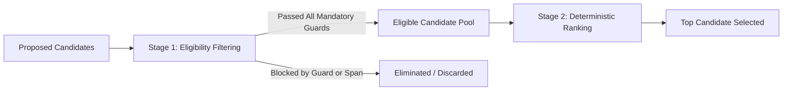

# Stage 33 — Candidate Selection, Two-Stage Resolution, and Governed Fallback

**Project:** AI-Powered Adaptive Child-Friendly Language Simplification System  
**Component:** Component 3 — AI/NLP-Based Language Simplification  
**Scope:** Two-stage resolution architecture, candidate ranking, terminal dispositions, and fail-closed fallback  
**Governance Checkpoint:** Stage 33 Technical Draft  

---

## 1. Two-Stage Candidate Resolution Architecture

To eliminate ambiguity between candidate filtering (safety) and candidate ranking (preference), Stage 33 enforces two distinct, sequential phases:



### Stage 1: Candidate Eligibility Filtering
Every generated candidate undergoes evaluation against mandatory semantic and structural guards:
1. Protected-span inviolability
2. Number preservation
3. Negation preservation
4. Modality preservation
5. Quotation preservation
6. Unicode integrity (zero `U+FFFD`)

Candidates violating any guard are marked with `CandidateTerminalStatus.BLOCKED_MEANING_GUARD` or `BLOCKED_PROTECTED_SPAN` and **eliminated**. Blocked candidates never enter the Stage 2 ranking pool.

### Stage 2: Deterministic Candidate Ranking
Eligible candidates that survived Stage 1 are ranked according to frozen precedence:
1. `LONGEST_APPROVED_PHRASE_MATCH`: Phrase rules take priority over lexical rules.
2. `HIGHER_RULE_PRIORITY`: Higher integer priority takes precedence.
3. `FEWER_TRANSFORMATIONS`: Fewer atomic operations preferred.
4. `LOWER_EDIT_DISTANCE`: Minimal structural length divergence from the source.
5. `STABLE_RULE_ID_ORDER`: Alphabetical order for deterministic tie-breaking.

The highest-ranked eligible candidate receives `CandidateTerminalStatus.SELECTED`. Remaining eligible candidates receive `CandidateTerminalStatus.NOT_SELECTED_LOWER_RANK`.

---

## 2. Terminal Disposition Hierarchy & Fallback

If no candidate is eligible, the pipeline triggers fail-closed fallback to return the original normalized text:

- If any candidate was deferred to manual review (e.g., ambiguous subject recovery) → `FinalDisposition.MANUAL_REVIEW_REQUIRED`.
- Else if candidates were generated but all were blocked by guards → `FinalDisposition.UNCHANGED_ALL_CANDIDATES_BLOCKED`.
- Else (no rule matched) → `FinalDisposition.UNCHANGED_NO_APPLICABLE_RULE`.

All terminal outputs maintain the fail-closed governance status:
```json
{
  "validation_status": "draft",
  "expert_validated": false,
  "approved_for_child_delivery": false,
  "requires_expert_review": true
}
```
