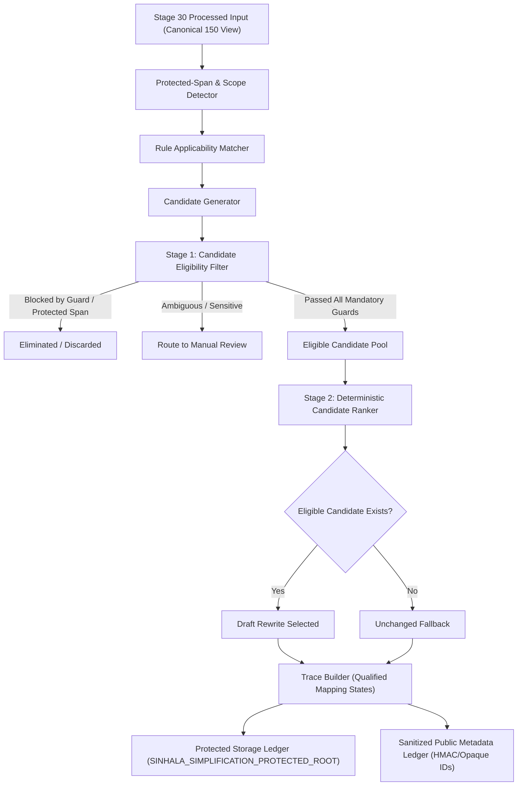
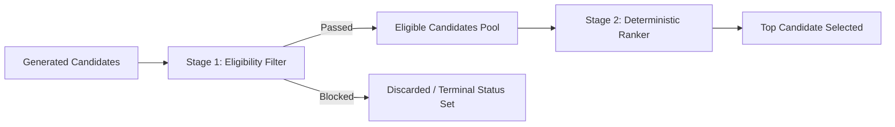
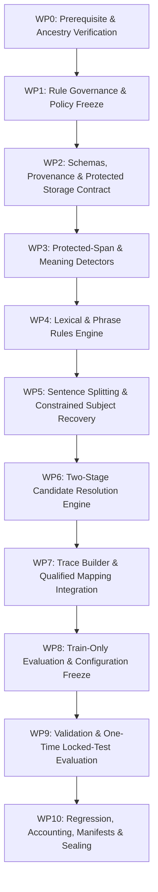

# Stage 33 Implementation Plan — Sinhala Linguistic Simplification Rules and Controlled Rewrite Engine (Revised)

**Project:** AI-Powered Adaptive Child-Friendly Language Simplification System  
**Component:** Component 3 — AI/NLP-Based Language Simplification  
**Scope:** Deterministic Sinhala linguistic simplification rules, guarded rewrite execution, traceability, and preliminary automated evaluation  
**Status:** Revision Required Before Execution (Revised Draft v2 submitted for governance approval)  
**Authoritative prerequisite:** `stage-32-complete-v5` at commit `7c6bb81a744305c3a59100a2c2af8fc06deb01c8`  
**Implementation branch:** `feature/stage33-sinhala-simplification-rules`  
**Planned start tag:** `stage-33-start`  
**Planned completion tag:** `stage-33-complete`

---

## 1. Purpose

Stage 33 establishes a deterministic, auditable, and fail-closed Sinhala simplification-rule engine. It uses the sealed Stage 30 preprocessing pipeline, the Stage 31 governed pilot corpus (evaluating strictly on the 150-record canonical analytical view), and Stage 32 vocabulary-frequency evidence to generate **draft automated simplification candidates**.

The stage is intended to prove that controlled lexical, phrase-level, sentence-splitting, and conservative syntactic transformations can be proposed and executed without silently altering meaning-critical elements. It does not establish that a rewritten sentence is linguistically natural, developmentally appropriate, educationally effective, or safe for child delivery.

### Primary outcomes

1. A frozen registry of deterministic Sinhala simplification rules with explicit authorship, evidence, and field-level rights protection.
2. A controlled rewrite engine with a two-stage pipeline separating candidate eligibility filtering from candidate ranking.
3. Complete auditable transformation traces connecting output spans to source spans, with explicit mapping cardinality and exactness qualifications.
4. Separate candidate-generation, guard-filtering, and candidate-selection stages.
5. External protected storage ledgers containing source, candidate, and rewritten text under `SINHALA_SIMPLIFICATION_PROTECTED_ROOT`.
6. Public metadata reports containing opaque IDs and versioned, domain-separated keyed HMACs—containing zero restricted, reconstructable, or raw text.
7. Train-only rule development followed by frozen validation and locked-test evaluation on the canonical analytical corpus view.
8. Zero-unaccounted accounting across inputs, mutually exclusive rule-attempt terminal statuses, mutually exclusive candidate terminal statuses, final dispositions, operations, and export boundaries.

---

## 2. Stage Boundaries

### 2.1 Included

- Registering versioned lexical, phrase-level, sentence-splitting, and conservative syntactic rules with explicit human technical authorship.
- Using Stage 32 frequency and provisional-band evidence strictly as non-authoritative rule features (never as automatic substitution licenses).
- Preserving Sinhala Unicode sequences and grapheme cluster boundaries through the Stage 30 interface.
- Protecting named entities, numbers, units, dates, negation, modality, conditions, quotations, parentheticals, and technical terms.
- Two-stage candidate resolution: eligibility filtering (guards/blockers) followed by deterministic ranking among eligible candidates.
- Conservative subject recovery in sentence splitting: permitted only when verbatim copied from an unambiguous source span and traced directly to it; otherwise routing to review.
- Producing zero, one, or multiple draft rewrite candidates per input, with unchanged fallback when any candidate is blocked.
- Recording complete rule provenance, configuration hashes, split manifest hashes, and rights inheritance.
- External protected storage boundary enforcement via `SINHALA_SIMPLIFICATION_PROTECTED_ROOT`.
- Evaluating technical behavior on development, validation, and locked-test partitions without cross-split tuning.

### 2.2 Explicitly excluded

- Claiming human-validated Sinhala linguistic correctness (deferred to Stage 34).
- Claiming developmental suitability for children aged 4–8 (deferred to Stage 34).
- Expert linguistic and child-development validation — Stage 34.
- Model-based Sinhala comparison involving Gemini, mT5, mBART, or other LLMs — Stage 35.
- Production output validation and governed fallback integration — Stage 36.
- Training or fine-tuning language models.
- Synthesizing human-reference simplifications or presenting SARI/BLEU as authoritative without governed references.
- Frequency-only or band-only substitution (replacing a word merely because target has higher frequency or different band).
- Serving Stage 33 output directly to children or altering Component 1 clinical/screening parameters.

---

## 3. Mandatory Governance Invariants

1. **Stage 30–32 immutability:** No Stage 30, Stage 31, or Stage 32 governed artifact or report may be modified in place.
2. **Draft-only output:** Every rewrite record maintains:
   ```json
   {
     "validation_status": "draft",
     "expert_validated": false,
     "research_eligible": false,
     "approved_for_child_delivery": false,
     "approved_for_unsupervised_child_delivery": false,
     "requires_expert_review": true
   }
   ```
3. **No frequency-only substitution:** Lower-frequency tokens may never be replaced merely because another token has higher frequency or lower provisional band.
4. **Sense, context, and authorship:** Lexical substitutions require explicit human technical authorship (`authoring_method`, `author_id_or_team`), allowlisted lexical relations, compatible contextual constraints, and traceable evidence refs.
5. **Meaning-critical preservation:** Named entities, numbers, units, dates, negation, modality, conditional relations, quotations, and identifiers are protected. Unallowlisted modification is strictly prohibited.
6. **Incompleteness acknowledgment:** Named-entity and semantic detectors are conservative and incomplete; absence of a detector flag is not proof that a token is not an entity or meaning-critical element.
7. **Two-stage conflict resolution:** Candidate filtering is separated from ranking. Blocked or review-deferred candidates are eliminated during eligibility filtering and never participate in ranking.
8. **Conservative subject recovery:** In sentence splitting, subject insertion is permitted only when verbatim extracted from an unambiguous source span and mapped directly to it. Ambiguous recovery routes to `MANUAL_REVIEW_REQUIRED` or unchanged fallback.
9. **Fail closed:** Uncertain, conflicting, unsupported, or unsafe transformations produce unchanged fallback or `MANUAL_REVIEW_REQUIRED`. `FAILED_INTERNAL_ERROR` is treated as an exceptional terminal failure.
10. **Transformation trace qualification:** Traces provide complete raw/normalized-to-output span mappings with explicit status (`one_to_one`, `many_to_one`, `one_to_many`, `inserted`, `deleted`, `reordered`, `non_local`, `unmapped`) and `mapping_exact: bool`. Exact one-to-one mapping is not claimed for insertions, deletions, reordering, or non-local changes.
11. **Analytical corpus view freeze:** Rule development and evaluation denominator is the **150-record canonical analytical corpus**. The 180-record pilot corpus and rational duplicate weights are used solely for provenance and rights diagnostics.
12. **Method-development sample isolation:** Any Stage 31 predeclared exploratory development units remain excluded or isolated exactly as specified by sealed Stage 31 v8 manifests; Stage 33 must not silently reinterpret them as ordinary training records.
13. **Rule payload rights separation:** Rule registry definitions derived from restricted sources are partitioned: public registries contain opaque IDs, types, and non-reconstructable metadata; literal source/target expressions, concordances, and evidence reside in protected storage.
14. **Protected storage boundary:** All restricted text, candidate rewrites, and protected rule payloads reside in external storage specified by `SINHALA_SIMPLIFICATION_PROTECTED_ROOT`, failing closed if resolving inside the repository tree.
15. **Expanded request provenance:** Every rewrite request cryptographically binds `stage30_configuration_hash`, `stage31_split_manifest_hash`, `stage31_corpus_view`, `stage32_configuration_hash`, `stage32_lexicon_manifest_hash`, `stage33_configuration_hash`, and `rights_profile_ids_and_versions`.
16. **Partition isolation:** Rule design and threshold calibration use training records only. Validation and locked-test data must not influence rule selection or thresholds.
17. **Configuration freeze:** All rules, priorities, thresholds, inventories, and seeds are frozen before locked-test execution.
18. **Public export safety:** Public exports expose opaque IDs or versioned, domain-separated keyed HMACs; raw SHA-256 hashes of restricted literal text are never exposed in public artifacts.
19. **No fabricated review:** Reviewer IDs, decisions, timestamps, and approval fields remain null.
20. **Historical tag immutability:** Existing Stage 26–32 tags must not be moved. Prerequisite `stage-32-complete-v5` and start `stage-33-start` must resolve to `7c6bb81a744305c3a59100a2c2af8fc06deb01c8`.
21. **Zero-loss mutually exclusive accounting:** All accounting equations use mutually exclusive terminal categories with zero unaccounted units.

---

## 4. Evidence Hierarchy and Authority Boundaries

| Evidence source | Permitted use | Prohibited interpretation |
|---|---|---|
| Stage 30 preprocessing | Unicode, token, sentence, and span boundaries | Proof of linguistic correctness |
| Stage 31 canonical corpus (150) | Primary empirical evaluation denominator and rule discovery | Proof of child suitability or complete representativeness |
| Stage 31 pilot corpus (180) | Rights, licensing, and provenance accounting diagnostics | Primary frequency denominator (avoids duplicate distortion) |
| Stage 32 lexicon & weights | Lexical frequency, dispersion, surface-form clustering | Autonomous substitution authorization or reading levels |
| Technical rule fixtures | Deterministic regression and boundary testing | Human simplification reference standards |
| Automated guards | Detection of configured invariant violations | Proof of complete semantic equivalence |
| Future Stage 34 review | Expert linguistic and developmental judgments | Available during Stage 33 — it is not |

---

## 5. Target Architecture



### Processing sequence

```text
Immutable source record (Canonical 150 view)
→ verified Stage 30 preprocessing
→ protected-span detection (entities, numbers, dates, units, negation, modality)
→ eligible rule matching & candidate generation
→ Stage 1: Candidate eligibility filtering (meaning guards, span overlap, subject recovery)
→ Stage 2: Candidate ranking among eligible candidates (longest phrase → priority → operations → rule ID)
→ Draft rewrite selected OR fail-closed unchanged fallback / manual review routing
→ Transformation trace building (explicit mapping cardinality & exactness flags)
→ External protected storage write (SINHALA_SIMPLIFICATION_PROTECTED_ROOT)
→ Public metadata ledger generation (keyed HMACs, zero restricted text)
```

---

## 6. Repository and Storage Architecture

```text
backend/app/sinhala_simplification/
├── __init__.py
├── enums.py                      # Mutually exclusive terminal statuses, rule types, mapping states
├── schemas.py                    # Pydantic v2 contracts with request provenance & qualified traces
├── protected_spans.py            # Conservative protected-span & scope detection
├── rule_registry.py              # Rule registry loader & payload rights boundary
├── lexical_rules.py              # Allowlisted lexical rules with authorship & evidence bindings
├── phrase_rules.py               # Phrase-level longest-match-first rules
├── sentence_splitter.py          # Sentence splitting with constrained subject recovery
├── syntactic_rules.py            # Conservative syntactic simplification rules
├── applicability.py              # Rule applicability evaluation & attempt recording
├── candidate_generator.py        # Candidate generation
├── candidate_filter.py           # Stage 1: Candidate eligibility filtering & guard evaluation
├── candidate_ranker.py           # Stage 2: Deterministic ranking among eligible candidates
├── candidate_selector.py         # Pipeline selection coordinator & fallback handler
├── trace_builder.py              # Operation trace builder with qualified mapping states
├── pipeline.py                   # End-to-end rewrite pipeline
└── serialization.py              # Public metadata sanitization & keyed HMAC generation

backend/tests/sinhala_simplification/
├── test_stage33_rule_registry.py
├── test_stage33_lexical_rules.py
├── test_stage33_phrase_rules.py
├── test_stage33_sentence_splitting.py
├── test_stage33_constrained_subject_recovery.py
├── test_stage33_protected_spans.py
├── test_stage33_negation_and_modality.py
├── test_stage33_entity_number_preservation.py
├── test_stage33_two_stage_candidate_resolution.py
├── test_stage33_transformation_traces.py
├── test_stage33_determinism.py
├── test_stage33_partition_isolation.py
├── test_stage33_rights_and_protected_payloads.py
├── test_stage33_public_export_safety.py
├── test_stage33_corpus_view_and_denominators.py
├── test_stage33_accounting.py
└── test_stage33_end_to_end.py

data/sinhala_simplification/
├── registry/
│   ├── stage33_configuration.json
│   ├── rule_registry_public.json        # Public rule metadata (opaque IDs, hashes, priorities)
│   ├── protected_span_policy.json
│   └── ranking_precedence.json
├── fixtures/
│   ├── lexical_rule_cases.json
│   ├── sentence_split_cases.json
│   ├── subject_recovery_cases.json
│   ├── protected_meaning_cases.json
│   ├── negative_rule_cases.json
│   └── overlapping_rule_cases.json
├── ledgers/
│   ├── rule_attempt_ledger.jsonl
│   ├── candidate_ledger.jsonl
│   ├── transformation_trace_ledger.jsonl
│   └── final_disposition_ledger.jsonl
├── evaluation/
│   ├── validation_metadata.jsonl
│   ├── locked_test_metadata.jsonl
│   └── public_summary.json
├── snapshots/
│   └── stage32_prerequisite_snapshot.json
└── manifests/
    └── stage33_implementation_manifest.sha256

scripts/stage33/
├── snapshot_prerequisites.py
├── generate_rule_registry.py
├── run_development_evaluation.py
├── freeze_stage33_configuration.py
├── run_locked_evaluation.py
├── verify_partition_isolation.py
├── verify_stage30_to_32_immutability.py
├── verify_stage33_accounting.py
├── generate_stage33_reports.py
├── generate_stage33_manifest.py
└── verify_stage33_manifest.py
```

### External Protected Storage Contract

Protected artifacts are isolated outside the repository under:
`SINHALA_SIMPLIFICATION_PROTECTED_ROOT`  
(defaults to `~/.sinhala_simplification_protected_data`).

If `SINHALA_SIMPLIFICATION_PROTECTED_ROOT` resolves inside the Git workspace, the pipeline **fails closed immediately**.

Protected subdirectories:
```text
$SINHALA_SIMPLIFICATION_PROTECTED_ROOT/
├── rules/
│   └── rule_payloads_protected.json     # Literal restricted phrases, concordances, evidence
├── candidates/                           # Literal candidate rewrite texts
├── outputs/                              # Selected draft rewrites & fallback texts
└── debug/                                # Internal diagnostic logs with full spans
```

---

## 7. Rule Taxonomy & Authorship Contract

Every simplification rule must be an authored, traceable technical artifact. Frequency or provisional-band membership alone must never automatically synthesize or authorize a rule.

### 7.1 Rule Authoring Metadata

```json
{
  "rule_id": "SI-LEX-SUB-0001",
  "rule_version": 1,
  "rule_type": "LEXICAL_SUBSTITUTION",
  "status": "TECHNICAL_DRAFT",
  "authoring_method": "technical_rule_authoring",
  "author_id_or_team": "stage33_technical_team",
  "evidence_type": "empirical_pilot_concordance",
  "evidence_refs": ["SI-CAND-ENTRY-000193", "STAGE32-LEX-FREQ-REF"],
  "rights_profile_refs": ["SRC-SI-001-RP-01"],
  "source_pattern_ref": "hmac_sha256:...",
  "target_template_ref": "hmac_sha256:...",
  "applicability_conditions": [
    {
      "condition_type": "POS_AND_INFLECTION_MATCH",
      "parameters": {"pos": "NOUN", "case": "NOMINATIVE"}
    }
  ],
  "blocking_conditions": [
    {"blocking_type": "OVERLAPS_PROTECTED_SPAN", "parameters": {}},
    {"blocking_type": "WITHIN_NEGATION_SCOPE", "parameters": {}}
  ],
  "required_guards": [
    "ENTITY_PRESERVATION",
    "NUMBER_PRESERVATION",
    "NEGATION_PRESERVATION"
  ],
  "priority": 100,
  "expert_validated": false,
  "approved_for_child_delivery": false
}
```

### 7.2 Permitted Rule Classes

1. **Lexical substitution (`SI-LEX-SUB-XXXX`):**
   - Replaces an allowlisted lemma or surface form with a simpler allowlisted target.
   - Requires explicit human technical author attribution and verified evidence refs.
   - Inflectional features must be preserved or the case is routed to review.
2. **Phrase-level substitution (`SI-PHR-SUB-XXXX`):**
   - Replaces a multi-token idiom or complex phrase with an allowlisted simpler expression.
   - Evaluated using longest-match-first detection.
3. **Sentence splitting (`SI-SNT-SPL-XXXX`):**
   - Splits compound sentences at allowlisted coordinating markers (e.g., `සහ`, `නමුත්`, `එමෙන්ම`).
   - Punctuation reconstructed deterministically.
   - **Subject recovery constraint:** Insertion of a grammatical subject into a second clause is permitted **only** when the exact subject is verbatim extracted from an unambiguous source span and mapped directly to it. Ambiguous recovery routes to `MANUAL_REVIEW_REQUIRED` or unchanged fallback.
4. **Conservative syntactic simplification (`SI-SYN-CON-XXXX`):**
   - Deletion of allowlisted redundant discourse fillers (e.g., `ඇත්තෙන්ම`) where core propositional meaning is preserved.
   - Reordering of allowlisted sequential clauses where dependencies remain traceable.

---

## 8. Protected Spans & Meaning Preservation

### 8.1 Meaning-Critical Elements

The protected-span detector identifies and locks:
- Named entities (person, location, organization).
- Numbers, digits, spelled numbers, percentages, fractions.
- Dates, times, calendar expressions.
- Measurements, quantities, and units.
- Currencies and financial symbols.
- Negation markers (`නැත`, `නො`, `නෙවෙයි`, `නොවේ`, `නැතැයි`) and their syntactic scope.
- Modality, conditional, and obligation markers (`හැකිය`, `යුතුය`, `නම්`, `බැවින්`).
- Quoted speech, dialogue, and bracketed quotations.
- Mixed-script tokens, codes, URLs, citations.
- Stage 32 review-required vocabulary items.

### 8.2 Detector Incompleteness Disclaimer

Automated Sinhala named-entity and semantic scope detection is conservative and rule-assisted. The absence of a detector flag does not prove that a token is not a proper noun or meaning-critical element.

---

## 9. Two-Stage Candidate Resolution Pipeline

Candidate filtering is strictly separated from candidate ranking. Blocked or review-deferred candidates never participate in ranking.



### Stage 1: Candidate Eligibility Filtering
1. **Protected span check:** If candidate mutates any protected span without an allowlist override → `BLOCKED_PROTECTED_SPAN`.
2. **Meaning guards:** If candidate violates negation, number, entity, unit, or modality preservation → `BLOCKED_MEANING_GUARD`.
3. **Grapheme & Unicode guards:** If candidate introduces invalid grapheme splits or `U+FFFD` → `BLOCKED_MEANING_GUARD`.
4. **Subject recovery check:** If sentence split requires subject insertion but source referent is ambiguous → `DEFERRED_MANUAL_REVIEW`.
5. **Internal exception:** In the event of an unhandled runtime exception → `FAILED_INTERNAL`.

### Stage 2: Deterministic Ranking (Eligible Candidates Only)
Among candidates that passed Stage 1:
1. `LONGEST_APPROVED_PHRASE_MATCH` (phrase rules prioritized over single-token lexical rules).
2. `HIGHER_RULE_PRIORITY` (descending integer priority).
3. `FEWER_TRANSFORMATIONS` (fewer operations preferred).
4. `LOWER_EDIT_DISTANCE` (minimal structural perturbation).
5. `STABLE_RULE_ID_ORDER` (alphabetical tie-breaker).

If no candidate is eligible:
- If any candidate deferred to manual review → disposition `MANUAL_REVIEW_REQUIRED`.
- Else if candidates were generated but all blocked → disposition `UNCHANGED_ALL_CANDIDATES_BLOCKED`.
- Else (no rule matched) → disposition `UNCHANGED_NO_APPLICABLE_RULE`.

---

## 10. Transformation Traceability & Mapping States

Stage 33 does not claim exact one-to-one mapping for insertions, deletions, reorderings, or non-local splits. Traces record explicit mapping states and exactness flags.

### 10.1 Mapping States

```text
one_to_one      Single source span mapped to single output span
many_to_one     Multiple source spans merged into single output span
one_to_many     Single source span expanded into multiple output spans
inserted        Output span created with no source span counterpart
deleted         Source span removed with no output span counterpart
reordered       Source span transposed to a different syntactic position
non_local       Long-distance structural shift or sentence split
unmapped        Fallback state for untraced boundary operations
```

### 10.2 Transformation Operation Contract

```json
{
  "operation_id": "SI-OP-000001",
  "operation_type": "REPLACE",
  "rule_id": "SI-LEX-SUB-0001",
  "raw_source_spans": [{"start_code_point": 10, "end_code_point": 15}],
  "normalized_source_spans": [{"start_code_point": 10, "end_code_point": 15}],
  "output_spans": [{"start_code_point": 10, "end_code_point": 14}],
  "mapping_status": "one_to_one",
  "mapping_exact": true,
  "before_hash_internal": "64_char_hex",
  "after_hash_internal": "64_char_hex"
}
```

---

## 11. Core Data Contracts & Request Provenance

### 11.1 Rewrite Request (Expanded Provenance Binding)

```json
{
  "request_id": "SI-SIMP-REQ-000001",
  "record_id": "SI-PILOT-000001",
  "source_storage_ref": "protected://sinhala_external/inputs/SI-PILOT-000001.txt",
  "source_sha256_internal": "64_char_hex",
  "language": "si",
  "stage30_configuration_hash": "64_char_hex",
  "stage31_split_manifest_hash": "64_char_hex",
  "stage31_corpus_view": "canonical_analytical_150",
  "stage32_configuration_hash": "64_char_hex",
  "stage32_lexicon_manifest_hash": "64_char_hex",
  "stage33_configuration_hash": "64_char_hex",
  "rights_profile_ids_and_versions": [
    {"rights_profile_id": "SRC-SI-001-RP-01", "version": 1}
  ],
  "partition": "train"
}
```

### 11.2 Rule Attempt Terminal Contract

```json
{
  "attempt_id": "SI-RULE-ATTEMPT-000001",
  "request_id": "SI-SIMP-REQ-000001",
  "rule_id": "SI-LEX-SUB-0001",
  "rule_version": 1,
  "terminal_status": "CANDIDATE_GENERATED",
  "reason_codes": [],
  "source_spans": [{"start_code_point": 10, "end_code_point": 15}],
  "candidate_id": "SI-CAND-000001"
}
```

### 11.3 Final Rewrite Record

```json
{
  "output_id": "SI-SIMP-OUT-000001",
  "request_id": "SI-SIMP-REQ-000001",
  "selected_candidate_id": "SI-CAND-000001",
  "final_disposition": "DRAFT_REWRITE_SELECTED",
  "output_storage_ref": "protected://sinhala_simplification/outputs/SI-SIMP-OUT-000001.txt",
  "output_sha256_internal": "64_char_hex",
  "applied_rule_ids": ["SI-LEX-SUB-0001"],
  "guard_results": {
    "ENTITY_PRESERVATION": {"passed": true, "reason_codes": []},
    "NEGATION_PRESERVATION": {"passed": true, "reason_codes": []}
  },
  "language": "si",
  "locale": "si-LK",
  "script": "Sinh",
  "validation_status": "draft",
  "expert_validated": false,
  "research_eligible": false,
  "approved_for_child_delivery": false,
  "approved_for_unsupervised_child_delivery": false,
  "requires_expert_review": true,
  "corpus_view": "canonical_analytical_150",
  "rights_profile_refs": ["SRC-SI-001-RP-01"]
}
```

---

## 12. Accounting Conservation Equations

All accounting operates on mutually exclusive terminal statuses.

### 12.1 Authoritative Input Disposition Accounting

Every submitted input must map to exactly one terminal disposition:

$$
\begin{aligned}
\text{SubmittedInputs} ={}& \text{RejectedSourceIneligible} \\
&+ \text{RejectedInvalidState} \\
&+ \text{FailedInternal} \\
&+ \text{ManualReviewRequired} \\
&+ \text{DraftRewriteSelected} \\
&+ \text{UnchangedAllBlocked} \\
&+ \text{UnchangedNoApplicableRule} \\
&+ \text{Unaccounted}
\end{aligned}
$$

### 12.2 Mutually Exclusive Rule-Attempt Accounting

Every evaluated rule attempt reaches exactly one terminal status:

$$
\begin{aligned}
\text{RuleAttempts} ={}& \text{NOT\_APPLICABLE} \\
&+ \text{BLOCKED\_PROTECTED\_SPAN} \\
&+ \text{BLOCKED\_MEANING\_GUARD} \\
&+ \text{CANDIDATE\_GENERATED} \\
&+ \text{DEFERRED\_MANUAL\_REVIEW} \\
&+ \text{FAILED\_INTERNAL} \\
&+ \text{Unaccounted}
\end{aligned}
$$

### 12.3 Mutually Exclusive Candidate Accounting

Every generated rewrite candidate reaches exactly one terminal status:

$$
\begin{aligned}
\text{GeneratedCandidates} ={}& \text{SELECTED} \\
&+ \text{NOT\_SELECTED\_LOWER\_RANK} \\
&+ \text{BLOCKED\_PROTECTED\_SPAN} \\
&+ \text{BLOCKED\_MEANING\_GUARD} \\
&+ \text{DEFERRED\_MANUAL\_REVIEW} \\
&+ \text{FAILED\_INTERNAL} \\
&+ \text{Unaccounted}
\end{aligned}
$$

### 12.4 Transformation Operation Accounting

$$
\begin{aligned}
\text{RecordedOperations} ={}& \text{Insertions} \\
&+ \text{Deletions} \\
&+ \text{Replacements} \\
&+ \text{Splits} \\
&+ \text{Reorders} \\
&+ \text{Unaccounted}
\end{aligned}
$$

### 12.5 Rights and Export Accounting

$$
\begin{aligned}
\text{ExportEvaluatedFields} ={}& \text{PublicPermitted} \\
&+ \text{ProtectedInternal} \\
&+ \text{SuppressedByPolicy} \\
&+ \text{ReviewRequired} \\
&+ \text{Unaccounted}
\end{aligned}
$$

Target for all unaccounted quantities is strictly **0**.

---

## 13. Work Packages and Execution Order



### WP0 — Prerequisite Verification, Clean Checkpoint & Baseline Snapshots
1. Execute explicit ancestry and tag identity verification:
   ```powershell
   git rev-parse "stage-32-complete-v5^{commit}"
   git rev-parse "stage-33-start^{commit}"
   git merge-base --is-ancestor "stage-32-complete-v5^{commit}" "stage-33-start^{commit}"
   ```
   Both tags must resolve exactly to `7c6bb81a744305c3a59100a2c2af8fc06deb01c8`.
2. Verify earlier checkpoints (`stage-31-complete-v8`, `stage-30-complete-v3`, `stage-29-complete-v2`, `stage-28a-complete-v4`, `stage-27-infrastructure-complete-v3`, `stage-26-complete-v5`) remain direct ancestors.
3. Verify Stage 31 manifest passes and confirm Stage 31 predeclared development units remain isolated.
4. Verify Stage 30–32 immutability: zero differences relative to `stage-33-start`.
5. Verify `SINHALA_SIMPLIFICATION_PROTECTED_ROOT` resolves outside the git workspace.
6. Record baseline metrics: 150 canonical records, 180 pilot records, 1,010 candidate lexicon entries.
7. Run baseline backend tests, frontend tests, and production build.

### WP1 — Rule Governance, Taxonomy, and Policy Freeze
1. Formalize rule taxonomy: lexical, phrase, sentence splitting, conservative syntactic.
2. Define mandatory rule authoring attributes: `authoring_method`, `author_id_or_team`, `evidence_refs`, `rights_profile_refs`.
3. Define field-level rights partitioning for rules (public registry vs protected payload).
4. Author `docs/stage33_rule_governance_and_scope.md` and registry contracts.

### WP2 — Schemas, Provenance, and Protected Storage
1. Implement Pydantic v2 schemas with mutually exclusive terminal statuses.
2. Implement expanded request provenance binding (`stage31_split_manifest_hash`, `stage31_corpus_view`, `stage32_lexicon_manifest_hash`).
3. Implement external protected storage manager enforcing boundary outside repository.
4. Implement public metadata serialization with keyed HMACs and zero text leakage.
5. Author `docs/stage33_schema_and_trace_contract.md`.

### WP3 — Protected-Span and Meaning-Critical Detectors
1. Implement detectors for named entities, numbers, dates, units, currencies, negation, modality, quotations.
2. Record detector rule IDs, versions, and acknowledge detector incompleteness.
3. Author positive and adversarial test fixtures for protected spans.
4. Author `docs/stage33_meaning_preservation_policy.md`.

### WP4 — Lexical and Phrase Rule Engine
1. Implement allowlisted lexical substitution rules with verified evidence and inflection preservation.
2. Implement phrase-level longest-match-first substitutions.
3. Integrate Stage 32 features as non-authoritative rule attributes.
4. Separate public rule metadata from protected lexical payloads.
5. Author `docs/stage33_lexical_and_phrase_rules.md`.

### WP5 — Sentence Splitting and Conservative Syntactic Rules
1. Implement sentence splitting at allowlisted coordinating conjunctions.
2. Implement **constrained subject recovery**: permit subject insertion only when copied from an unambiguous source span and mapped to it; otherwise route to `MANUAL_REVIEW_REQUIRED`.
3. Implement conservative syntactic simplification (discourse filler deletion, clause reordering).
4. Author `docs/stage33_sentence_and_syntactic_rules.md`.

### WP6 — Two-Stage Candidate Resolution Engine
1. Implement Stage 1 candidate eligibility filter (meaning guards, span overlap, subject recovery).
2. Implement Stage 2 candidate ranker (longest phrase → priority → operations → rule ID).
3. Implement fail-closed fallback: return unchanged normalized source when all candidates are blocked.
4. Implement `FAILED_INTERNAL` as exception-derived terminal state.
5. Author `docs/stage33_candidate_selection_and_fallback.md`.

### WP7 — Traceability and Qualified Mapping Integration
1. Build operation traces with explicit mapping states (`one_to_one`, `many_to_one`, `one_to_many`, `inserted`, `deleted`, `reordered`, `non_local`, `unmapped`) and `mapping_exact: bool`.
2. Verify deterministic pipeline execution: identical inputs and seeds yield identical byte outputs.
3. Verify zero pipeline-introduced grapheme splits or `U+FFFD`.

### WP8 — Train-Only Development Evaluation and Configuration Freeze
1. Evaluate rules strictly on Stage 31 `train` split partition using the **150-record canonical analytical view**.
2. Reconcile all rule attempts, candidates, and dispositions against mutually exclusive conservation equations.
3. Freeze `data/sinhala_simplification/registry/stage33_configuration.json` and rule payloads.
4. Author `docs/stage33_development_evaluation_report.md`.

### WP9 — Validation and One-Time Locked-Test Evaluation
1. Run frozen validation evaluation to detect edge cases and implementation defects.
2. Document defects; if adjustments are required, increment configuration version and re-verify.
3. Execute locked-test evaluation **exactly once** using final sealed configuration.
4. Author `docs/stage33_locked_evaluation_report.md` and `docs/stage33_error_analysis.md`.

### WP10 — Regression, Accounting, Documentation, and Sealing
1. Run Stage 33 test suite, complete backend test suite, frontend tests, and production build.
2. Verify Stage 30–32 immutability with zero diffs.
3. Reconcile all six accounting levels with zero unaccounted items.
4. Generate self-excluding documentation manifest (14 deliverables = 13 files + manifest).
5. Generate implementation manifest and verify with read-only verifier including negative tamper tests.
6. Commit, tag with immutable annotated tag `stage-33-complete`, and push branch and tag.

---

## 14. Automated Test Plan

### Test Suites (`backend/tests/sinhala_simplification/`)

- `test_stage33_rule_registry.py`: Validates unique rule IDs, human authorship fields, evidence refs, and public/protected separation.
- `test_stage33_lexical_rules.py`: Validates allowlisted lexical substitution, morphology preservation, and rejection of frequency-only swaps.
- `test_stage33_phrase_rules.py`: Validates longest-match-first behavior and prevents overlapping partial substitutions.
- `test_stage33_sentence_splitting.py`: Validates punctuation reconstruction, structural completeness, and boundary preservation.
- `test_stage33_constrained_subject_recovery.py`: Validates that subject insertion occurs only from unambiguous source spans; ambiguous recovery routes to review.
- `test_stage33_protected_spans.py`: Validates detection of entities, numbers, dates, units, currencies, parentheticals, and technical terms.
- `test_stage33_negation_and_modality.py`: Validates that negation markers and modal/conditional scopes are never altered or dropped.
- `test_stage33_two_stage_candidate_resolution.py`: Validates that blocked candidates are filtered out before ranking and never participate in ranking.
- `test_stage33_transformation_traces.py`: Validates trace mappings, mapping status enums (`one_to_one`, `inserted`, `deleted`, `reordered`, `non_local`), and `mapping_exact` flags.
- `test_stage33_determinism.py`: Validates byte-for-byte reproducibility across repeated pipeline runs.
- `test_stage33_partition_isolation.py`: Validates that validation and locked-test data never leak into rule authoring or threshold tuning.
- `test_stage33_corpus_view_and_denominators.py`: Validates that the 150-record canonical analytical view governs evaluation metrics and avoids duplicate weight distortion.
- `test_stage33_rights_and_protected_payloads.py`: Validates external protected storage boundary, rights inheritance, and absence of restricted text in public metadata.
- `test_stage33_accounting.py`: Validates that all conservation equations hold with exactly 0 unaccounted items.
- `test_stage33_end_to_end.py`: Comprehensive pipeline tests from raw request to governed output and audit traces.

---

## 15. Required Documentation Deliverables

1. `docs/stage33_implementation_plan.md`
2. `docs/stage33_rule_governance_and_scope.md`
3. `docs/stage33_schema_and_trace_contract.md`
4. `docs/stage33_meaning_preservation_policy.md`
5. `docs/stage33_lexical_and_phrase_rules.md`
6. `docs/stage33_sentence_and_syntactic_rules.md`
7. `docs/stage33_candidate_selection_and_fallback.md`
8. `docs/stage33_development_evaluation_report.md`
9. `docs/stage33_locked_evaluation_report.md`
10. `docs/stage33_error_analysis.md`
11. `docs/stage33_accounting_summary.md`
12. `docs/stage33_reproducibility_record.json`
13. `docs/stage33_completion_record.md`
14. `docs/stage33_manifest.sha256`

---

## 16. Completion Record Template

```text
================================================================
STAGE 33 — SINHALA CONTROLLED SIMPLIFICATION RULE ENGINE
================================================================

Prerequisite tag:                           stage-32-complete-v5
Prerequisite commit:                        7c6bb81a744305c3a59100a2c2af8fc06deb01c8
Start tag:                                  stage-33-start
Final commit:                               <full SHA>
Completion tag:                             stage-33-complete

Ancestry verification:                      PASSED
Stage 30–32 immutability:                   PASSED (0 diffs)
Corpus view evaluated:                      canonical_analytical_150
External protected root:                    <verified outside worktree>
Rule registry:                              <count> rules, PASSED
Protected rule payloads separated:          PASSED
Protected-span policy:                      PASSED
Two-stage candidate resolution:             PASSED
Constrained subject recovery:               PASSED
Transformation trace coverage:              100% qualified mapping
Deterministic rerun equality:                PASSED (100% byte identical)
Training-only rule development:             PASSED
Configuration frozen before locked test:    PASSED
Locked-test executions:                     1

Submitted inputs:                           <count>
Draft rewrites selected:                    <count>
Unchanged all candidates blocked:           <count>
Unchanged no applicable rule:               <count>
Manual-review required:                     <count>
Rejected source ineligible:                 <count>
Rejected invalid preprocessing:             <count>
Failed internal error:                      0
Protected-span violations:                  0
Grapheme split violations:                  0
Pipeline-introduced U+FFFD:                 0
Restricted text in public artifacts:        0

Unaccounted inputs:                         0
Unaccounted rule attempts:                  0
Unaccounted candidates:                     0
Unaccounted dispositions:                   0
Unaccounted operations:                     0
Unaccounted export fields:                  0

Stage 33 tests:                             <passed>/<collected>
Full backend tests:                         <passed>/<collected>
Frontend tests:                             <passed>/<collected>
Frontend production build:                 PASSED
Documentation manifest:                     13/13 verified
Implementation manifest:                    <verified>/<expected>
Read-only verification:                     PASSED
Negative tamper tests:                      PASSED

Sinhala expert linguistic validation:       DEFERRED TO STAGE 34
Child-development validation:               DEFERRED TO STAGE 34
Model comparison:                           DEFERRED TO STAGE 35
Production validation and fallback:         DEFERRED TO STAGE 36
Approved for child delivery:                FALSE

================================================================
```
