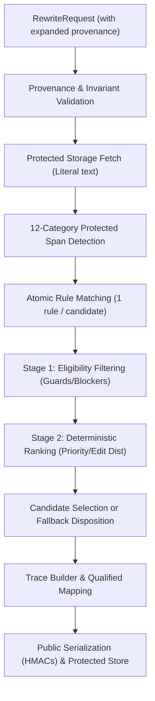
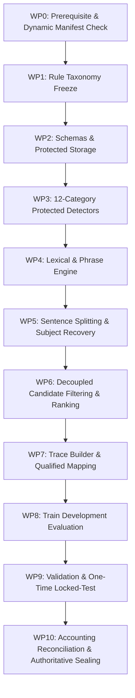

# Stage 33 Implementation Plan — Sinhala Linguistic Simplification Rules and Controlled Rewrite Engine (Pre-Execution Approved Baseline)

**Project:** AI-Powered Adaptive Child-Friendly Language Simplification System  
**Component:** Component 3 — AI/NLP-Based Language Simplification  
**Scope:** Deterministic Sinhala linguistic simplification rules, guarded rewrite execution, qualified traceability, and multi-partition zero-loss accounting  
**Status:** Approved Pre-Execution Implementation Baseline  
**Authoritative prerequisite:** `stage-32-complete-v5` at commit `7c6bb81a744305c3a59100a2c2af8fc06deb01c8`  
**Implementation branch:** `feature/stage33-sinhala-simplification-rules`  
**Planned start tag:** `stage-33-start`  
**Planned completion tag:** `stage-33-complete`  
**Ready to create stage-33-start:** YES  
**Ready to begin WP1:** YES  

---

## 1. Purpose & Primary Outcomes

Stage 33 establishes a deterministic, auditable, and fail-closed Sinhala simplification-rule engine. It uses the sealed Stage 30 preprocessing pipeline, the Stage 31 governed pilot corpus (evaluating across the 150-record canonical analytical corpus view), and Stage 32 vocabulary-frequency evidence to generate **draft automated simplification candidates**.

The stage is intended to prove that controlled lexical, phrase-level, sentence-splitting, and conservative discourse-filler deletion transformations can be proposed and executed without silently altering meaning-critical elements. It does **not** establish that a rewritten sentence is linguistically natural, developmentally appropriate, educationally effective, or safe for child delivery.

### Primary outcomes

1. **Frozen Rule Registry:** Deterministic Sinhala simplification rules with explicit human technical authorship, traceable evidence, and field-level rights partitioning.
2. **Two-Stage Candidate Resolution Pipeline:** Strict decoupling of candidate eligibility filtering (guards/blockers) from candidate ranking (preference ordering).
3. **Qualified Transformation Traceability:** Complete auditable transformation traces connecting output spans to source spans, recording explicit mapping status cardinality and `mapping_exact: bool` flags.
4. **Atomic Candidate Generation Policy:** Single transformation rule per candidate (`len(candidate.applied_rule_ids) == 1`) to prevent unsafe compositional interactions; candidate selection chooses the single best eligible rewrite.
5. **Mandatory External Protected Storage:** Strict isolation of all restricted literal source text, candidate rewrites, and protected rule payloads under `SINHALA_SIMPLIFICATION_PROTECTED_ROOT`.
6. **Sanitized Public Metadata:** Public metadata ledgers containing opaque IDs and versioned, domain-separated keyed HMACs, exposing zero raw restricted text.
7. **Partition-Isolated Evaluation & Dynamic Manifest Enforcement:** Partition counts and memberships are dynamically loaded from the sealed Stage 31 authoritative partition metadata artifact (`data/sinhala_external/corpus/corpus_metadata.json`) and verified against `canonical_analytical_corpus.jsonl`. Rule authoring and calibration are strictly restricted to canonical train records, defect detection to canonical validation records, and final evaluation to a single execution on canonical locked-test records.
8. **Multi-Partition Zero-Loss Conservation Accounting:** Authoritative accounting across all four evaluation scopes (Train-partition development, Validation, Locked-Test, and Consolidated Canonical Evaluation over the 150 inputs) across all six levels with strictly zero unaccounted units.

---

## 2. Stage Boundaries

### 2.1 Included

- Registering versioned lexical, phrase-level, sentence-splitting, and conservative discourse-filler deletion rules with explicit human technical authorship.
- Using Stage 32 frequency and provisional-band evidence strictly as non-authoritative rule features (never as autonomous substitution licenses).
- Preserving Sinhala Unicode sequences and grapheme cluster boundaries through the sealed Stage 30 interface.
- Protecting all 12 enumerated meaning-critical span categories (named entities, numbers, dates/times, measurements/units, currencies, negation scopes, modality/obligation, conditional relations, quotations/dialogue, parentheticals, mixed-script identifiers/URLs, and Stage 32 review-required vocabulary).
- Two-stage candidate resolution: Stage 1 eligibility filtering (guards/blockers) followed by Stage 2 deterministic ranking among eligible candidates.
- Conservative subject recovery in sentence splitting: permitted only when verbatim copied from an unambiguous source span and mapped directly to it; otherwise routing to review.
- Producing zero, one, or multiple draft rewrite candidates per input, with unchanged fallback when no eligible candidate remains after filtering.
- Recording complete rule provenance, configuration hashes, split manifest hashes, and structured rights inheritance (`RP-SRC-SI-XXX`).
- Mandatory external protected storage boundary enforcement via `SINHALA_SIMPLIFICATION_PROTECTED_ROOT`.
- Technical automated evaluation on train, validation, and locked-test partitions without cross-split leakage.

### 2.2 Explicitly excluded

- Claiming human-validated Sinhala linguistic correctness (deferred to Stage 34).
- Claiming developmental suitability for children aged 4–8 (deferred to Stage 34).
- Expert linguistic and child-development validation — Stage 34.
- Clause reordering transformations (deferred to Stage 34 due to syntactic ambiguity and dependency risks).
- Model-based Sinhala comparison involving Gemini, mT5, mBART, or other LLMs — Stage 35.
- Production output validation and governed fallback integration — Stage 36.
- Training or fine-tuning language models.
- Synthesizing human-reference simplifications or presenting SARI/BLEU as authoritative without governed references.
- Frequency-only or band-only substitution (replacing a word merely because target has higher frequency or different band).
- Serving Stage 33 output directly to children or altering Component 1 clinical/screening parameters.

---

## 3. Mandatory Governance Invariants

1. **Stage 30–32 immutability:** No Stage 30, Stage 31, or Stage 32 governed artifact or report may be modified in place.
2. **Draft-only output:** Every rewrite record maintains:
   ```json
   {
     "validation_status": "draft",
     "expert_validated": false,
     "research_eligible": false,
     "approved_for_child_delivery": false,
     "approved_for_unsupervised_child_delivery": false,
     "requires_expert_review": true
   }
   ```
3. **No frequency-only substitution:** Lower-frequency tokens may never be replaced merely because another token has higher frequency or lower provisional band.
4. **Sense, context, and authorship:** Lexical substitutions require explicit human technical authorship (`authoring_method`, `author_id_or_team`), allowlisted lexical relations, compatible contextual constraints, and traceable evidence refs.
5. **Meaning-critical preservation:** All 12 protected-span categories are locked against unallowlisted mutation.
6. **Incompleteness acknowledgment:** Named-entity and semantic detectors are conservative and incomplete; absence of a detector flag is not proof that a token is not an entity or meaning-critical element.
7. **Two-stage conflict resolution:** Candidate filtering is separated from ranking. Blocked or review-deferred candidates are eliminated during eligibility filtering and never participate in ranking.
8. **Conservative subject recovery:** In sentence splitting, subject insertion is permitted only when verbatim extracted from an unambiguous source span and mapped directly to it. Ambiguous recovery routes to `MANUAL_REVIEW_REQUIRED` or unchanged fallback.
9. **Fail closed:** Uncertain, conflicting, unsupported, or unsafe transformations produce unchanged fallback or `MANUAL_REVIEW_REQUIRED`. `FAILED_INTERNAL` is treated as an exceptional terminal failure. Fallback occurs when no eligible candidate remains after filtering.
10. **Transformation trace qualification:** Traces provide complete raw/normalized-to-output span mappings with explicit status (`one_to_one`, `many_to_one`, `one_to_many`, `inserted`, `deleted`, `non_local`, `unmapped`) and `mapping_exact: bool`. Exact one-to-one mapping is not claimed for insertions, deletions, or non-local splits. Selected rewrites may contain `unmapped` only if explicitly routed to manual review; otherwise candidate selection is blocked.
11. **Analytical corpus view freeze:** Rule development and evaluation denominator is the **150-record canonical analytical corpus** (`canonical_analytical_150`). The 180-record pilot corpus and rational duplicate weights are used solely for provenance and rights diagnostics.
12. **Method-development sample isolation:** Any Stage 31 predeclared exploratory development units remain excluded or isolated exactly as specified by sealed Stage 31 v8 manifests; Stage 33 must not silently reinterpret them as ordinary training records.
13. **Rule payload rights separation:** Rule registry definitions derived from restricted sources are partitioned: public registries contain opaque IDs, types, and versioned keyed HMACs; literal source/target expressions, concordances, and evidence reside in protected storage.
14. **Mandatory protected storage boundary:** All restricted text, candidate rewrites, and protected rule payloads reside in external storage specified by `SINHALA_SIMPLIFICATION_PROTECTED_ROOT`, failing closed if unset, nonexistent, unwritable, or resolving inside the repository worktree.
15. **Expanded request provenance:** Every rewrite request cryptographically binds `stage30_configuration_hash`, `stage31_split_manifest_hash`, `stage31_corpus_view`, `stage32_configuration_hash`, `stage32_lexicon_manifest_hash`, `stage33_configuration_hash`, and structured `rights_profile_ids_and_versions`.
16. **Partition isolation & dynamic manifest enforcement:** Partition counts and record memberships are dynamically loaded from the sealed Stage 31 authoritative partition metadata artifact (`data/sinhala_external/corpus/corpus_metadata.json`) and verified against `canonical_analytical_corpus.jsonl`. Stage 33 fails closed if observed counts or memberships differ from the sealed manifest. Rule discovery and calibration use canonical training records only; validation records serve defect detection only; locked-test records are evaluated exactly once.
17. **Configuration freeze sequence:** Provisional configuration is frozen before validation; final immutable configuration is frozen and sealed before locked-test execution. In-memory loaded configuration bytes are verified against disk hash prior to execution.
18. **Public export safety:** Public exports expose opaque IDs or versioned, domain-separated keyed HMACs; raw SHA-256 hashes of restricted literal text are never exposed in public artifacts.
19. **No fabricated review:** Reviewer IDs, decisions, timestamps, and approval fields remain null.
20. **Historical tag immutability:** Existing Stage 26–32 tags must not be moved. Prerequisite `stage-32-complete-v5` and start `stage-33-start` must resolve to `7c6bb81a744305c3a59100a2c2af8fc06deb01c8`.
21. **Multi-partition zero-loss accounting:** All six accounting equations use mutually exclusive terminal categories with strictly zero unaccounted units across Train, Validation, Locked-Test, and Consolidated partitions.

---

## 4. Evidence Hierarchy

1. **Sealed Stage 31 v8 analytical corpus (`data/sinhala_external/corpus/canonical_analytical_corpus.jsonl`):** Authoritative source for the 150 canonical inputs (record identity and `"split"` field).
2. **Sealed Stage 31 partition metadata artifact (`data/sinhala_external/corpus/corpus_metadata.json`):** Authoritative Stage 31 split definition, hash-verified under Stage 31 implementation manifest (`39ee316a...`).
3. **Governed Stage 32 frequency evidence (`data/sinhala_lexicon/lexicon/draft_lexicon.jsonl` & `data/sinhala_lexicon/ledgers/candidate_entry_ledger.jsonl`):** Governed lexicon ledgers controlled by Stage 32 v5 implementation manifest; used strictly as non-authoritative rule features.
4. **Stage 33 rule registry (`data/sinhala_simplification/registry/stage33_configuration.json`):** Governed, authored rules with priority, preconditions, and postconditions.
5. **Partition-specific ledgers:** Partition-isolated ledgers (`train_*`, `validation_*`, `locked_test_*`) ensuring strict traceability without cross-contamination.
6. **Consolidated public ledgers (`final_disposition_ledger.jsonl`, etc.):** Audit trails recording all canonical evaluations.
7. **Protected rewrite payloads (`$SINHALA_SIMPLIFICATION_PROTECTED_ROOT/`):** Full literal rewrites and traces held under restricted external storage.

---

## 5. Architecture & Pipeline Topology



---

## 6. Storage & Rights Contracts

### 6.1 Public vs Protected Boundary

| Element | Public Ledgers (`data/sinhala_simplification/ledgers/`) | External Protected Root (`$SINHALA_SIMPLIFICATION_PROTECTED_ROOT/`) |
|---|---|---|
| Rule Metadata | Opaque IDs, types, priorities, condition types | Full literal Sinhala patterns, templates, concordances |
| Rewrite Output | Output ID, disposition, applied rule IDs, guards | Full literal rewritten Sinhala string |
| Operation Spans | Code point ranges, mapping status, `mapping_exact` | Verbatim before/after substrings |
| Hashes | Versioned domain-separated keyed HMACs | Raw internal SHA-256 for integrity verification |

### 6.2 Mandatory Protected Root Contract

The environment variable `SINHALA_SIMPLIFICATION_PROTECTED_ROOT` must be set, point to an existing, writable directory outside the git workspace, and enforce POSIX `0700` or Windows ACL restrictions.

---

## 7. Rule Taxonomy & Atomic Composition Policy

### 7.1 Permitted Rule Classes

1. **Lexical substitution (`SI-LEX-SUB-XXXX`):** Allowlisted lemma/form replacement with inflection preservation.
2. **Phrase substitution (`SI-PHR-SUB-XXXX`):** Multi-token idiom/phrase simplification via longest-match-first.
3. **Sentence splitting (`SI-SNT-SPL-XXXX`):** Splitting compound sentences at coordinating conjunctions (`සහ`, `නමුත්`) with deterministic punctuation reconstruction.
4. **Conservative discourse deletion (`SI-SYN-CON-XXXX`):** Removal of redundant discourse markers where semantic guards detect zero protected change.

### 7.2 Atomic Candidate Generation Policy

Stage 33 enforces **one transformation rule per candidate**:
```python
len(candidate.applied_rule_ids) == 1
```
Multi-rule composition within a single candidate is prohibited to avoid uncontrolled syntactic interaction. Candidate selection picks the single best eligible rewrite among competing candidates.

---

## 8. Protected Spans & Meaning Preservation Detectors

### 8.1 Enumeration of All 12 Protected-Span Categories

To prevent semantic drift, the protected-span detector identifies, locks, and guards spans belonging to all 12 categories:

1. **`NAMED_ENTITY`:** Person names, organization titles, geopolitical entities, and administrative locations.
2. **`NUMBER_NUMERIC`:** Hindu-Arabic digits, Sinhala numerals, spelled numbers, decimals, percentages, and numeric ranges.
3. **`DATE_TIME`:** Calendar dates, Gregorian and Buddhist Era years, months, days, relative times, and timestamps.
4. **`UNIT_MEASUREMENT`:** SI units, imperial measures, localized volumetric/distance measures, and abbreviated symbols.
5. **`CURRENCY`:** Currency symbols, ISO codes (`LKR`, `USD`, `EUR`, `GBP`), localized notations (`රු.`, `Rs.`), and monetary amounts.
6. **`NEGATION_MARKER`:** Negation particles (`නො`, `නැත`, `නොවේ`, `නොහැක`, `නොමැත`) and their full syntactic scopes.
7. **`MODALITY_CONDITION`:** Modal verbs and obligation markers (`යුතුය`, `හැකිය`, `නොහැකිය`, `අවශ්‍යය`).
8. **`CONDITIONAL_RELATION`:** Conditional particles, dependencies, and clauses (`නම්`, `වුවහොත්`, `පමණක්`, `විට`).
9. **`QUOTATION_DIRECT_SPEECH`:** Single and double quotation marks, direct dialogue, and verbatim quoted statements.
10. **`PARENTHETICAL_REFERENCE`:** Content within parentheses, square brackets, supplementary citations, and explanatory notes.
11. **`IDENTIFIER_CODE_URL` / `MIXED_SCRIPT_TERM`:** Latin alphanumeric tokens, technical identifiers, URLs, DOIs, mixed-script terms, and citations.
12. **`STAGE32_REVIEW_REQUIRED_VOCABULARY`:** Sensitive, clinical, technical, or review-required lexicon entries identified during Stage 32 auditing.

### 8.2 Incompleteness Disclaimer

Automated Sinhala semantic detectors are conservative and incomplete. The absence of a detector flag does not prove that an unmarked token is not a named entity or meaning-critical element.

---

## 9. Two-Stage Candidate Resolution Pipeline

### Stage 1: Eligibility Filtering (Guards & Blockers)

1. **Protected span check:** Candidate mutates any of the 12 protected categories without override → `BLOCKED_PROTECTED_SPAN`.
2. **Meaning guards:** Candidate alters numbers, negation scope, modality, or entities → `BLOCKED_MEANING_GUARD`.
3. **Grapheme guards:** Candidate introduces invalid grapheme breaks or Unicode `U+FFFD` → `BLOCKED_MEANING_GUARD`.
4. **Subject recovery check:** Sentence split requires subject insertion but source referent is ambiguous → `DEFERRED_MANUAL_REVIEW`.
5. **Trace mapping check:** Candidate contains `unmapped` traces without manual review routing → `BLOCKED_MEANING_GUARD`.
6. **Internal error:** Unhandled processing exception → `FAILED_INTERNAL`.

### Stage 2: Deterministic Ranking (Eligible Candidates Only)

Among candidates passing Stage 1:
1. `LONGEST_APPROVED_PHRASE_MATCH`
2. `HIGHER_RULE_PRIORITY`
3. `FEWER_TRANSFORMATIONS`
4. `LOWER_EDIT_DISTANCE`
5. `STABLE_RULE_ID_ORDER`

#### Fallback Routing

When zero candidates are eligible:
- Any candidate review-deferred → `MANUAL_REVIEW_REQUIRED`.
- All generated candidates blocked → `UNCHANGED_ALL_CANDIDATES_BLOCKED`.
- No rule matched → `UNCHANGED_NO_APPLICABLE_RULE`.

---

## 10. Transformation Traceability & Qualified Mapping

Every transformation operation records:
- `operation_id`: Unique identifier (`SI-OP-XXXXXX`).
- `operation_type`: `REPLACE`, `SPLIT`, `INSERT`, `DELETE`.
- `mapping_status`: `one_to_one`, `many_to_one`, `one_to_many`, `inserted`, `deleted`, `non_local`, `unmapped`.
- `mapping_exact`: `true` if character-level exact mapping holds; `false` otherwise.
- Invariant: Selected rewrites have 0 `unmapped` operations.

---

## 11. Multi-Partition Accounting Framework

Stage 33 specifies **authoritative multi-partition zero-loss conservation accounting** covering all 150 canonical inputs:
- **Train-partition development accounting:** Reconciled on canonical training inputs.
- **Validation partition accounting:** Reconciled on canonical validation inputs.
- **Locked-test partition accounting:** Reconciled on canonical locked-test inputs.
- **Consolidated canonical evaluation accounting:** Reconciled across the complete 150-input population.

### 11.1 The Six Conservation Equations

#### Level 1: Authoritative Input Disposition Accounting

$$\text{TotalInputs} = \text{DraftSelected} + \text{UnchangedNoRule} + \text{UnchangedBlocked} + \text{ManualReview} + \text{RejectedIneligible} + \text{RejectedInvalid} + \text{FailedInternal} + \text{Unaccounted}$$

Target `Unaccounted`: strictly **0**.

#### Level 2: Mutually Exclusive Rule-Attempt Accounting

$$\text{RuleAttempts} = \text{NOT\_APPLICABLE} + \text{CANDIDATE\_GENERATED} + \text{DEFERRED\_BEFORE\_GENERATION} + \text{FAILED\_INTERNAL} + \text{Unaccounted}$$

**Definition of Rule Attempt & Denominator Formulation:**
A rule attempt is created per evaluated rule applicability site. A rule creates an attempt when tested against an input:
- When the rule pattern does not match, exactly 1 attempt with terminal status `NOT_APPLICABLE` is recorded.
- When the rule pattern matches one or more non-overlapping source spans, 1 attempt with terminal status `CANDIDATE_GENERATED` is recorded for each discrete match site.
$$\text{TotalRuleAttempts} = \text{BaseRuleInputEvaluations} (N_{\text{inputs}} \times N_{\text{rules}}) + \text{AdditionalMatchSiteEvaluations}$$
Target `Unaccounted`: strictly **0**.

#### Level 3: Mutually Exclusive Candidate Accounting

$$\text{GeneratedCandidates} = \text{SELECTED} + \text{NOT\_SELECTED\_LOWER\_RANK} + \text{BLOCKED\_PROTECTED\_SPAN} + \text{BLOCKED\_MEANING\_GUARD} + \text{DEFERRED\_MANUAL\_REVIEW} + \text{FAILED\_INTERNAL} + \text{Unaccounted}$$

Target `Unaccounted`: strictly **0**.

#### Level 4: Transformation Operation Accounting

$$\text{RecordedOperations} = \text{Replacements} + \text{Splits} + \text{Insertions} + \text{Deletions} + \text{Unaccounted}$$

Target `Unaccounted`: strictly **0**.

#### Level 5: Mutually Exclusive Trace Element Accounting

$$\text{TraceElements} = \text{ExactlyMapped} + \text{QualifiedNonExact} + \text{UnmappedReviewed} + \text{Unaccounted}$$

Target `Unaccounted`: strictly **0**.

#### Level 6: Rights and Export Accounting

$$\text{ExportEvaluatedFields} = \text{PublicPermitted} + \text{ProtectedInternal} + \text{SuppressedByPolicy} + \text{ReviewRequired} + \text{Unaccounted}$$

**Frozen Inventory of the 4 Evaluated Field Slots Per Record:**
1. **Record Identifier Slot:** `request_id`, `record_id`, `output_id` (PublicPermitted)
2. **Rule and Guard Metadata Slot:** `final_disposition`, `applied_rule_ids`, `guard_results`, `validation_status` (PublicPermitted)
3. **Output Storage Locator Slot:** `output_storage_ref` (ProtectedInternal — opaque external pointer)
4. **Restricted Text Content Slot:** literal `source_text`, `candidate_text_internal`, `output_text` (SuppressedByPolicy — omitted from public export)

Total evaluated field instances $= N_{\text{inputs}} \times 4$.  
Target `Unaccounted`: strictly **0**.

---

## 12. Dynamic Partition Contract & Isolation Requirements

Partition assignments are dynamically loaded from the sealed Stage 31 baseline:
- Manifest path: `data/sinhala_external/corpus/corpus_metadata.json`
- Analytical corpus: `data/sinhala_external/corpus/canonical_analytical_corpus.jsonl`
- Partition verification script: `scripts/stage33/verify_partition_isolation.py`
- Invariant: Zero cross-split record overlaps, zero cross-split document-group overlaps, zero leakage of evaluation records into training.

---

## 13. Locked-Test Execution Protocol (One-Time Governed Gate)

The locked-test evaluation represents a one-time irrevocable gate:
1. Configuration is permanently frozen and sealed (`status: "FROZEN_FOR_LOCKED_EVALUATION"`).
2. The locked-test runner (`scripts/stage33/run_locked_evaluation.py`) reads configuration bytes into memory and verifies that in-memory byte SHA-256 equals the on-disk file hash before reading any locked test record.
3. Locked evaluation is executed **exactly once**.
4. An immutable execution record is generated containing execution ID, start/end timestamps, input manifest SHA-256, loaded configuration SHA-256, output ledger SHA-256, records processed, execution status, and confirmation of 0 post-execution changes.

---

## 14. Work Packages and Execution Order



- **WP0:** Prerequisite verification (`stage-32-complete-v5` at `7c6bb81a...`), dynamic split manifest loading, immutability check, baseline snapshots.
- **WP1–WP7:** Core rule engine, 12-category span detector, atomic candidate generator, decoupled ranker, and qualified trace builder.
- **WP8:** Development evaluation on canonical training records, emitting `train_*_ledger.jsonl`.
- **WP9:** Validation evaluation on canonical validation records (`validation_*_ledger.jsonl`), frozen configuration seal, and single-execution locked evaluation on canonical locked-test records (`locked_test_*_ledger.jsonl`), appending to consolidated ledgers.
- **WP10:** Multi-partition accounting verification across all 6 levels, documentation/implementation manifest verification, tamper tests, commit, annotated tag `stage-33-complete`, and push.

---

## 15. Automated Test Plan

The Stage 33 test suite comprises **18 test modules (32 test cases)** in `backend/tests/sinhala_simplification/`:

1. `test_stage33_rule_registry.py`: Validates unique rule IDs, human authorship fields, evidence refs, and public/protected separation.
2. `test_stage33_lexical_rules.py`: Validates allowlisted lexical substitution, morphology preservation, and rejection of frequency-only swaps.
3. `test_stage33_phrase_rules.py`: Validates longest-match-first behavior and prevents overlapping partial substitutions.
4. `test_stage33_sentence_splitting.py`: Validates punctuation reconstruction, structural completeness, and boundary preservation.
5. `test_stage33_constrained_subject_recovery.py`: Validates that subject insertion occurs only from unambiguous source spans; ambiguous recovery routes to review.
6. `test_stage33_protected_spans.py`: Validates detection of entities, numbers, dates, units, currencies, parentheticals, and technical terms.
7. `test_stage33_negation_and_modality.py`: Validates that negation markers and modal/conditional scopes are never altered or dropped.
8. `test_stage33_two_stage_candidate_resolution.py`: Validates that blocked candidates are filtered out before ranking and never participate in ranking.
9. `test_stage33_composed_rule_safety.py`: Validates atomic single-rule policy (`len(candidate.applied_rule_ids) == 1`) and verifies composite candidate rejection.
10. `test_stage33_transformation_traces.py`: Validates trace mappings, mapping status enums, and `mapping_exact` flags.
11. `test_stage33_determinism.py`: Validates byte-for-byte reproducibility across repeated pipeline runs.
12. `test_stage33_partition_isolation.py`: Validates dynamic loading from Stage 31 manifest, fail-closed handling of count mismatches, and zero data leakage.
13. `test_stage33_corpus_view_and_denominators.py`: Validates that the 150-record canonical analytical view governs evaluation metrics.
14. `test_stage33_rights_and_protected_payloads.py`: Validates external protected storage boundary, source hash verification, and zero text leakage.
15. `test_stage33_public_export_safety.py`: Validates versioned domain-separated keyed HMACs and confirms absence of raw text hashes.
16. `test_stage33_accounting.py`: Validates that all six conservation equations hold with exactly 0 unaccounted items.
17. `test_stage33_end_to_end.py`: Comprehensive pipeline tests from raw request to governed output and audit traces.
18. `test_stage33_entity_number_preservation.py`: Dedicated adversarial regression suite for numeric precision, unit binding, and entity boundary preservation.

---

## 16. Evidence Required for Authoritative Sealing

The completion record requires complete, unabridged terminal command outputs:

1. `git rev-parse HEAD`
2. `git rev-parse "stage-33-start^{commit}"`
3. `git rev-parse "stage-33-complete^{commit}"`
4. `git cat-file -t stage-33-complete`
5. `git merge-base --is-ancestor "stage-32-complete-v5^{commit}" "stage-33-complete^{commit}"`
6. `git status --short`
7. `git ls-remote --tags origin "stage-33-complete*"`
8. `python scripts/stage33/verify_partition_isolation.py`
9. `python scripts/stage33/verify_stage30_to_32_immutability.py`
10. `python scripts/stage33/verify_stage33_accounting.py`
11. `python scripts/stage33/verify_stage33_manifest.py`

---

## 17. Authoritative Completion Template (Pre-Execution Specification)

```text
================================================================
STAGE 33 — SINHALA CONTROLLED SIMPLIFICATION RULE ENGINE
================================================================

Stage 33:                                   <COMPLETE / REVISION_REQUIRED>
Governance accounting:                      <RECONCILED / UNRECONCILED>
Locked-test execution:                      <VERIFIED ONCE / PENDING>
Authoritative completion tag:               <SEALED / UNSEALED>
Approved for child delivery:                FALSE

Prerequisite tag:                           stage-32-complete-v5
Prerequisite commit:                        7c6bb81a744305c3a59100a2c2af8fc06deb01c8
Start tag:                                  stage-33-start
Final commit:                               <full 40-character SHA>
Completion tag:                             stage-33-complete

Ancestry verification:                      <PASSED / FAILED>
Stage 30–32 immutability:                   <PASSED / FAILED>
Corpus view evaluated:                      canonical_analytical_150
Verified canonical split counts:            Train: <dyn_train>, Validation: <dyn_val>, Locked Test: <dyn_test> (Total: 150)
External protected root:                    <verified outside worktree>
Rule registry:                              <count> rules, <PASSED / FAILED>
Protected rule payloads separated:          <PASSED / FAILED>
Protected-span policy:                      <PASSED (12 categories) / FAILED>
Two-stage candidate resolution:             <PASSED / FAILED>
Constrained subject recovery:               <PASSED / FAILED>
Trace classification coverage:              100% of trace elements classified
Selected rewrite unmapped traces:           0
Deterministic rerun equality:                <PASSED / FAILED>
Training-only rule development:             <PASSED / FAILED>
Configuration frozen before locked test:    <PASSED / FAILED>
Locked-test executions:                     1

Multi-Partition Reconciled Totals (150 inputs):
- Train-partition development accounting:   <count> / <count>
- Validation partition accounting:          <count> / <count>
- Locked-test partition accounting:         <count> / <count>
- Consolidated canonical accounting:        <count> / <count>

Terminal Dispositions:
- Draft rewrites selected:                  <count>
- Unchanged no applicable rule:             <count>
- Unchanged all candidates blocked:         <count>
- Manual review required:                   <count>
- Rejected source ineligible:               <count>
- Rejected invalid preprocessing:           <count>
- Failed internal error:                    0
- Total reconciled inputs:                  150 / 150 (Unaccounted: 0)

Conservation Equation Parity (Unaccounted across all levels):
- Level 1 (Inputs):                         0
- Level 2 (Rule attempts):                  0
- Level 3 (Candidates):                     0
- Level 4 (Operations):                     0
- Level 5 (Trace elements):                 0
- Level 6 (Export fields):                  0

Automated Test Suites:
- Stage 33 test cases:                      <passed>/<collected> (18 test modules)
- Full backend regression:                  <passed>/<collected>
- Frontend test suite:                      <passed>/<collected>
- Frontend production bundle:               <PASSED / FAILED>

Manifest Verification:
- Documentation manifest:                   <verified>/<expected>
- Implementation manifest:                  <verified>/<expected>

Governance Exclusions & Disclaimers:
- Complete semantic-equivalence:            NOT ESTABLISHED
- Expert semantic-drift assessment:         DEFERRED TO STAGE 34
- Sinhala expert linguistic validation:     DEFERRED TO STAGE 34
- Child-development validation:             DEFERRED TO STAGE 34
- Model comparison:                         DEFERRED TO STAGE 35
- Production validation and fallback:       DEFERRED TO STAGE 36
- Approved for child delivery:              FALSE
================================================================
```
