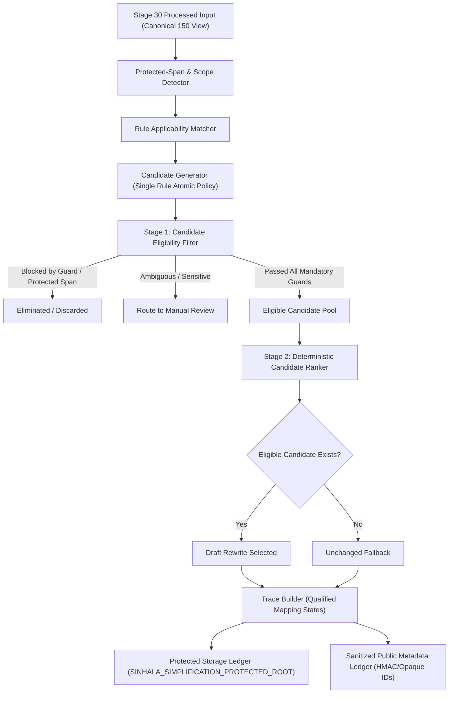
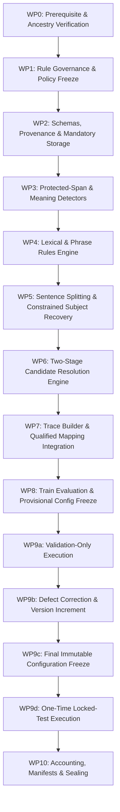

# Stage 33 Implementation Plan — Sinhala Linguistic Simplification Rules and Controlled Rewrite Engine (Revised v4 — Final Approved)

**Project:** AI-Powered Adaptive Child-Friendly Language Simplification System  
**Component:** Component 3 — AI/NLP-Based Language Simplification  
**Scope:** Deterministic Sinhala linguistic simplification rules, guarded rewrite execution, qualified traceability, and partition-isolated automated evaluation  
**Status:** Approved for Execution Baseline (Revised v4 incorporating dynamic partition loading, sealed manifest verification, and all governance corrections)  
**Authoritative prerequisite:** `stage-32-complete-v5` at commit `7c6bb81a744305c3a59100a2c2af8fc06deb01c8`  
**Implementation branch:** `feature/stage33-sinhala-simplification-rules`  
**Planned start tag:** `stage-33-start`  
**Planned completion tag:** `stage-33-complete`  
**Ready to create stage-33-start:** YES  
**Ready to begin WP1:** YES  

---

## 1. Purpose & Primary Outcomes

Stage 33 establishes a deterministic, auditable, and fail-closed Sinhala simplification-rule engine. It uses the sealed Stage 30 preprocessing pipeline, the Stage 31 governed pilot corpus (evaluating strictly on the 150-record canonical analytical view), and Stage 32 vocabulary-frequency evidence to generate **draft automated simplification candidates**.

The stage is intended to prove that controlled lexical, phrase-level, sentence-splitting, and conservative discourse-filler deletion transformations can be proposed and executed without silently altering meaning-critical elements. It does **not** establish that a rewritten sentence is linguistically natural, developmentally appropriate, educationally effective, or safe for child delivery.

### Primary outcomes

1. **Frozen Rule Registry:** Deterministic Sinhala simplification rules with explicit human technical authorship, traceable evidence, and field-level rights partitioning.
2. **Two-Stage Candidate Resolution Pipeline:** Strict decoupling of candidate eligibility filtering (guards/blockers) from candidate ranking (preference ordering).
3. **Qualified Transformation Traceability:** Complete auditable transformation traces connecting output spans to source spans, recording explicit mapping status cardinality and `mapping_exact: bool` flags.
4. **Atomic Candidate Generation Policy:** Single transformation rule per candidate to prevent unsafe compositional interactions; candidate selection chooses the single best eligible rewrite.
5. **Mandatory External Protected Storage:** Strict isolation of all restricted literal source text, candidate rewrites, and protected rule payloads under `SINHALA_SIMPLIFICATION_PROTECTED_ROOT`.
6. **Sanitized Public Metadata:** Public metadata ledgers containing opaque IDs and versioned, domain-separated keyed HMACs, exposing zero raw restricted text.
7. **Partition-Isolated Evaluation & Dynamic Manifest Enforcement:** Partition counts and memberships are dynamically loaded from the sealed Stage 31 v8 split manifest (`split_manifest.json`) and verified against `canonical_analytical_corpus.jsonl`. Rule authoring and calibration are strictly restricted to canonical train records, defect detection to canonical validation records, and final evaluation to a single execution on canonical locked-test records.
8. **Six-Level Zero-Loss Conservation Accounting:** Authoritative accounting across inputs, mutually exclusive rule attempts, mutually exclusive candidates, transformation operations, trace elements, and export fields—with strictly zero unaccounted units.

---

## 2. Stage Boundaries

### 2.1 Included

- Registering versioned lexical, phrase-level, sentence-splitting, and conservative discourse-filler deletion rules with explicit human technical authorship.
- Using Stage 32 frequency and provisional-band evidence strictly as non-authoritative rule features (never as autonomous substitution licenses).
- Preserving Sinhala Unicode sequences and grapheme cluster boundaries through the sealed Stage 30 interface.
- Protecting named entities, numbers, units, dates, currencies, negation, modality, conditions, quotations, parentheticals, and technical terms.
- Two-stage candidate resolution: Stage 1 eligibility filtering (guards/blockers) followed by Stage 2 deterministic ranking among eligible candidates.
- Conservative subject recovery in sentence splitting: permitted only when verbatim copied from an unambiguous source span and mapped directly to it; otherwise routing to review.
- Producing zero, one, or multiple draft rewrite candidates per input, with unchanged fallback when no eligible candidate remains after filtering.
- Recording complete rule provenance, configuration hashes, split manifest hashes, and structured rights inheritance (`RP-SRC-SI-XXX`).
- Mandatory external protected storage boundary enforcement via `SINHALA_SIMPLIFICATION_PROTECTED_ROOT`.
- Technical automated evaluation on train, validation, and locked-test partitions without cross-split leakage.

### 2.2 Explicitly excluded

- Claiming human-validated Sinhala linguistic correctness (deferred to Stage 34).
- Claiming developmental suitability for children aged 4–8 (deferred to Stage 34).
- Expert linguistic and child-development validation — Stage 34.
- Clause reordering transformations (deferred to Stage 34 due to syntactic ambiguity and dependency risks).
- Model-based Sinhala comparison involving Gemini, mT5, mBART, or other LLMs — Stage 35.
- Production output validation and governed fallback integration — Stage 36.
- Training or fine-tuning language models.
- Synthesizing human-reference simplifications or presenting SARI/BLEU as authoritative without governed references.
- Frequency-only or band-only substitution (replacing a word merely because target has higher frequency or different band).
- Serving Stage 33 output directly to children or altering Component 1 clinical/screening parameters.

---

## 3. Mandatory Governance Invariants

1. **Stage 30–32 immutability:** No Stage 30, Stage 31, or Stage 32 governed artifact or report may be modified in place.
2. **Draft-only output:** Every rewrite record maintains:
   ```json
   {
     "validation_status": "draft",
     "expert_validated": false,
     "research_eligible": false,
     "approved_for_child_delivery": false,
     "approved_for_unsupervised_child_delivery": false,
     "requires_expert_review": true
   }
   ```
3. **No frequency-only substitution:** Lower-frequency tokens may never be replaced merely because another token has higher frequency or lower provisional band.
4. **Sense, context, and authorship:** Lexical substitutions require explicit human technical authorship (`authoring_method`, `author_id_or_team`), allowlisted lexical relations, compatible contextual constraints, and traceable evidence refs.
5. **Meaning-critical preservation:** Named entities, numbers, units, dates, currencies, negation, modality, conditional relations, quotations, and identifiers are protected. Unallowlisted mutation is strictly prohibited.
6. **Incompleteness acknowledgment:** Named-entity and semantic detectors are conservative and incomplete; absence of a detector flag is not proof that a token is not an entity or meaning-critical element.
7. **Two-stage conflict resolution:** Candidate filtering is separated from ranking. Blocked or review-deferred candidates are eliminated during eligibility filtering and never participate in ranking.
8. **Conservative subject recovery:** In sentence splitting, subject insertion is permitted only when verbatim extracted from an unambiguous source span and mapped directly to it. Ambiguous recovery routes to `MANUAL_REVIEW_REQUIRED` or unchanged fallback.
9. **Fail closed:** Uncertain, conflicting, unsupported, or unsafe transformations produce unchanged fallback or `MANUAL_REVIEW_REQUIRED`. `FAILED_INTERNAL` is treated as an exceptional terminal failure. Fallback occurs when no eligible candidate remains after filtering.
10. **Transformation trace qualification:** Traces provide complete raw/normalized-to-output span mappings with explicit status (`one_to_one`, `many_to_one`, `one_to_many`, `inserted`, `deleted`, `non_local`, `unmapped`) and `mapping_exact: bool`. Exact one-to-one mapping is not claimed for insertions, deletions, or non-local splits. Selected rewrites may contain `unmapped` only if explicitly routed to manual review; otherwise candidate selection is blocked.
11. **Analytical corpus view freeze:** Rule development and evaluation denominator is the **150-record canonical analytical corpus** (`canonical_analytical_150`). The 180-record pilot corpus and rational duplicate weights are used solely for provenance and rights diagnostics.
12. **Method-development sample isolation:** Any Stage 31 predeclared exploratory development units remain excluded or isolated exactly as specified by sealed Stage 31 v8 manifests; Stage 33 must not silently reinterpret them as ordinary training records.
13. **Rule payload rights separation:** Rule registry definitions derived from restricted sources are partitioned: public registries contain opaque IDs, types, and versioned keyed HMACs; literal source/target expressions, concordances, and evidence reside in protected storage.
14. **Mandatory protected storage boundary:** All restricted text, candidate rewrites, and protected rule payloads reside in external storage specified by `SINHALA_SIMPLIFICATION_PROTECTED_ROOT`, failing closed if unset, nonexistent, unwritable, or resolving inside the repository worktree.
15. **Expanded request provenance:** Every rewrite request cryptographically binds `stage30_configuration_hash`, `stage31_split_manifest_hash`, `stage31_corpus_view`, `stage32_configuration_hash`, `stage32_lexicon_manifest_hash`, `stage33_configuration_hash`, and structured `rights_profile_ids_and_versions`.
16. **Partition isolation & dynamic manifest enforcement:** Partition counts and record memberships are dynamically loaded from the sealed Stage 31 v8 split manifest (`split_manifest.json`) and verified against `canonical_analytical_corpus.jsonl`. Stage 33 fails closed if observed counts or memberships differ from the sealed manifest. Rule discovery and calibration use canonical training records only; validation records serve defect detection only; locked-test records are evaluated exactly once.
17. **Configuration freeze sequence:** Provisional configuration is frozen before validation; final immutable configuration is frozen and sealed before locked-test execution.
18. **Public export safety:** Public exports expose opaque IDs or versioned, domain-separated keyed HMACs; raw SHA-256 hashes of restricted literal text are never exposed in public artifacts.
19. **No fabricated review:** Reviewer IDs, decisions, timestamps, and approval fields remain null.
20. **Historical tag immutability:** Existing Stage 26–32 tags must not be moved. Prerequisite `stage-32-complete-v5` and start `stage-33-start` must resolve to `7c6bb81a744305c3a59100a2c2af8fc06deb01c8`.
21. **Zero-loss mutually exclusive accounting:** All six accounting equations use mutually exclusive terminal categories with strictly zero unaccounted units.

---

## 4. Evidence Hierarchy, Authority Boundaries & Partition Usage

| Evidence source | Permitted use | Prohibited interpretation |
|---|---|---|
| Stage 30 preprocessing | Unicode, token, sentence, and span boundaries | Proof of linguistic correctness |
| Stage 31 canonical train (dynamically loaded from sealed v8 manifest) | Rule discovery, pattern extraction, threshold calibration | Test set performance estimation |
| Stage 31 canonical validation (dynamically loaded from sealed v8 manifest) | Defect detection, edge-case analysis, guard failure diagnosis | Iterative threshold tuning or rule tailoring |
| Stage 31 canonical locked test (dynamically loaded from sealed v8 manifest) | One-time final evaluation of frozen engine | Retrospective engine retraining |
| Stage 31 canonical total (150) | Overall evaluation denominator (reported only after split breakdown) | Single monolithic training set |
| Stage 31 pilot corpus (180) | Rights, licensing, and provenance accounting diagnostics | Primary frequency denominator (avoids duplicate distortion) |
| Stage 32 lexicon & weights | Lexical frequency, dispersion, surface-form clustering | Autonomous substitution authorization or reading levels |
| Technical rule fixtures | Deterministic regression and boundary testing | Human simplification reference standards |
| Automated guards | Detection of configured invariant violations | Proof of complete semantic equivalence |
| Future Stage 34 review | Expert linguistic and developmental judgments | Available during Stage 33 — it is not |

---

## 5. Target Architecture & Two-Stage Processing Sequence



### Processing sequence

```text
Immutable source record (Canonical 150 view)
→ verified Stage 30 preprocessing
→ protected-span detection (entities, numbers, dates, units, currencies, negation, modality)
→ rule applicability matching & candidate generation (atomic single-rule generation)
→ Stage 1: Candidate eligibility filtering (meaning guards, span overlap, subject recovery)
→ Stage 2: Candidate ranking among eligible candidates (longest phrase → priority → operations → rule ID)
→ Draft rewrite selected OR fail-closed unchanged fallback / manual review routing
→ Transformation trace building (explicit mapping cardinality & exactness flags)
→ External protected storage write (SINHALA_SIMPLIFICATION_PROTECTED_ROOT)
→ Public metadata ledger generation (versioned keyed HMACs, zero restricted text)
```

---

## 6. Repository & External Protected Storage Contract

### 6.1 In-Tree Repository Structure

```text
backend/app/sinhala_simplification/
├── __init__.py
├── enums.py                      # Mutually exclusive terminal statuses, rule types, mapping states
├── schemas.py                    # Pydantic v2 contracts with request provenance & qualified traces
├── storage.py                    # Mandatory external storage manager & boundary guard
├── protected_spans.py            # Conservative protected-span & scope detection
├── rule_registry.py              # Rule registry loader & payload rights boundary
├── lexical_rules.py              # Allowlisted lexical rules with authorship & evidence bindings
├── phrase_rules.py               # Phrase-level longest-match-first rules
├── sentence_splitter.py          # Sentence splitting with constrained subject recovery
├── syntactic_rules.py            # Conservative discourse filler deletion rules
├── applicability.py              # Rule applicability evaluation & attempt recording
├── candidate_generator.py        # Candidate generation (atomic single-rule policy)
├── candidate_filter.py           # Stage 1: Candidate eligibility filtering & guard evaluation
├── candidate_ranker.py           # Stage 2: Deterministic ranking among eligible candidates
├── candidate_selector.py         # Pipeline selection coordinator & fallback handler
├── trace_builder.py              # Operation trace builder with qualified mapping states
├── pipeline.py                   # End-to-end rewrite pipeline
└── serialization.py              # Public metadata sanitization & versioned keyed HMAC generation

backend/tests/sinhala_simplification/
├── test_stage33_rule_registry.py
├── test_stage33_lexical_rules.py
├── test_stage33_phrase_rules.py
├── test_stage33_sentence_splitting.py
├── test_stage33_constrained_subject_recovery.py
├── test_stage33_protected_spans.py
├── test_stage33_negation_and_modality.py
├── test_stage33_entity_number_preservation.py
├── test_stage33_two_stage_candidate_resolution.py
├── test_stage33_composed_rule_safety.py
├── test_stage33_transformation_traces.py
├── test_stage33_determinism.py
├── test_stage33_partition_isolation.py
├── test_stage33_rights_and_protected_payloads.py
├── test_stage33_public_export_safety.py
├── test_stage33_corpus_view_and_denominators.py
├── test_stage33_accounting.py
└── test_stage33_end_to_end.py

data/sinhala_simplification/
├── registry/
│   ├── stage33_configuration.json
│   ├── rule_registry_public.json        # Public metadata (opaque IDs, versioned keyed HMACs, priorities)
│   ├── protected_span_policy.json
│   └── ranking_precedence.json
├── fixtures/
│   ├── lexical_rule_cases.json
│   ├── sentence_split_cases.json
│   ├── subject_recovery_cases.json
│   ├── protected_meaning_cases.json
│   ├── negative_rule_cases.json
│   └── overlapping_rule_cases.json
├── ledgers/
│   ├── rule_attempt_ledger.jsonl
│   ├── candidate_ledger.jsonl
│   ├── transformation_trace_ledger.jsonl
│   └── final_disposition_ledger.jsonl
├── evaluation/
│   ├── validation_metadata.jsonl
│   ├── locked_test_metadata.jsonl
│   └── public_summary.json
├── snapshots/
│   └── stage32_prerequisite_snapshot.json
└── manifests/
    └── stage33_implementation_manifest.sha256

scripts/stage33/
├── snapshot_prerequisites.py
├── generate_rule_registry.py
├── run_development_evaluation.py
├── freeze_stage33_configuration.py
├── run_locked_evaluation.py
├── verify_partition_isolation.py
├── verify_stage30_to_32_immutability.py
├── verify_stage33_accounting.py
├── generate_stage33_reports.py
├── generate_stage33_manifest.py
└── verify_stage33_manifest.py
```

### 6.2 Mandatory External Protected Storage Contract

The environment variable `SINHALA_SIMPLIFICATION_PROTECTED_ROOT` is **mandatory**. The pipeline **fails closed immediately** on startup if `SINHALA_SIMPLIFICATION_PROTECTED_ROOT` is:
1. Unset or empty string.
2. Non-existent on the local filesystem.
3. Not writable by the executing process.
4. Resolving inside the Git repository working tree.
5. Resolving through a filesystem symlink or directory junction into the Git working tree.

#### Protected Subdirectory Layout & Access Permissions

```text
$SINHALA_SIMPLIFICATION_PROTECTED_ROOT/
├── keys/
│   └── hmac_secret.key                   # Key for public domain-separated HMAC generation (chmod 0400)
├── rules/
│   └── rule_payloads_protected.json      # Literal restricted phrases, concordances, evidence (chmod 0600)
├── candidates/                            # Literal candidate rewrite texts (chmod 0600)
├── outputs/                               # Selected draft rewrites & fallback texts (chmod 0600)
└── debug/                                 # Internal diagnostic logs with full spans (chmod 0600)
```

- **Filesystem Permissions:** POSIX systems must enforce `0700` (directory) and `0600` (files). Windows systems must enforce practical restricted ACLs: remove broad inherited access (`Everyone`, unprivileged users) and restrict access strictly to the executing service account, authorized system account, and explicitly approved administrators.
- **Debug Directory Retention Policy:** `$SINHALA_SIMPLIFICATION_PROTECTED_ROOT/debug/` contains verbatim strings and character offsets. It is strictly temporary and diagnostic. It must be purged upon verification run completion and is never packaged into release artifacts.

---

## 7. Rule Taxonomy, Authorship & Composition Policy

Every simplification rule must be an authored, traceable technical artifact. Frequency or provisional-band membership alone must never automatically authorize or synthesize a rule.

### 7.1 Rule Authoring Metadata

```json
{
  "rule_id": "SI-LEX-SUB-0001",
  "rule_version": 1,
  "rule_type": "LEXICAL_SUBSTITUTION",
  "status": "TECHNICAL_DRAFT",
  "authoring_method": "technical_rule_authoring",
  "author_id_or_team": "stage33_technical_team",
  "evidence_type": "empirical_pilot_concordance",
  "evidence_refs": ["SI-CAND-ENTRY-000193", "STAGE32-LEX-FREQ-REF"],
  "rights_profile_refs": [
    {
      "rights_profile_id": "RP-SRC-SI-001",
      "rights_profile_version": 1
    }
  ],
  "source_pattern_hmac": {
    "hmac_key_id": "ST33-KEY-01",
    "hmac_scheme_version": 1,
    "domain_separator": "sinhala_simplification:rule_pattern:v1",
    "canonical_message_schema": "utf8_nfc_string",
    "hmac_value": "64_char_hex"
  },
  "target_template_hmac": {
    "hmac_key_id": "ST33-KEY-01",
    "hmac_scheme_version": 1,
    "domain_separator": "sinhala_simplification:rule_target:v1",
    "canonical_message_schema": "utf8_nfc_string",
    "hmac_value": "64_char_hex"
  },
  "applicability_conditions": [
    {
      "condition_type": "POS_AND_INFLECTION_MATCH",
      "parameters": {"pos": "NOUN", "case": "NOMINATIVE"}
    }
  ],
  "blocking_conditions": [
    {"blocking_type": "OVERLAPS_PROTECTED_SPAN", "parameters": {}},
    {"blocking_type": "WITHIN_NEGATION_SCOPE", "parameters": {}}
  ],
  "required_guards": [
    "ENTITY_PRESERVATION",
    "NUMBER_PRESERVATION",
    "NEGATION_PRESERVATION"
  ],
  "priority": 100,
  "expert_validated": false,
  "approved_for_child_delivery": false
}
```

### 7.2 Permitted Rule Classes

1. **Lexical substitution (`SI-LEX-SUB-XXXX`):**
   - Replaces an allowlisted lemma or surface form with a simpler allowlisted target.
   - Requires explicit human technical author attribution and verified evidence refs.
   - Inflectional features must be preserved or the case is routed to review.
2. **Phrase-level substitution (`SI-PHR-SUB-XXXX`):**
   - Replaces a multi-token idiom or complex phrase with an allowlisted simpler expression.
   - Evaluated using longest-match-first detection.
3. **Sentence splitting (`SI-SNT-SPL-XXXX`):**
   - Splits compound sentences at allowlisted coordinating markers (e.g., `සහ`, `නමුත්`, `එමෙන්ම`).
   - Punctuation reconstructed deterministically.
   - **Constrained subject recovery:** Insertion of a grammatical subject into a second clause is permitted **only** when the exact subject is verbatim extracted from an unambiguous source span and mapped directly to it. Ambiguous recovery routes to `MANUAL_REVIEW_REQUIRED` or unchanged fallback.
4. **Conservative discourse filler deletion (`SI-SYN-DEL-XXXX`):**
   - Deletion of allowlisted redundant discourse fillers (e.g., `ඇත්තෙන්ම`) where configured guards detect no protected change.
   - *Clause reordering is excluded from Stage 33* and deferred to Stage 34.

### 7.3 Rule Composition Policy

- **Authoritative Stage 33 Policy:** **One transformation rule per candidate** (atomic candidate generation).
- Each candidate rewrite is the product of exactly one applied transformation rule. Multi-rule chaining within a single candidate is strictly prohibited to prevent uncontrolled syntactic and semantic compounding. The pipeline strictly enforces:
  ```python
  len(candidate.applied_rule_ids) == 1
  ```
- Multiple candidates may be generated for an input (one per matching rule), and Stage 2 ranking selects the single highest-priority eligible candidate.
- Test `test_stage33_composed_rule_safety.py` validates that any candidate containing more than one applied transformation rule (`len(candidate.applied_rule_ids) > 1`) is rejected before guard evaluation and cannot enter candidate ranking. Composite candidates are never generated in Stage 33.

---

## 8. Protected Spans & Meaning Preservation Detectors

### 8.1 Meaning-Critical Elements

The protected-span detector identifies and locks:
- Named entities (person, location, organization).
- Numbers, digits, spelled numbers, percentages, fractions.
- Dates, times, calendar expressions.
- Measurements, quantities, and units.
- Currencies and financial symbols.
- Negation markers (`නැත`, `නො`, `නෙවෙයි`, `නොවේ`, `නැතැයි`) and their syntactic scope.
- Modality, conditional, and obligation markers (`හැකිය`, `යුතුය`, `නම්`, `බැවින්`).
- Quoted speech, dialogue, and bracketed quotations.
- Mixed-script tokens, codes, URLs, citations.
- Stage 32 review-required vocabulary items.

### 8.2 Detector Incompleteness Disclaimer

Automated Sinhala named-entity and semantic scope detection is conservative, rule-assisted, and incomplete. The absence of a detector flag does not prove that a token is not a proper noun or meaning-critical element.

---

## 9. Two-Stage Candidate Resolution Pipeline

Candidate filtering is strictly separated from candidate ranking. Blocked or review-deferred candidates never participate in ranking.

### Stage 1: Candidate Eligibility Filtering
1. **Protected span check:** If candidate mutates any protected span without an allowlist override → `BLOCKED_PROTECTED_SPAN`.
2. **Meaning guards:** If candidate violates negation, number, entity, unit, currency, or modality preservation → `BLOCKED_MEANING_GUARD`.
3. **Grapheme & Unicode guards:** If candidate introduces invalid grapheme splits or `U+FFFD` → `BLOCKED_MEANING_GUARD`.
4. **Subject recovery check:** If sentence split requires subject insertion but source referent is ambiguous → `DEFERRED_MANUAL_REVIEW`.
5. **Trace mapping check:** If candidate contains `unmapped` traces without manual review routing → `BLOCKED_MEANING_GUARD`.
6. **Internal exception:** In the event of an unhandled runtime exception → `FAILED_INTERNAL`.

### Stage 2: Deterministic Ranking (Eligible Candidates Only)
Among candidates that passed Stage 1:
1. `LONGEST_APPROVED_PHRASE_MATCH` (phrase rules prioritized over single-token lexical rules).
2. `HIGHER_RULE_PRIORITY` (descending integer priority).
3. `FEWER_TRANSFORMATIONS` (fewer operations preferred).
4. `LOWER_EDIT_DISTANCE` (minimal structural perturbation).
5. `STABLE_RULE_ID_ORDER` (alphabetical tie-breaker).

#### Fail-Closed Fallback Resolution
If no candidate is eligible:
- If any candidate deferred to manual review → disposition `MANUAL_REVIEW_REQUIRED`.
- Else if candidates were generated but all blocked → disposition `UNCHANGED_ALL_CANDIDATES_BLOCKED`.
- Else (no rule matched) → disposition `UNCHANGED_NO_APPLICABLE_RULE`.

---

## 10. Transformation Traceability & Mapping States

Stage 33 does not claim exact one-to-one mapping for insertions, deletions, or non-local splits. Traces record explicit mapping states and exactness flags.

### 10.1 Mapping States

```text
one_to_one      Single source span mapped to single output span
many_to_one     Multiple source spans merged into single output span
one_to_many     Single source span expanded into multiple output spans
inserted        Output span created with no source span counterpart
deleted         Source span removed with no output span counterpart
non_local       Long-distance structural shift or sentence split
unmapped        Fallback state for untraced boundary operations (blocks selection unless review-routed)
```

### 10.2 Transformation Operation Contract

```json
{
  "operation_id": "SI-OP-000001",
  "operation_type": "REPLACE",
  "rule_id": "SI-LEX-SUB-0001",
  "raw_source_spans": [{"start_code_point": 10, "end_code_point": 15}],
  "normalized_source_spans": [{"start_code_point": 10, "end_code_point": 15}],
  "output_spans": [{"start_code_point": 10, "end_code_point": 14}],
  "mapping_status": "one_to_one",
  "mapping_exact": true,
  "before_hash_internal": "64_char_hex",
  "after_hash_internal": "64_char_hex"
}
```

---

## 11. Explicit Automated Evaluation Metrics Framework

The pipeline computes 16 technical diagnostic metrics reported separately for each canonical analytical split (`train`, `validation`, and `locked_test`, with partition counts loaded dynamically from the sealed Stage 31 v8 split manifest):

1. **Rule applicability rate:** Fraction of submitted inputs matching at least one rule.
2. **Candidate generation rate:** Mean count of candidates generated per input.
3. **Candidate eligibility rate:** Fraction of generated candidates passing Stage 1 guards.
4. **Draft rewrite selection rate:** Fraction of submitted inputs yielding a selected draft rewrite.
5. **Unchanged fallback rate:** Fraction of inputs returning unchanged source (broken down by `UNCHANGED_NO_APPLICABLE_RULE` vs `UNCHANGED_ALL_CANDIDATES_BLOCKED`).
6. **Manual-review rate:** Fraction of inputs routed to `MANUAL_REVIEW_REQUIRED`.
7. **Protected-span block rate:** Fraction of candidates rejected due to protected-span overlap.
8. **Meaning-guard block rate:** Fraction of candidates rejected due to semantic guard violations.
9. **Trace coverage rate:** Fraction of trace elements classified with a mapping status and exactness flag (target 100%). Calculated over trace elements rather than output spans because deletion operations have no output span. Selected rewrites contain strictly zero `unmapped` elements; `unmapped` elements may exist only in candidates routed to manual review.
10. **Exact vs qualified-non-exact mapping rate:** Proportion of operations with `mapping_exact == true` vs `false`.
11. **Mean operations per selected rewrite:** Average number of operations per selected draft.
12. **Token-count change:** Absolute and relative delta in Stage 30 tokens.
13. **Grapheme-count change:** Absolute and relative delta in Sinhala grapheme clusters.
14. **Sentence-count change:** Net change in sentence count (sentence-splitting diagnostic).
15. **Deterministic rerun equality:** Percentage of byte-identical outputs upon repeated runs (target 100%).
16. **Configured invariant violation count:** Detected violations of protected spans, numbers, entities, negation, modality, Unicode, grapheme, or trace rules. Target: strictly 0 among selected candidates.

> [!IMPORTANT]
> - **Complete semantic-equivalence validation:** NOT ESTABLISHED
> - **Expert semantic-drift assessment:** DEFERRED TO STAGE 34
> These metrics are automated technical diagnostics of rule execution and guard enforcement. Automated Stage 33 checks can only detect violations of configured technical rules and explicit invariants; they cannot mathematically or linguistically establish propositional equivalence or developmental readability.

---

## 12. Core Data Contracts & Request Provenance

### 12.1 Rewrite Request (Expanded Provenance Binding)

```json
{
  "request_id": "SI-SIMP-REQ-000001",
  "record_id": "SI-PILOT-000001",
  "source_record_ref": "data/sinhala_external/corpus/canonical_analytical_corpus.jsonl#record_id=SI-PILOT-000001",
  "source_text_storage_ref": "protected://sinhala_external/normalized/SI-PILOT-000001.txt",
  "source_sha256_internal": "64_char_hex",
  "language": "si",
  "stage30_configuration_hash": "64_char_hex",
  "stage31_split_manifest_hash": "64_char_hex",
  "stage31_corpus_view": "canonical_analytical_150",
  "stage32_configuration_hash": "64_char_hex",
  "stage32_lexicon_manifest_hash": "64_char_hex",
  "stage33_configuration_hash": "64_char_hex",
  "rights_profile_ids_and_versions": [
    {
      "rights_profile_id": "RP-SRC-SI-001",
      "rights_profile_version": 1
    }
  ],
  "partition": "train"
}
```

The pipeline verifies that the SHA-256 hash of the literal text retrieved from `source_text_storage_ref` matches the governed `source_sha256_internal` recorded in the canonical analytical record before processing. If the hash does not match, or the reference is stale or missing, the request fails closed immediately with `REJECTED_INVALID_PREPROCESSING_STATE`.

### 12.2 Rule Attempt Terminal Contract

```json
{
  "attempt_id": "SI-RULE-ATTEMPT-000001",
  "request_id": "SI-SIMP-REQ-000001",
  "rule_id": "SI-LEX-SUB-0001",
  "rule_version": 1,
  "terminal_status": "CANDIDATE_GENERATED",
  "reason_codes": [],
  "source_spans": [{"start_code_point": 10, "end_code_point": 15}],
  "candidate_id": "SI-CAND-000001"
}
```

### 12.3 Final Rewrite Record

```json
{
  "output_id": "SI-SIMP-OUT-000001",
  "request_id": "SI-SIMP-REQ-000001",
  "selected_candidate_id": "SI-CAND-000001",
  "final_disposition": "DRAFT_REWRITE_SELECTED",
  "output_storage_ref": "protected://outputs/SI-SIMP-OUT-000001.txt",
  "output_sha256_internal": "64_char_hex",
  "applied_rule_ids": ["SI-LEX-SUB-0001"],
  "guard_results": {
    "ENTITY_PRESERVATION": {"passed": true, "reason_codes": []},
    "NEGATION_PRESERVATION": {"passed": true, "reason_codes": []}
  },
  "language": "si",
  "locale": "si-LK",
  "script": "Sinh",
  "validation_status": "draft",
  "expert_validated": false,
  "research_eligible": false,
  "approved_for_child_delivery": false,
  "approved_for_unsupervised_child_delivery": false,
  "requires_expert_review": true,
  "corpus_view": "canonical_analytical_150",
  "rights_profile_refs": [
    {
      "rights_profile_id": "RP-SRC-SI-001",
      "rights_profile_version": 1
    }
  ]
}
```

---

## 13. Six-Level Accounting Conservation Equations

All accounting operates on mutually exclusive terminal statuses with strictly zero unaccounted units.

### 13.1 Level 1: Authoritative Input Disposition Accounting

Every submitted input maps to exactly one terminal disposition:

$$
\begin{aligned}
\text{SubmittedInputs} ={}& \text{RejectedSourceIneligible} \\
&+ \text{RejectedInvalidState} \\
&+ \text{FailedInternal} \\
&+ \text{ManualReviewRequired} \\
&+ \text{DraftRewriteSelected} \\
&+ \text{UnchangedAllBlocked} \\
&+ \text{UnchangedNoApplicableRule} \\
&+ \text{Unaccounted}
\end{aligned}
$$

### 13.2 Level 2: Mutually Exclusive Rule-Attempt Accounting

Rule attempts record pre-candidate evaluation outcomes. According to the architecture, protected-span and meaning-guard checks occur *after* candidate generation; therefore, those are candidate outcomes recorded exclusively in `CandidateTerminalStatus`, avoiding double-counting a rule attempt as both `CANDIDATE_GENERATED` and `BLOCKED_MEANING_GUARD`.

$$
\begin{aligned}
\text{RuleAttempts} ={}& \text{NOT\_APPLICABLE} \\
&+ \text{CANDIDATE\_GENERATED} \\
&+ \text{DEFERRED\_BEFORE\_GENERATION} \\
&+ \text{FAILED\_INTERNAL} \\
&+ \text{Unaccounted}
\end{aligned}
$$

### 13.3 Level 3: Mutually Exclusive Candidate Accounting

Generated candidates record post-generation guard and selection outcomes:

$$
\begin{aligned}
\text{GeneratedCandidates} ={}& \text{SELECTED} \\
&+ \text{NOT\_SELECTED\_LOWER\_RANK} \\
&+ \text{BLOCKED\_PROTECTED\_SPAN} \\
&+ \text{BLOCKED\_MEANING\_GUARD} \\
&+ \text{DEFERRED\_MANUAL\_REVIEW} \\
&+ \text{FAILED\_INTERNAL} \\
&+ \text{Unaccounted}
\end{aligned}
$$

### 13.4 Level 4: Transformation Operation Accounting

$$
\begin{aligned}
\text{RecordedOperations} ={}& \text{Insertions} \\
&+ \text{Deletions} \\
&+ \text{Replacements} \\
&+ \text{Splits} \\
&+ \text{Unaccounted}
\end{aligned}
$$

### 13.5 Level 5: Mutually Exclusive Trace Element Accounting

$$
\begin{aligned}
\text{TraceElements} ={}& \text{ExactlyMapped} \\
&+ \text{QualifiedNonExact} \\
&+ \text{UnmappedReviewed} \\
&+ \text{Unaccounted}
\end{aligned}
$$

### 13.6 Level 6: Rights and Export Accounting

$$
\begin{aligned}
\text{ExportEvaluatedFields} ={}& \text{PublicPermitted} \\
&+ \text{ProtectedInternal} \\
&+ \text{SuppressedByPolicy} \\
&+ \text{ReviewRequired} \\
&+ \text{Unaccounted}
\end{aligned}
$$

Target for all `Unaccounted` quantities across all six levels is strictly **0**.

---

## 14. Work Packages and Execution Order



### WP0 — Prerequisite Verification, Clean Checkpoint & Baseline Snapshots
1. Verify prerequisite tag `stage-32-complete-v5` at commit `7c6bb81a744305c3a59100a2c2af8fc06deb01c8` and confirm clean working tree.
2. Create branch `feature/stage33-sinhala-simplification-rules` from commit `7c6bb81a744305c3a59100a2c2af8fc06deb01c8`.
3. Create annotated start tag `stage-33-start` on that commit:
   ```powershell
   git tag -a stage-33-start 7c6bb81a744305c3a59100a2c2af8fc06deb01c8 -m "Stage 33 start baseline"
   ```
4. Resolve both tag commits:
   ```powershell
   git rev-parse "stage-32-complete-v5^{commit}"
   git rev-parse "stage-33-start^{commit}"
   ```
   Both must resolve to `7c6bb81a744305c3a59100a2c2af8fc06deb01c8`.
5. Execute ancestry check:
   ```powershell
   git merge-base --is-ancestor "stage-32-complete-v5^{commit}" "stage-33-start^{commit}"
   ```
   Verify earlier checkpoints (`stage-31-complete-v8`, `stage-30-complete-v3`, `stage-29-complete-v2`, `stage-28a-complete-v4`, `stage-27-infrastructure-complete-v3`, `stage-26-complete-v5`) remain ancestors of `stage-33-start`.
6. Verify Stage 31 manifest passes and confirm Stage 31 predeclared development units remain isolated. Dynamically verify partition counts and record memberships against the sealed Stage 31 v8 split manifest (`split_manifest.json`) and `canonical_analytical_corpus.jsonl`; fail closed if any count or membership differs. Record verified partition counts dynamically during WP0 instead of prescribing them in advance.
7. Verify Stage 30–32 immutability: all paths declared by the Stage 30, Stage 31, and Stage 32 authoritative manifests verified, with 0 mismatches relative to `stage-33-start`.
8. Verify `SINHALA_SIMPLIFICATION_PROTECTED_ROOT` is set, exists, is writable, and resolves outside the git workspace.
9. Record baseline metrics: 150 canonical records, 180 pilot records, 1,010 candidate lexicon entries.
10. Run baseline backend tests, frontend tests, and production build.

### WP1 — Rule Governance, Taxonomy, and Policy Freeze
1. Formalize rule taxonomy: lexical, phrase, sentence splitting, conservative discourse filler deletion.
2. Define mandatory rule authoring attributes: `authoring_method`, `author_id_or_team`, `evidence_refs`, structured `rights_profile_refs`.
3. Define field-level rights partitioning for rules (public metadata with versioned keyed HMACs vs protected external payload).
4. Author `docs/stage33_rule_governance_and_scope.md` and registry contracts.

### WP2 — Schemas, Provenance, and Mandatory Protected Storage
1. Implement Pydantic v2 schemas with mutually exclusive terminal statuses.
2. Implement expanded request provenance binding (`stage31_split_manifest_hash`, `stage31_corpus_view`, `stage32_lexicon_manifest_hash`).
3. Implement mandatory external protected storage manager failing closed on misconfiguration.
4. Implement public metadata serialization with versioned, domain-separated keyed HMACs and zero text leakage.
5. Author `docs/stage33_schema_and_trace_contract.md`.

### WP3 — Protected-Span and Meaning-Critical Detectors
1. Implement detectors for named entities, numbers, dates, units, currencies, negation, modality, quotations.
2. Record detector rule IDs, versions, and acknowledge detector incompleteness.
3. Author positive and adversarial test fixtures for protected spans.
4. Author `docs/stage33_meaning_preservation_policy.md`.

### WP4 — Lexical and Phrase Rule Engine
1. Implement allowlisted lexical substitution rules with verified evidence and inflection preservation.
2. Implement phrase-level longest-match-first substitutions.
3. Integrate Stage 32 features as non-authoritative rule attributes.
4. Separate public rule metadata from protected lexical payloads.
5. Author `docs/stage33_lexical_and_phrase_rules.md`.

### WP5 — Sentence Splitting and Discourse Filler Deletion Rules
1. Implement sentence splitting at allowlisted coordinating conjunctions.
2. Implement **constrained subject recovery**: permit subject insertion only when copied verbatim from an unambiguous source span and mapped to it; otherwise route to `MANUAL_REVIEW_REQUIRED`.
3. Implement conservative discourse filler deletion where configured guards detect no protected change.
4. Author `docs/stage33_sentence_and_syntactic_rules.md`.

### WP6 — Two-Stage Candidate Resolution Engine
1. Implement Stage 1 candidate eligibility filter (meaning guards, span overlap, subject recovery, trace unmapped check).
2. Implement Stage 2 candidate ranker (longest phrase → priority → operations → edit distance → rule ID).
3. Implement fail-closed fallback: return unchanged normalized source when no eligible candidate remains after filtering.
4. Implement `FAILED_INTERNAL` as exception-derived terminal state.
5. Author `docs/stage33_candidate_selection_and_fallback.md`.

### WP7 — Traceability and Qualified Mapping Integration
1. Build operation traces with explicit mapping states (`one_to_one`, `many_to_one`, `one_to_many`, `inserted`, `deleted`, `non_local`, `unmapped`) and `mapping_exact: bool`.
2. Verify deterministic pipeline execution: identical inputs and seeds yield identical byte outputs.
3. Verify zero pipeline-introduced grapheme splits or `U+FFFD`.

### WP8 — Train-Only Development Evaluation & Provisional Config Freeze
1. Evaluate rules strictly on Stage 31 `train` split partition using the **150-record canonical analytical view** (exact count loaded dynamically from sealed Stage 31 manifest).
2. Reconcile all six accounting levels with zero unaccounted units.
3. Freeze provisional configuration `data/sinhala_simplification/registry/stage33_configuration_v1.json`.
4. Author `docs/stage33_development_evaluation_report.md`.

### WP9 — Validation, Defect Resolution, and One-Time Locked-Test Evaluation
- **WP9a (Validation Execution):** Run validation evaluation (canonical validation records as dynamically loaded from the sealed Stage 31 manifest) using provisional configuration for defect detection only.
- **WP9b (Defect Resolution & Policy Protection):** Validation may identify implementation defects or violations of already frozen behavior. Corrections must not introduce new lexical rules, alter thresholds, or tailor patterns to validation text. Any governance or rule-policy change requires a new declared development cycle and invalidates the current validation result. For every correction made, record:
  - `configuration_version`
  - `change_type`
  - `change_reason`
  - `validation_evidence_used`
  - `policy_changed` (must be `false` to proceed)
  - `threshold_changed` (must be `false` to proceed)
  - `rule_inventory_changed` (must be `false` to proceed)
  Only implementation corrections should proceed directly to the final freeze.
- **WP9c (Final Immutable Configuration Freeze):** Freeze final configuration `stage33_configuration.json` and seal locked-test manifest before execution. No subsequent configuration changes may be permitted.
- **WP9d (One-Time Locked-Test Execution):** Execute locked-test evaluation (canonical locked-test records as dynamically loaded from the sealed Stage 31 manifest) **exactly once** using final sealed configuration.
  - **Locked-Test Execution Accounting Rule:** A locked-test execution is counted once the first locked-test record is read or its membership is revealed to the evaluator.
  - If execution fails or halts after that point, the run is permanently recorded as `LOCKED_TEST_EXECUTION_FAILED`. It must never be silently rerun. Any authorized rerun requires a new versioned checkpoint and documented governance justification.
  - Author `docs/stage33_locked_evaluation_report.md` and `docs/stage33_error_analysis.md`.

### WP10 — Regression, Accounting, Documentation, and Sealing
1. Run complete test suites (Stage 33 suite, full backend suite, frontend suite, production build).
2. Verify Stage 30–32 immutability: all paths declared by the Stage 30, Stage 31, and Stage 32 authoritative manifests verified, with 0 mismatches.
3. Reconcile all six accounting levels with strictly zero unaccounted items.
4. Generate self-excluding documentation manifest (14 deliverables = 13 files + manifest).
5. Generate implementation manifest and verify with read-only verifier including negative tamper tests.
6. Commit, tag with immutable annotated tag `stage-33-complete`, and push branch and tag.

---

## 15. Automated Test Plan

### Test Suites (`backend/tests/sinhala_simplification/`)

- `test_stage33_rule_registry.py`: Validates unique rule IDs, human authorship fields, evidence refs, and public/protected separation.
- `test_stage33_lexical_rules.py`: Validates allowlisted lexical substitution, morphology preservation, and rejection of frequency-only swaps.
- `test_stage33_phrase_rules.py`: Validates longest-match-first behavior and prevents overlapping partial substitutions.
- `test_stage33_sentence_splitting.py`: Validates punctuation reconstruction, structural completeness, and boundary preservation.
- `test_stage33_constrained_subject_recovery.py`: Validates that subject insertion occurs only from unambiguous source spans; ambiguous recovery routes to review.
- `test_stage33_protected_spans.py`: Validates detection of entities, numbers, dates, units, currencies, parentheticals, and technical terms.
- `test_stage33_negation_and_modality.py`: Validates that negation markers and modal/conditional scopes are never altered or dropped.
- `test_stage33_two_stage_candidate_resolution.py`: Validates that blocked candidates are filtered out before ranking and never participate in ranking.
- `test_stage33_composed_rule_safety.py`: Validates atomic single-rule policy (`len(candidate.applied_rule_ids) == 1`) and verifies that any candidate containing more than one applied transformation rule is rejected before guard evaluation and cannot enter candidate ranking.
- `test_stage33_transformation_traces.py`: Validates trace mappings, mapping status enums (`one_to_one`, `many_to_one`, `one_to_many`, `inserted`, `deleted`, `non_local`, `unmapped`), and `mapping_exact` flags.
- `test_stage33_determinism.py`: Validates byte-for-byte reproducibility across repeated pipeline runs.
- `test_stage33_partition_isolation.py`: Validates that partition memberships and counts are dynamically loaded from the sealed Stage 31 manifest, fails closed on any count or membership mismatch, and ensures validation and locked-test data never leak into rule authoring or threshold tuning.
- `test_stage33_corpus_view_and_denominators.py`: Validates that the 150-record canonical analytical view governs evaluation metrics and avoids duplicate weight distortion.
- `test_stage33_rights_and_protected_payloads.py`: Validates external protected storage boundary, verification that protected-source text hash matches governed internal hash before processing, fail-closed handling of stale or missing protected references, rights inheritance, and absence of restricted text in public metadata.
- `test_stage33_public_export_safety.py`: Validates versioned domain-separated keyed HMACs and confirms absence of raw SHA-256 hashes of text.
- `test_stage33_accounting.py`: Validates that all six conservation equations hold with exactly 0 unaccounted items.
- `test_stage33_end_to_end.py`: Comprehensive pipeline tests from raw request to governed output and audit traces.

---

## 16. Formal Completion Criteria Checklist

Before declaring Stage 33 complete and creating the `stage-33-complete` tag, all the following criteria must be satisfied:

- [ ] **Prerequisite and Start Tag Identity:** `stage-32-complete-v5` and `stage-33-start` resolve exactly to commit `7c6bb81a744305c3a59100a2c2af8fc06deb01c8`.
- [ ] **Historical Ancestry:** Earlier checkpoint tags (`stage-31-complete-v8`, `stage-30-complete-v3`, etc.) verified as ancestors.
- [ ] **Protected Root Isolation:** `SINHALA_SIMPLIFICATION_PROTECTED_ROOT` confirmed outside repository; fail-closed behavior verified if pointed inside worktree.
- [ ] **Corpus View Governance:** Primary evaluation denominator is strictly the 150-record canonical analytical corpus view.
- [ ] **Method-Development Isolation:** Sealed Stage 31 exploratory units verified as isolated from ordinary training data.
- [ ] **Rule Authorship Completeness:** All rules contain human author attribution, empirical evidence refs, and structured rights profile refs (`RP-SRC-SI-XXX`).
- [ ] **Atomic Rule Policy:** Candidates generated from single transformation rules (`len(candidate.applied_rule_ids) == 1`); composite rules prohibited.
- [ ] **Two-Stage Candidate Resolution:** Decoupled candidate filtering from ranking verified; blocked candidates never participate in ranking.
- [ ] **Constrained Subject Recovery:** Sentence splitting permits subject recovery only from verbatim unambiguous source spans.
- [ ] **Trace Classification & Quality:** 100% of trace elements classified with a mapping status and exactness flag. Selected rewrites contain zero unmapped elements. unmapped elements may exist only in candidates routed to manual review.
- [ ] **Partition Isolation & Manifest Parity:** Partition counts and memberships dynamically verified against sealed Stage 31 v8 split manifest with zero discrepancies. Training records only used for rule authoring; validation records used for defect detection; locked-test records evaluated exactly once.
- [ ] **Configuration Freeze:** Final configuration frozen and sealed before locked-test execution.
- [ ] **Public Metadata Safety:** Zero restricted text or plain content hashes in public artifacts; versioned keyed HMACs verified.
- [ ] **Six-Level Accounting Parity:** All 6 accounting conservation levels reconcile with strictly 0 unaccounted units.
- [ ] **Stage 30–32 Immutability:** All paths declared by the Stage 30, Stage 31, and Stage 32 authoritative manifests verified, with 0 mismatches.
- [ ] **Test Regression:** 100% pass on Stage 33 tests, full backend test suite, frontend test suite, and frontend production build.
- [ ] **Manifest Verification:** Documentation and implementation manifests verified with read-only verifiers and negative tamper tests.
- [ ] **Working Tree State:** Clean working tree with no untracked or uncommitted changes, and annotated tag pushed.

---

## 17. Manual Review and Verification Checklist

The governance reviewer must manually inspect and sign off on the following:

- [ ] Inspect git tag logs to confirm commit SHA parity and tag immutability.
- [ ] Inspect `rule_registry_public.json` to confirm no literal Sinhala source or target strings exist in repository.
- [ ] Inspect `final_disposition_ledger.jsonl` to confirm all rewrite records contain `validation_status: "draft"` and `approved_for_child_delivery: false`.
- [ ] Audit sample transformation traces to confirm qualified mapping states and `mapping_exact` accuracy.
- [ ] Verify that no claims of child suitability, readability improvement, clinical validity, or semantic equivalence are made in any deliverable.
- [ ] Confirm that external protected storage location is secured with restricted permissions.

---

## 18. Required Documentation Deliverables

1. `docs/stage33_implementation_plan.md`
2. `docs/stage33_rule_governance_and_scope.md`
3. `docs/stage33_schema_and_trace_contract.md`
4. `docs/stage33_meaning_preservation_policy.md`
5. `docs/stage33_lexical_and_phrase_rules.md`
6. `docs/stage33_sentence_and_syntactic_rules.md`
7. `docs/stage33_candidate_selection_and_fallback.md`
8. `docs/stage33_development_evaluation_report.md`
9. `docs/stage33_locked_evaluation_report.md`
10. `docs/stage33_error_analysis.md`
11. `docs/stage33_accounting_summary.md`
12. `docs/stage33_reproducibility_record.json`
13. `docs/stage33_completion_record.md`
14. `docs/stage33_manifest.sha256`

---

## 19. Authoritative Completion Record Template

```text
================================================================
STAGE 33 — SINHALA CONTROLLED SIMPLIFICATION RULE ENGINE
================================================================

Prerequisite tag:                           stage-32-complete-v5
Prerequisite commit:                        7c6bb81a744305c3a59100a2c2af8fc06deb01c8
Start tag:                                  stage-33-start
Final commit:                               <full 40-character SHA>
Completion tag:                             stage-33-complete

Ancestry verification:                      PASSED (7 checkpoints)
Stage 30–32 immutability:                   PASSED (All declared manifest paths, 0 mismatches)
Corpus view evaluated:                      canonical_analytical_150
Verified canonical split counts:            Train: <dyn_train>, Validation: <dyn_val>, Locked Test: <dyn_test> (Total: 150)
External protected root:                    <verified outside worktree>
Rule registry:                              <count> rules, PASSED
Protected rule payloads separated:          PASSED (Field-level rights isolation)
Protected-span policy:                      PASSED (12 categories)
Two-stage candidate resolution:             PASSED (Decoupled filtering & ranking)
Constrained subject recovery:               PASSED (Strict non-invention)
Trace classification coverage:              100% of trace elements classified
Selected rewrite unmapped traces:           0
Deterministic rerun equality:                PASSED (100% byte identical)
Training-only rule development:             PASSED
Configuration frozen before locked test:    PASSED
Locked-test executions:                     1

Submitted inputs:                           <count>
Draft rewrites selected:                    <count>
Unchanged all candidates blocked:           <count>
Unchanged no applicable rule:               <count>
Manual-review required:                     <count>
Rejected source ineligible:                 <count>
Rejected invalid preprocessing:             <count>
Failed internal error:                      0
Protected-span violations:                  0
Grapheme split violations:                  0
Pipeline-introduced U+FFFD:                 0
Restricted text in public artifacts:        0
Configured invariant violations:            0

Unaccounted input dispositions:             0
Unaccounted rule attempts:                  0
Unaccounted candidates:                     0
Unaccounted transformation operations:      0
Unaccounted trace elements:                 0
Unaccounted export fields:                  0

Stage 33 tests:                             <passed>/<collected>
Full backend tests:                         <passed>/<collected>
Frontend tests:                             <passed>/<collected>
Frontend production build:                 PASSED
Documentation manifest:                     13/13 verified
Implementation manifest:                    <verified>/<expected>
Read-only verification:                     PASSED
Negative tamper tests:                      PASSED

Complete semantic-equivalence validation:   NOT ESTABLISHED
Expert semantic-drift assessment:           DEFERRED TO STAGE 34
Sinhala expert linguistic validation:       DEFERRED TO STAGE 34
Child-development validation:               DEFERRED TO STAGE 34
Model comparison:                           DEFERRED TO STAGE 35
Production validation and fallback:         DEFERRED TO STAGE 36
Approved for child delivery:                FALSE

================================================================
```
