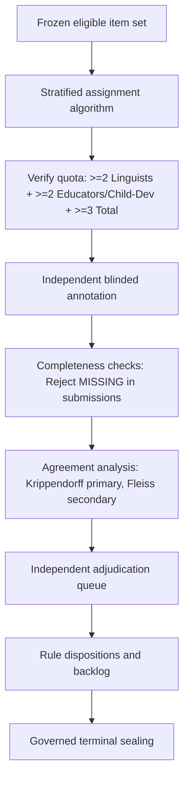

# Stage 34 Implementation Plan — Sinhala Expert Linguistic and Child-Development Validation

**Project:** AI-Powered Adaptive Child-Friendly Language Simplification System  
**Component:** Component 3 — AI/NLP-Based Language Simplification  
**Scope:** Human expert validation of Sinhala controlled-simplification rules and draft outputs for children aged 4–8  
**Status:** Planned — governance, ethics, and reviewer-readiness approval required before annotation  
**Authoritative prerequisite:** `stage-33-complete-v2` at commit `74481f4d09beeba42ccb9b9c32ff994e372af5bf`  
**Implementation branch:** `feature/stage34-sinhala-expert-validation`  
**Planned start tag:** `stage-34-start`  
**Planned terminal tags:**
- Successful validation: `stage-34-complete`
- Governed execution with insufficient evidence: `stage-34-insufficient-expert-evidence`

---

## 1. Purpose

Stage 34 establishes a reproducible, privacy-safe, and auditable human-expert annotation process for evaluating the Sinhala simplification rules and draft outputs sealed in Stage 33.

The stage evaluates:

- preservation of the source meaning;
- Sinhala grammatical and morphological acceptability;
- fluency, naturalness, and register;
- whether the output is simpler than the source;
- provisional developmental suitability for children aged 4–8;
- vocabulary-band alignment with the Stage 32 draft lexicon;
- safety concerns and cases requiring rejection or revision;
- consistency among independent expert reviewers.

Stage 34 does **not** establish clinical effectiveness, diagnostic validity, therapeutic benefit, or approval for unsupervised child delivery. It does not involve children unless a separately approved ethics protocol, consent process, safeguarding plan, and data-management procedure are established.

Evidentiary consistency is measured primarily using **Krippendorff's alpha** to support missingness, `CANNOT_ASSESS` designations, and variable reviewer availability, with **Fleiss' kappa** applied secondarily to eligible fully crossed nominal subsets. 

To ensure mathematical computability of inter-rater agreement across all critical dimensions, every primary evaluation item receives at least two qualified ratings for language and at least two qualified ratings for child development. If required expert panel qualifications, coverage, independence, or primary agreement thresholds ($\hat{\alpha} \ge 0.667$ point estimate across all four primary critical endpoints) are not achieved, Stage 34 terminates under governance seal as `stage-34-insufficient-expert-evidence`; it does not silently relabel the stage as validated or issue `stage-34-complete`. High raw agreement cannot substitute for a failed primary endpoint.

---

## 2. Stage Boundaries

### 2.1 Included

- Expert-panel eligibility criteria, competency declarations, and conflict-of-interest declarations.
- Reviewer onboarding, training, calibration, and predeclared qualification testing.
- Blinded, independently assigned Sinhala annotations with dual-competency coverage ($\ge 2$ linguists, $\ge 2$ educators/child-dev, $\ge 3$ total).
- Source–candidate pair review and unchanged-source controls.
- Evaluation of lexical, phrase, deletion, sentence-splitting, and constrained insertion rules.
- Structured `{ status, score }` dimensions distinguishing rated scores from `NOT_APPLICABLE` and `CANNOT_ASSESS`.
- Enforcement that `MISSING` is valid only in autosaved drafts and is rejected upon final submission.
- Structured error spans, controlled reason codes, and protected-storage storage of free-text comments.
- **Primary agreement metric:** Krippendorff's alpha for nominal and ordinal ratings with explicit missing-data handling.
- **Secondary agreement metric:** Fleiss' kappa for eligible fully crossed nominal subsets where assumptions are satisfied.
- Exact agreement, percent agreement, confusion matrices, and bootstrap confidence intervals as supporting evidence.
- Independent adjudication of disagreement without overwriting immutable independent annotations.
- Rule-level dispositions and a governed correction backlog for future stages.
- Seven-level zero-loss accounting reconciling reviewers, items, assignments, annotations, amendments, adjudications, and rule dispositions.
- Dual-manifest architecture: documentation manifest (`docs/stage34_manifest.sha256`) and implementation manifest (`data/sinhala_expert_validation/manifests/stage34_implementation_manifest.sha256`).
- Privacy-safe external storage (`SINHALA_EXPERT_VALIDATION_PROTECTED_ROOT`), audit logs, reproducibility records, and tamper verification.

### 2.2 Explicitly excluded

- Clinical validation, diagnosis, DLD classification, or treatment-effect claims.
- Modification of Component 1 `screening_risk_level`.
- Direct testing with children without separate ethics and safeguarding approval.
- Using annotation as therapy or educational intervention.
- Model training, fine-tuning, Gemini/mT5/mBART comparison, or LLM judging — Stage 35.
- Production validation and automated fallback deployment — Stage 36.
- Automatic approval of any text for child delivery (`approved_for_child_delivery` remains false).
- Retrospective fabrication of reviewers, annotations, timestamps, or agreement scores.
- Tuning Stage 33 rules against the sealed Stage 33 locked-test partition.
- Repository commits containing raw reviewer PII, restricted source/candidate text, or unredacted free-text comments.

---

## 3. Mandatory Governance Invariants

1. **Human evidence only:** Every expert annotation must be attributable to a real, consented reviewer represented by a pseudonymous reviewer ID (`REV-S34-XXX`).
2. **No fabricated review:** Synthetic, model-generated, copied, or administratively inferred annotations are strictly prohibited.
3. **Independent first pass:** Reviewers complete assigned annotations independently before seeing peer labels or adjudication outcomes.
4. **Blinding:** Review interfaces must not expose source identity, source licence posture, split name, rule priority, candidate rank, other reviewers' decisions, or expected answers where those fields could bias judgment.
5. **Locked-test protection:** Stage 33 locked-test outputs may be evaluated, but no Stage 33 rule, threshold, ranking weight, or configuration may be changed using those results.
6. **Immutable upstream stages:** Governed Stage 30–33 artifacts and historical tags remain unchanged. Corrections are recorded as Stage 34 findings or future versioned work.
7. **Raw annotation preservation:** Submitted annotations are immutable. Corrections create versioned amendment records linked to the original annotation; originals are never overwritten.
8. **Adjudication separation:** Adjudicated labels are stored separately and never replace individual annotations.
9. **No majority-vote truth claim:** Consensus and adjudication are governed decisions, not proof of absolute linguistic or developmental truth.
10. **No clinical claim:** Reviewers must not diagnose children or infer clinical status from text.
11. **No child-facing approval by automation:** Agreement thresholds alone cannot set `approved_for_child_delivery: true`.
12. **Privacy minimization:** Store only reviewer data necessary for eligibility, audit, payment/acknowledgement, and conflict management. Public artifacts use pseudonymous IDs and aggregates.
13. **Protected text handling:** Restricted Stage 31 source text and Stage 33 candidates remain in external protected storage and are displayed only to authorized reviewers.
14. **Least privilege:** Reviewers access only their assigned batches and cannot export restricted text.
15. **Reasoned dispositions:** Every rejection, review referral, and adjudication decision must include a governed reason code.
16. **Zero-loss accounting:** Every reviewer, assignment, item, annotation, amendment, adjudication, and rule disposition must reconcile to exactly one governed state across all **seven** accounting levels ($7/7$).
17. **Fail-closed completion:** If required reviewer qualifications, coverage, independence, or agreement evidence are not achieved, report `INSUFFICIENT_EXPERT_EVIDENCE` and seal `stage-34-insufficient-expert-evidence`; do not issue `stage-34-complete`.
18. **Historical tag immutability:** Existing Stage 26–33 tags must never be moved. Reconciliations use new versioned tags.
19. **Expertise-aware scoring:** Reviewers score only dimensions within their declared and qualified competency; outside dimensions must be marked `CANNOT_ASSESS`.
20. **Rubric immutability after locked evaluation:** Adjudicators and the research team are strictly prohibited from changing the frozen rubric, scale definitions, or reason codes after observing locked-test results.
21. **Project-team reviewer isolation:** Project-team members who perform annotations for calibration or workflow validation must be flagged and excluded from the primary independent-expert dataset. Their labels may only be analyzed in a separate, labeled sensitivity appendix.
22. **Free-text comment protection:** Free-text comments must never appear in repository-tracked files. They are restricted to external protected storage (`protected://stage34/comments/`) and audited for privacy compliance. Public artifacts track structured reason codes only.
23. **Submission completeness:** `MISSING` is valid solely in autosaved drafts. A submitted annotation containing `MISSING` in any mandatory dimension is invalid and fail-closed rejected.
24. **Computable pair guarantee:** Every primary item must receive at least two qualified ratings for each critical dimension (language and child development) to ensure Krippendorff's alpha is mathematically computable.

---

## 4. Authoritative Prerequisite and Baseline

Before Stage 34 begins, verify:

```powershell
git rev-parse "stage-33-complete-v2^{commit}"
# 74481f4d09beeba42ccb9b9c32ff994e372af5bf

git merge-base --is-ancestor `
  "stage-32-complete-v5^{commit}" `
  "stage-33-complete-v2^{commit}"

git status --short
# expected: empty
```

Create `stage-34-start` at the unchanged prerequisite commit `74481f4d09beeba42ccb9b9c32ff994e372af5bf`.

Record Stage 30–33 manifests, Stage 31 partition hashes, Stage 32 lexicon configuration, Stage 33 configuration, rule-registry hash, candidate-ledger hash, and declared test counts in `data/sinhala_expert_validation/snapshots/stage33_prerequisite_snapshot.json`.

The Stage 33 partition finding must be described precisely:

> No partition leakage was detected under the frozen record, document-group, and method-development relations.

---

## 5. Ethical and Institutional Readiness Gate

### 5.1 Required determination before recruitment

Record whether the planned expert-only annotation is:

- exempt or not human-subject research under the institution's policy;
- covered by an existing institutional approval;
- subject to new ethics/IRB approval; or
- blocked pending formal determination.

The project team must not self-declare an ethics exemption unless institutional policy explicitly permits it.

### 5.2 Reviewer consent

Before annotation, each reviewer must receive and acknowledge:

- purpose and non-clinical scope;
- expected time and compensation, if any;
- types of text they may encounter;
- confidentiality and restricted-text obligations;
- voluntary participation and withdrawal procedure;
- data retained about them;
- conflict-of-interest disclosure;
- contact and complaint process.

The consent form version must be frozen and cryptographically hashed (`consent_version_hash`).

### 5.3 Safeguarding boundary

Stage 34 is expert-only. No child participant, learner record, raw child response, or identifiable clinical record may enter the annotation system.

---

## 6. Expert Panel and Role Contract

### 6.1 Unique reviewer panel minimum

To guarantee rigorous independence and domain competency, the production review panel must contain **at least six unique qualified individuals**:

| Role | Unique Individuals | Minimum qualification evidence | Primary responsibility |
|---|---:|---|---|
| Sinhala linguist/language specialist | $\ge 2$ | Relevant degree or demonstrated professional Sinhala linguistics expertise | Meaning, grammar, morphology, fluency, register |
| Early-childhood/primary educator | $\ge 2$ | Experience teaching or developing Sinhala materials for ages 4–8 | Simplicity, classroom naturalness, developmental suitability |
| Child-development specialist | $\ge 1$ | Relevant professional or academic qualification | Developmental appropriateness and safety boundaries |
| Independent adjudicator | $\ge 1$ | Senior expertise across Sinhala linguistics and child development | Resolve disputed items after independent review |

**Panel Invariants:**
- A single reviewer may possess cross-disciplinary qualifications, but no reduction below **six unique individuals** is permitted.
- The adjudicator must be an independent individual who **does not** perform primary first-pass reviews on items requiring adjudication.

### 6.2 Expertise-aware reviewer coverage

To guarantee that both linguistic and developmental dimensions possess the minimum rating pairs necessary to compute Krippendorff's alpha, every primary evaluation item must satisfy:

1. **At least 2 Sinhala-language-qualified ratings** (from reviewers with declared language competency);
2. **At least 2 developmental-suitability-qualified ratings** (from early-childhood educators and/or child-development specialists);
3. **At least 3 independent reviewers overall**.

A cross-qualified reviewer (e.g., an educator with proven formal Sinhala linguistic qualifications) may contribute to both competency quotas. However, each critical dimension must contain at least **two independent qualified ratings per item** included in its agreement population.

Reviewers score only dimensions matching their declared expertise:
- A linguist without child-development credentials must not make an authoritative developmental-suitability judgment and must mark that dimension `CANNOT_ASSESS`.
- An educator or child-development specialist may mark intricate morphosyntactic sub-invariants as `CANNOT_ASSESS` if beyond their declared linguistic competency.

### 6.3 Reviewer eligibility record

```json
{
  "reviewer_id": "REV-S34-001",
  "roles": ["SINHALA_LINGUIST"],
  "qualification_evidence_ref": "protected://stage34/reviewers/REV-S34-001/evidence.json",
  "years_relevant_experience_band": "5_TO_9",
  "native_or_professional_sinhala_proficiency": true,
  "ages_4_to_8_experience": false,
  "competency_declarations": {
    "meaning_preservation": true,
    "grammatical_acceptability": true,
    "morphology_preservation": true,
    "fluency_naturalness": true,
    "simplicity_improvement": true,
    "vocabulary_suitability": true,
    "sentence_structure_suitability": true,
    "developmental_suitability": false
  },
  "conflict_declaration_completed": true,
  "consent_version": "S34-CONSENT-V1",
  "consent_version_hash": "<SHA-256>",
  "training_status": "QUALIFIED",
  "identity_publicly_disclosed": false,
  "is_project_team_member": false
}
```

Public reports must not expose personal contact information, signatures, payment information, or raw qualification documents.

### 6.4 Prohibited reviewer combinations

- A rule author must not be the sole reviewer or sole adjudicator of that rule.
- A reviewer must not adjudicate their own disputed item.
- Project-team annotations must be identified, flagged (`is_project_team_member: true`), and excluded from primary agreement statistics.
- Reviewers with an undeclared source, employment, or authorship conflict must be removed from affected assignments.

---

## 7. Evaluation Population and Sampling

### 7.1 Population

The evaluation population is derived from the sealed Stage 33 candidate and outcome ledgers over the 150-record canonical analytical corpus:

- train: 124 records;
- validation: 13 records;
- locked test: 13 records.

Counts must be loaded dynamically from governed artifacts and must not be hard-coded into processing logic.

### 7.2 Evaluation strata

Sampling must track:

- Stage 33 partition;
- rule family and rule ID;
- selected simplification vs unchanged fallback;
- output disposition;
- source and output length bands;
- Stage 32 vocabulary-band profile;
- protected-span presence;
- mixed-script presence;
- provisional domain/source category;
- Stage 33 risk or review flags.

### 7.3 Coverage policy

The primary expert set must include:

- every Stage 33 selected rewrite, subject to lawful access;
- every Stage 33 `MANUAL_REVIEW_REQUIRED` output;
- a stratified sample of unchanged/no-rule and unchanged/blocked controls;
- at least one eligible example per governed active rule where available;
- all locked-test items, evaluated without subsequent Stage 33 tuning.

If resource constraints prevent complete review, freeze the sampling seed and design before annotations begin, document inclusion probabilities, and report coverage limitations.

### 7.4 Development and locked-test separation

- Reviewer training and rubric calibration use train-partition examples or synthetic/permitted examples only.
- Validation examples may be used to assess rubric operation after it is frozen.
- Locked-test examples are annotated only after the rubric, codebook, assignment scheme, and analysis plan are frozen.
- Locked-test results are reported once and cannot be used to revise Stage 33 rules or configurations.

---

## 8. Annotation Instrument

### 8.1 Core dimensions and value contract

All ordinal and structured dimensions use an explicit `{ status, score }` contract:

Allowed statuses:
- `RATED`: valid numeric score (0–3) or categorical label;
- `NOT_APPLICABLE`: dimension is structurally inapplicable to the candidate;
- `CANNOT_ASSESS`: dimension is outside reviewer's qualified competency or evidence is insufficient;
- `MISSING`: collection-state value permitted **only** in incomplete autosaved drafts.

**Submission rule:**
- Only status `RATED` may contain a non-null `score`.
- `MISSING` is rejected at submission time. A submitted annotation must not contain `MISSING` in any mandatory dimension. If a reviewer cannot evaluate a dimension, they must submit `CANNOT_ASSESS` with `score: null`.

| Dimension | Permitted Statuses at Final Submission | Scale / Values when `RATED` | Interpretation |
|---|---|---|---|
| Meaning preservation | `RATED`, `CANNOT_ASSESS` | 0–3 ordinal | 0 major loss/contradiction; 1 substantial drift; 2 minor drift; 3 meaning preserved |
| Grammatical acceptability | `RATED`, `CANNOT_ASSESS` | 0–3 ordinal | Sinhala grammar and sentence well-formedness |
| Morphology preservation | `RATED`, `NOT_APPLICABLE`, `CANNOT_ASSESS` | 0–3 ordinal | Case, number, tense, agreement, negation, modality, inflection |
| Fluency/naturalness | `RATED`, `CANNOT_ASSESS` | 0–3 ordinal | Natural Sinhala usage and register |
| Simplicity improvement | `RATED`, `CANNOT_ASSESS` | `SIMPLER`, `SAME`, `MORE_COMPLEX`, `UNCERTAIN` | Comparison with source |
| Vocabulary suitability | `RATED`, `CANNOT_ASSESS` | 0–3 ordinal | Provisional accessibility for ages 4–8 |
| Sentence-structure suitability | `RATED`, `CANNOT_ASSESS` | 0–3 ordinal | Clause load, length, comprehension burden |
| Developmental suitability | `RATED`, `CANNOT_ASSESS` | 0–3 ordinal | Expert judgment for ages 4–8 (not clinical validation) |
| Safety flag | `RATED`, `CANNOT_ASSESS` | `NO_FLAG`, `POTENTIAL_CONCERN`, `UNSUITABLE`, `UNCERTAIN` | Harm, distress, or content concern |
| Overall disposition | `RATED` | `ACCEPT_DRAFT`, `ACCEPT_WITH_MINOR_EDIT`, `REVISE`, `REJECT`, `ESCALATE` | Recommended draft disposition |

### 8.2 Mandatory reason codes

```text
SEMANTIC_OMISSION
SEMANTIC_ADDITION
SEMANTIC_CONTRADICTION
ENTITY_OR_NUMBER_CHANGED
NEGATION_OR_MODALITY_CHANGED
TEMPORAL_OR_CAUSAL_RELATION_CHANGED
GRAMMAR_ERROR
MORPHOLOGY_ERROR
UNNATURAL_SINHALA
REGISTER_MISMATCH
NOT_SIMPLER
VOCABULARY_TOO_ADVANCED
SENTENCE_STRUCTURE_TOO_COMPLEX
DEVELOPMENTAL_CONCERN
SAFETY_CONCERN
SOURCE_AMBIGUOUS
INSUFFICIENT_CONTEXT
ANNOTATION_INTERFACE_ERROR
OTHER_EXPLAINED
```

### 8.3 Error spans

Where legally permitted, reviewers select source and candidate spans using zero-based, code-point, half-open intervals. Restricted text remains external; repository artifacts store opaque span references, rule IDs, reason codes, and aggregate counts.

### 8.4 Annotation record schema

```json
{
  "annotation_id": "ANN-S34-000001",
  "item_id": "ITEM-S34-000001",
  "reviewer_id": "REV-S34-001",
  "assignment_id": "ASN-S34-000001",
  "rubric_version": "S34-RUBRIC-V1",
  "rubric_hash": "<SHA-256>",
  "submitted_at": "<ISO-8601>",
  "meaning_preservation": { "status": "RATED", "score": 3 },
  "grammatical_acceptability": { "status": "RATED", "score": 3 },
  "morphology_preservation": { "status": "RATED", "score": 3 },
  "fluency_naturalness": { "status": "RATED", "score": 2 },
  "simplicity_improvement": { "status": "RATED", "score": "SIMPLER" },
  "vocabulary_suitability": { "status": "RATED", "score": 2 },
  "sentence_structure_suitability": { "status": "RATED", "score": 3 },
  "developmental_suitability": { "status": "CANNOT_ASSESS", "score": null },
  "safety": { "status": "RATED", "score": "NO_FLAG" },
  "overall_disposition": { "status": "RATED", "score": "ACCEPT_DRAFT" },
  "reason_codes": [],
  "error_spans": [],
  "confidence": "HIGH",
  "independent_submission": true,
  "human_authored": true,
  "has_protected_comments": false,
  "protected_comment_ref": null
}
```

### 8.5 Comment handling

Free-text comments are strictly prohibited in git-tracked repository files. Reviewers express feedback using governed reason codes. If free-text rationales are collected, they are stored exclusively in external protected storage (`protected://stage34/comments/ANN-S34-000001.txt`) and tracked by opaque reference.

---

## 9. Reviewer Training, Calibration, and Qualification

### 9.1 Training sequence

1. Scope, protected data, and non-clinical boundaries.
2. Rubric dimensions, `{ status, score }` contract, and competency bounds.
3. Protected-span and semantic-drift examples.
4. Independent practice batch on train-partition items.
5. Practice debrief (disagreements discussed only after practice submission).
6. Freeze final rubric version, codebook, and qualification threshold.
7. Separate qualification batch on a sealed qualification key.

### 9.2 Qualification rule

Qualification requires:

- completion of all training modules;
- no confidentiality or protocol violations;
- minimum agreement with the adjudicated qualification key on critical labels;
- correct recognition of major semantic drift and protected-span violations;
- compliant use of `CANNOT_ASSESS` and controlled reason codes.

The qualification key must be produced by senior human experts, not generated synthetically. Reviewers who fail are routed to retraining, restricted assignment, or exclusion; failures cannot be silently overridden.

### 9.3 Governance hashes

Before production review begins, record cryptographic hashes:
- `rubric_hash`
- `reason_codes_hash`
- `training_material_hash`
- `qualification_key_hash`
- `analysis_plan_hash`

---

## 10. Assignment, Blinding, and Annotation Workflow



### 10.1 Assignment rules

- Use a deterministic, seeded assignment algorithm (`assignment_seed`).
- Enforce the dual-competency coverage quota: each primary item receives $\ge 2$ Sinhala-language-qualified ratings, $\ge 2$ developmental-suitability-qualified ratings, and $\ge 3$ total independent assignments.
- Balance workload across reviewers where feasible.
- Prevent reviewers from receiving conflicted items.
- Freeze assignment ledger in `data/sinhala_expert_validation/assignments/assignment_ledger.jsonl` (`assignment_ledger_hash`).
- Preserve assignment history and reassignment reasons.

### 10.2 Blinding rules

The review interface presents only:
- source text;
- candidate text or unchanged control;
- minimal context where lawful and necessary;
- rubric dimensions and controlled reason codes.

It must not reveal partition split, rule IDs, candidate rank, expected disposition, other reviewers' labels, or control status.

### 10.3 Incomplete work

Partial drafts are autosaved in protected storage but not counted as submitted annotations. Reviewer withdrawal, timeout, technical failure, reassignment, and exclusion are distinct terminal assignment outcomes.

---

## 11. Agreement and Statistical Analysis Plan

### 11.1 Primary and secondary agreement metrics

- **Primary agreement metric: Krippendorff's alpha ($\alpha$)**
  - Used across all nominal and ordinal dimensions.
  - Accommodates missing data, incomplete rater overlap, and legitimate `CANNOT_ASSESS` statuses without forcing imputed ratings.
- **Secondary metric: Fleiss' kappa ($\kappa$)**
  - Computed only for planned, fully crossed nominal subsets where a fixed number of raters evaluate every item with complete data.
  - Must not be used where rater sets vary or data are missing.
- **Supporting metrics:**
  - Exact and percent agreement.
  - Pairwise confusion matrices to identify systematic linguistic vs developmental divergence.
  - Bootstrap 95% confidence intervals (item-level resampling, frozen random seed).

### 11.2 Metric formulas and distance function

Fleiss' kappa:

$$
\kappa = \frac{\bar{P} - \bar{P}_e}{1 - \bar{P}_e}
$$

Krippendorff's alpha:

$$
\alpha = 1 - \frac{D_o}{D_e}
$$

For ordinal dimensions (0–3), the ordinal distance function is frozen as:

$$
\delta^2(c, k) = \left( \sum_{g=\min(c,k)}^{\max(c,k)} n_g - \frac{n_c + n_k}{2} \right)^2
$$

**Missingness policy:** `CANNOT_ASSESS` and `NOT_APPLICABLE` entries are treated as valid missing observations in pairwise distance calculations; they are never coerced to numerical values (such as 0 or 1).

### 11.3 Decision rules, critical endpoints, and secondary diagnostics

The analysis plan strictly distinguishes **Primary Critical Endpoints** (which determine the terminal validation outcome) from **Secondary Agreement Diagnostics** (which are reported for analytical depth):

#### A. Primary Critical Endpoints (Mandatory $\hat{\alpha} \ge 0.667$)

To qualify for `stage-34-complete`, the point estimate of Krippendorff's alpha ($\hat{\alpha}$) must satisfy:

1. **Meaning preservation:** $\hat{\alpha} \ge 0.667$
2. **Grammatical acceptability:** $\hat{\alpha} \ge 0.667$
3. **Developmental suitability:** $\hat{\alpha} \ge 0.667$ (computed over qualified developmental ratings)
4. **Overall disposition:** $\hat{\alpha} \ge 0.667$

**Terminal decision rule on confidence intervals:**
- The terminal agreement decision uses the **point estimate** of Krippendorff's alpha ($\hat{\alpha}$).
- The 95% bootstrap confidence interval is reported as uncertainty evidence and does not independently alter the pass/fail determination.
- A critical endpoint passes when its point estimate is $\hat{\alpha} \ge 0.667$ and the metric is computable from the minimum frozen number of items and independent rating pairs (predeclared in `stage34_analysis_plan.json`).
- High raw or percent agreement cannot silently replace a failed or non-computable primary endpoint. Failure on any primary critical endpoint automatically routes the stage to `stage-34-insufficient-expert-evidence`.

#### B. Secondary Agreement Diagnostics (Informational)

The following dimensions are computed and reported as diagnostics:
- Morphology preservation ($\alpha$)
- Fluency/naturalness ($\alpha$)
- Simplicity improvement ($\alpha$)
- Vocabulary suitability ($\alpha$)
- Sentence-structure suitability ($\alpha$)

A secondary diagnostic does **not** trigger `stage-34-insufficient-expert-evidence` unless explicitly predeclared as mandatory in `stage34_analysis_plan.json`.

#### C. Interpretation benchmark

- $\hat{\alpha} \ge 0.800$ is interpreted as strong agreement;
- $0.667 \le \hat{\alpha} < 0.800$ is interpreted as acceptable/moderate agreement;
- $\hat{\alpha} < 0.667$ is interpreted as insufficient agreement.

### 11.4 Primary defect and safety endpoints

- Rate of major semantic drift.
- Rate of protected-meaning violations.
- Rate of grammatical or morphological defects.
- Proportion of candidates judged simpler than source.
- Provisional developmental suitability distribution.
- Overall disposition distribution.
- Dimension-level and rule-family-level agreement.
- Safety escalation rate.

---

## 12. Adjudication Protocol

### 12.1 Items requiring adjudication

- Any `REJECT`, `ESCALATE`, `UNSUITABLE`, or major semantic-drift label.
- Ordinal disagreement spanning 2 or more scale points.
- Conflicting accept/reject dispositions.
- Protected-span, negation, modality, entity, number, temporal, or causal concerns.
- Items failing predeclared agreement thresholds.
- Random quality-control sample of agreed items (5%).

### 12.2 Adjudication safeguards

- Adjudicator accesses independent labels only after first-pass submission closure.
- Original independent annotations remain immutable.
- Adjudicators cannot alter the frozen rubric or codebook.
- Adjudication records cite governed reason codes and structured evidence.
- If adjudication cannot resolve uncertainty, disposition is `UNRESOLVED_EXPERT_DISAGREEMENT`.
- Safety or clinical ambiguity is escalated to governance, not resolved by guessing.

### 12.3 Adjudicated record schema

```json
{
  "adjudication_id": "ADJ-S34-000001",
  "item_id": "ITEM-S34-000001",
  "independent_annotation_ids": ["ANN-S34-000001", "ANN-S34-000002", "ANN-S34-000003"],
  "adjudicator_id": "REV-S34-006",
  "final_disposition": "REVISE_RULE_OUTPUT",
  "reason_codes": ["SEMANTIC_OMISSION"],
  "rationale_ref": "protected://stage34/adjudications/ADJ-S34-000001.json",
  "resolved": true,
  "changes_upstream_artifact": false
}
```

---

## 13. Rule-Level Validation Contract

Stage 34 produces evidence-based dispositions without rewriting Stage 33 rules or ledgers in place:

```text
SUPPORTED_FOR_FURTHER_RESEARCH
SUPPORTED_WITH_CONSTRAINTS
REVISION_REQUIRED
REJECT_RULE_OR_OUTPUT_PATTERN
INSUFFICIENT_EXPERT_EVIDENCE
UNRESOLVED_EXPERT_DISAGREEMENT
```

Each rule record includes:
- rule ID and version;
- evaluated item count and partition coverage;
- semantic-drift and protected-span findings;
- grammar, morphology, fluency, and simplicity profiles;
- agreement statistics and confidence intervals;
- adjudicated defect counts;
- recommended action for Stage 35/36;
- governance flags.

`SUPPORTED_FOR_FURTHER_RESEARCH` does **not** authorize child delivery.

---

## 14. Privacy, Security, and Storage Architecture

### 14.1 External protected storage layout

```text
<SINHALA_EXPERT_VALIDATION_PROTECTED_ROOT>/stage34/
├── reviewers/
├── assignments/
├── item_text/
├── annotations/
├── amendments/
├── adjudications/
├── comments/
├── exports/
└── audit/
```

The protected root must exist outside the Git repository and fail closed if configured within the repository tree.

### 14.2 Repository-safe artifacts

The repository stores only:
- schemas, code, and test suites;
- pseudonymous reviewer IDs (`REV-S34-XXX`);
- opaque item, assignment, annotation, amendment, and adjudication IDs;
- aggregate statistics and confusion matrices;
- governed reason codes;
- cryptographic hashes and manifest files.

It must never store reviewer names, contact info, compensation records, qualification documents, restricted source/candidate text, or unredacted free-text comments.

### 14.3 Audit logging

Audit logs track actor ID, action, object ID, timestamp, rule ID, outcome, and request ID. Logs never contain raw text or reviewer PII.

---

## 15. Data Contracts and Validation Status

All Stage 34 records maintain:

```json
{
  "validation_status": "draft",
  "review_stage": "EXPERT_REVIEW_COMPLETED",
  "expert_review_status": "SUPPORTED_FOR_RESEARCH",
  "approved_for_child_delivery": false,
  "approved_for_unsupervised_child_delivery": false,
  "requires_expert_review": true
}
```

Both child-delivery approval flags remain strictly `false` throughout Stage 34.

---

## 16. Implementation Architecture

```text
backend/app/datasets/sinhala_expert_validation/
├── __init__.py
├── enums.py
├── schemas.py
├── eligibility.py
├── sampling.py
├── assignment.py
├── blinding.py
├── annotation_service.py
├── amendment_service.py
├── agreement.py
├── adjudication.py
├── rule_disposition.py
├── protected_storage.py
├── audit.py
└── export_service.py

backend/tests/datasets/sinhala_expert_validation/
├── test_reviewer_eligibility.py
├── test_ethics_gate.py
├── test_sampling_freeze.py
├── test_assignment_independence.py
├── test_expertise_aware_coverage.py
├── test_blinding.py
├── test_annotation_schema.py
├── test_status_score_contract.py
├── test_submission_rejects_missing.py
├── test_immutable_annotations.py
├── test_amendment_lifecycle.py
├── test_agreement_krippendorff.py
├── test_agreement_fleiss.py
├── test_missingness_and_special_values.py
├── test_adjudication_separation.py
├── test_locked_test_protection.py
├── test_privacy_and_exports.py
├── test_seven_level_accounting.py
├── test_manifest_verification.py
└── test_stage34_end_to_end.py

data/sinhala_expert_validation/
├── registry/
│   ├── stage34_configuration.json
│   ├── rubric.json
│   ├── reason_codes.json
│   └── stage34_analysis_plan.json
├── assignments/
├── ledgers/
├── reports/
├── snapshots/
└── manifests/
    └── stage34_implementation_manifest.sha256

scripts/stage34/
├── snapshot_prerequisites.py
├── build_annotation_items.py
├── verify_reviewer_readiness.py
├── freeze_stage34_configuration.py
├── compute_agreement.py
├── verify_annotation_accounting.py
├── verify_locked_test_protocol.py
├── verify_stage30_to_33_immutability.py
├── generate_stage34_reports.py
├── generate_stage34_manifest.py
├── verify_stage34_manifest.py
├── generate_implementation_manifest.py
└── verify_implementation_manifest.py
```

---

## 17. Work Packages

### WP0 — Prerequisite, ancestry, and immutable baseline

1. Verify `stage-33-complete-v2` at commit `74481f4d09beeba42ccb9b9c32ff994e372af5bf`.
2. Verify Stage 30–33 ancestry and declared manifest scopes.
3. Confirm clean working tree.
4. Create branch `feature/stage34-sinhala-expert-validation` and annotated `stage-34-start`.
5. Snapshot configurations, partitions, rule registry, ledgers, and hashes in `data/sinhala_expert_validation/snapshots/stage33_prerequisite_snapshot.json`.
6. Run baseline backend/frontend regressions and build.

### WP1 — Ethics, governance, and protected-storage readiness

1. Record institutional ethics determination.
2. Freeze consent form (`consent_version_hash`), confidentiality, withdrawal, and conflict protocols.
3. Configure and validate external protected storage outside Git.
4. Establish reviewer access controls and audit logging.
5. Produce the ethics and privacy readiness report.

**Mandatory halt:** No recruitment or annotation begins until WP1 is approved.

### WP2 — Reviewer recruitment, competency, and eligibility

1. Recruit reviewers against frozen qualification criteria.
2. Verify qualifications and competency declarations privately.
3. Assign pseudonymous IDs (`REV-S34-XXX`).
4. Collect signed consent and conflict disclosures.
5. Record eligibility, competency maps, and project-team flags.
6. Verify minimum panel composition ($\ge 6$ unique individuals: $\ge 2$ linguists, $\ge 2$ educators, $\ge 1$ child dev, $\ge 1$ independent adjudicator).

### WP3 — Rubric, codebook, and analysis-plan freeze

1. Finalize `{ status, score }` dimensions, scales, controlled reason codes, and submission completeness rules.
2. Declare Krippendorff's alpha as primary metric; freeze ordinal distance function $\delta^2(c, k)$.
3. Predeclare interpretation bands and freeze the decision rule: pass requires point estimate $\hat{\alpha} \ge 0.667$ on all 4 primary critical endpoints, with minimum computable rating pairs defined in `stage34_analysis_plan.json`.
4. Freeze and seal hashes: `rubric_hash`, `reason_codes_hash`, `analysis_plan_hash`.

### WP4 — Annotation-set construction and expertise-aware assignment

1. Build eligible item population from sealed Stage 33 ledgers.
2. Apply lawful-access and privacy gates.
3. Stratify and sample using frozen seed.
4. Generate unchanged-source controls.
5. Apply dual-competency assignment algorithm: each primary item receives $\ge 2$ Sinhala-language-qualified ratings, $\ge 2$ developmental ratings, and $\ge 3$ total independent raters.
6. Freeze assignment ledger (`assignment_ledger_hash`) and verify blinding.

### WP5 — Reviewer training, calibration, and qualification

1. Standardized training on rubric dimensions, `{ status, score }` contract, and competency boundaries.
2. Individual practice batch on train-partition items.
3. Debrief disagreements after practice submission.
4. Seal qualification batch key (`qualification_key_hash`).
5. Run independent qualification test.
6. Qualify, retrain, or exclude reviewers under predeclared rules.

**Mandatory halt:** Production annotation begins only after reviewer-readiness verification passes.

### WP6 — Blinded independent production annotation

1. Open frozen assignments in blinded interface.
2. Capture independent immutable submissions with `{ status, score }` structure; reject any submission containing `MISSING`.
3. Monitor completion and security without coaching raters.
4. Record withdrawals, reassignments, timeouts, and amendments.
5. Close production batches before revealing peer labels.

### WP7 — Agreement analysis and defect detection

1. Validate annotation schema integrity and submission completeness.
2. Compute primary Krippendorff's alpha with explicit `CANNOT_ASSESS` missingness handling against frozen $\hat{\alpha} \ge 0.667$ thresholds for the 4 critical endpoints.
3. Compute secondary agreement diagnostics and Fleiss' kappa on eligible fully crossed nominal subsets.
4. Report point estimates, missingness, marginal prevalence, confusion matrices, and bootstrap 95% CIs.
5. Route defect candidates to the adjudication queue.
6. Keep locked-test evaluation strictly isolated from rule revision.

### WP8 — Adjudication and rule-level dispositions

1. Adjudicate required disagreements without modifying independent annotations.
2. Store adjudication rationales in protected storage.
3. Aggregate findings by rule, stratum, dimension, and partition.
4. Assign rule-level Stage 34 dispositions.
5. Create versioned correction backlog for Stage 35 without altering Stage 33.

### WP9 — Verification, seven-level accounting, documentation, and sealing

1. Verify all **seven** accounting equations ($7/7$, 0 unaccounted).
2. Verify locked-test protocol and Stage 30–33 immutability.
3. Run Stage 34 unit and integration test suites.
4. Run full backend regressions, frontend tests, and production build.
5. Generate documentation manifest (`docs/stage34_manifest.sha256`) and implementation manifest (`data/sinhala_expert_validation/manifests/stage34_implementation_manifest.sha256`).
6. Run read-only manifest verification and negative tamper tests.
7. Seal terminal tag:
   - `stage-34-complete` if all expert evidence, coverage, and $\hat{\alpha} \ge 0.667$ criteria pass;
   - `stage-34-insufficient-expert-evidence` if governance passed but expert evidence was insufficient.

---

## 18. Accounting Requirements (Seven Governed Levels)

Every unit must reconcile to exactly one governed terminal state. Target for all seven equations: $\text{Unaccounted} = 0$.

### 18.1 Level 1 — Reviewer accounting

$$
\text{RecruitedReviewers} = \text{Qualified} + \text{RetrainingRequired} + \text{Excluded} + \text{Withdrawn} + \text{Unaccounted}
$$

### 18.2 Level 2 — Item accounting

$$
\text{EligibleItems} = \text{Assigned} + \text{BlockedByRights} + \text{BlockedByPrivacy} + \text{ExcludedByFrozenSampling} + \text{TechnicalFailure} + \text{Unaccounted}
$$

### 18.3 Level 3 — Assignment accounting

$$
\text{Assignments} = \text{Submitted} + \text{Withdrawn} + \text{Expired} + \text{Reassigned} + \text{ExcludedForIntegrity} + \text{Unaccounted}
$$

### 18.4 Level 4 — Annotation accounting

$$
\text{SubmittedAnnotations} = \text{ValidIndependent} + \text{AmendedWithAcceptedRecord} + \text{ExcludedForIntegrity} + \text{Unaccounted}
$$

### 18.5 Level 5 — Amendment accounting

$$
\text{AmendmentRecords} = \text{AcceptedAmendments} + \text{RejectedAmendments} + \text{WithdrawnAmendments} + \text{Unaccounted}
$$

### 18.6 Level 6 — Adjudication accounting

$$
\text{AdjudicationQueue} = \text{Resolved} + \text{UnresolvedExpertDisagreement} + \text{Pending} + \text{ExcludedWithReason} + \text{Unaccounted}
$$

At sealing, $\text{Pending} = 0$.

### 18.7 Level 7 — Rule-disposition accounting

$$
\text{EvaluatedRules} = \text{SupportedForResearch} + \text{SupportedWithConstraints} + \text{RevisionRequired} + \text{Rejected} + \text{InsufficientEvidence} + \text{UnresolvedDisagreement} + \text{Unaccounted}
$$

---

## 19. Automated Test Plan

```powershell
Push-Location backend
python -m pytest tests/datasets/sinhala_expert_validation/ -v
python -m pytest tests/ -q
Pop-Location

Push-Location frontend
npm run test -- --run
npm run build
Pop-Location

python scripts/stage34/verify_annotation_accounting.py
python scripts/stage34/verify_locked_test_protocol.py
python scripts/stage34/verify_stage30_to_33_immutability.py
python scripts/stage34/verify_stage34_manifest.py
python scripts/stage34/verify_implementation_manifest.py
```

Minimum required test assertions:

- Protected storage rejects repository-internal paths.
- Annotation cannot begin before ethics and reviewer-readiness gates pass.
- Reviewer qualification records contain no public personal data.
- Conflicted reviewers cannot receive affected assignments.
- Expertise-aware coverage verifies $\ge 2$ language ratings, $\ge 2$ developmental ratings, and $\ge 3$ total independent raters per primary item.
- Unique reviewer panel check asserts $\ge 6$ unique qualified individuals with an independent adjudicator.
- Reviewers cannot see peer labels before submission closure.
- Split, rule, rank, expected label, and source identity remain blinded.
- Submitted annotations are immutable.
- Amendment lifecycle: amendments link to originals without overwriting them.
- Dimension schema validates `{ status, score }` contract and enforces non-null score only when `status == "RATED"`.
- `test_submission_rejects_missing`: Submitted annotations containing `MISSING` in mandatory dimensions are rejected.
- `CANNOT_ASSESS` and `NOT_APPLICABLE` are handled explicitly in agreement calculations without numerical imputation.
- Krippendorff's alpha implementation reproduces against frozen fixtures.
- Fleiss' kappa rejects datasets with missing observations or uncrossed raters.
- Terminal pass decision tests: verifies point estimate $\hat{\alpha} \ge 0.667$ decision rule and reports 95% CIs.
- Adjudication records remain separate from independent annotations.
- Locked-test items are excluded from training and calibration.
- Stage 30–33 rules/configuration remain strictly immutable.
- Public exports contain no restricted text, reviewer PII, or free-text comments.
- Child-delivery flags remain false.
- All seven accounting levels reconcile with zero unaccounted units ($7/7$).
- Read-only manifest verifiers detect temporary tampered copies in both documentation and implementation manifests.

---

## 20. Manual Verification Checklist

1. Confirm institutional ethics determination is recorded before recruitment.
2. Confirm every reviewer is real, consented, qualified, pseudonymized, and conflict-checked.
3. Confirm production panel contains at least six unique qualified individuals with an independent adjudicator.
4. Confirm no child participants or learner records are included.
5. Confirm protected storage resolves strictly outside the Git repository.
6. Confirm training and qualification examples exclude locked-test items.
7. Confirm rubric, reason codes, distance function, and analysis plan were frozen before production review.
8. Confirm dual-competency coverage ($\ge 2$ language ratings, $\ge 2$ developmental ratings, $\ge 3$ total) across primary items.
9. Confirm reviewers could not see peer labels before closure.
10. Confirm `{ status, score }` schema separates valid scores from `CANNOT_ASSESS` and `NOT_APPLICABLE`.
11. Confirm no submitted annotation contains `MISSING` in any mandatory dimension.
12. Confirm free-text reviewer comments are restricted to external protected storage.
13. Confirm project-team reviewers are excluded from primary independent agreement analyses.
14. Confirm critical semantic and protected-span failures entered adjudication.
15. Confirm adjudication records do not overwrite original annotations.
16. Confirm Krippendorff's alpha point estimates meet frozen $\hat{\alpha} \ge 0.667$ thresholds for all 4 primary critical endpoints.
17. Confirm 95% bootstrap CIs are reported as uncertainty evidence and high raw agreement did not replace any primary endpoint calculation.
18. Confirm locked-test results were evaluated once under the frozen protocol without tuning Stage 33.
19. Confirm Stage 30–33 governed artifacts are unchanged.
20. Confirm public artifacts contain no restricted text, PII, credentials, or raw comments.
21. Confirm no report claims clinical validation or child-delivery approval.
22. Confirm all seven accounting equations report zero unaccounted units ($7/7$).
23. Confirm both documentation and implementation manifests verify in read-only mode and pass tamper tests.
24. Confirm the working tree is clean before completion tagging.

---

## 21. Required Documentation and Manifest Deliverables

### 21.1 Documentation deliverables

1. `docs/stage34_implementation_plan.md`
2. `docs/stage34_ethics_privacy_and_reviewer_governance.md`
3. `docs/stage34_expert_panel_and_conflict_record.md`
4. `docs/stage34_annotation_rubric_and_codebook.md`
5. `docs/stage34_sampling_assignment_and_blinding_protocol.md`
6. `docs/stage34_reviewer_training_and_qualification_report.md`
7. `docs/stage34_agreement_analysis_report.md`
8. `docs/stage34_semantic_drift_and_error_analysis.md`
9. `docs/stage34_adjudication_and_rule_disposition_report.md`
10. `docs/stage34_accounting_summary.md`
11. `docs/stage34_reproducibility_record.json`
12. `docs/stage34_completion_record.md`
13. `docs/stage34_manifest.sha256`

### 21.2 Implementation manifest

14. `data/sinhala_expert_validation/manifests/stage34_implementation_manifest.sha256`

### 21.3 Manifest scope contracts

- **Documentation manifest (`docs/stage34_manifest.sha256`):**
  - Covers exactly the 12 documentation files (1–12 above).
  - Excludes itself.
- **Implementation manifest (`data/sinhala_expert_validation/manifests/stage34_implementation_manifest.sha256`):**
  - Covers all Stage 34 schemas, registry files, configuration, rubric, analysis plan, reason-code registry, scripts, tests, and sanitized ledgers.
  - Excludes itself.
- **Protected boundary rule:**
  - Protected reviewer identities, raw qualification evidence, restricted source/candidate text, raw annotations, free-text comments, and adjudication rationales must **never** enter either repository manifest.

---

## 22. Completion and Terminal Sealing Criteria

Stage 34 concludes under one of two mutually exclusive terminal tags:

### 22.1 Successful validation tag: `stage-34-complete`

Issued only when:
- [ ] `stage-33-complete-v2` resolves to `74481f4d09beeba42ccb9b9c32ff994e372af5bf`.
- [ ] `stage-34-start` points to the unchanged prerequisite commit.
- [ ] Institutional ethics/governance determination is formally recorded.
- [ ] External protected storage is validated outside Git.
- [ ] Reviewer panel meets qualification and composition quotas ($\ge 6$ unique individuals: $\ge 2$ linguists, $\ge 2$ educators, $\ge 1$ child dev, $\ge 1$ independent adjudicator).
- [ ] Consent and conflict declarations are complete with frozen hashes.
- [ ] No synthetic or fabricated expert annotations exist.
- [ ] Rubric, reason codes, distance function, assignments, and analysis plan were frozen before production annotation.
- [ ] Reviewer training and qualification gates passed.
- [ ] Primary items achieved dual-competency coverage ($\ge 2$ language ratings, $\ge 2$ developmental ratings, $\ge 3$ total).
- [ ] Blinding and cross-reviewer isolation were preserved.
- [ ] Submission completeness verified: no accepted submission contains `MISSING`.
- [ ] Point estimate of primary Krippendorff's alpha met predeclared agreement thresholds ($\hat{\alpha} \ge 0.667$ on all 4 primary critical endpoints: meaning preservation, grammar, developmental suitability, and overall disposition).
- [ ] No primary endpoint was replaced or substituted by raw percent agreement.
- [ ] Missingness, prevalence, bootstrap 95% confidence intervals, and metric limitations are fully reported.
- [ ] Critical disagreements were adjudicated; original annotations remain immutable.
- [ ] Amendment records reconciled in Level 5 accounting.
- [ ] Locked-test results were evaluated once under frozen protocol without modifying Stage 33.
- [ ] Stage 30–33 governed artifacts remain immutable.
- [ ] Rule-level dispositions and limitations are recorded.
- [ ] Child-delivery flags remain strictly `false`.
- [ ] No reviewer PII, restricted text, or free-text comments appear in public git artifacts.
- [ ] All seven accounting levels reconcile with zero unaccounted units ($7/7$).
- [ ] Stage 34 tests and full backend regressions pass.
- [ ] Frontend tests and build pass.
- [ ] Both documentation and implementation manifests verify in read-only mode and pass negative tamper tests.
- [ ] Working tree is clean.
- [ ] Annotated tag `stage-34-complete` is created.

### 22.2 Governed insufficient evidence tag: `stage-34-insufficient-expert-evidence`

Issued if:
- The governed process, audit trail, accounting, and security procedures were executed completely, BUT:
- Required reviewer qualifications, panel minimums, dual-competency coverage, independence quotas, or statistical agreement thresholds ($\hat{\alpha} \ge 0.667$ on any of the 4 critical endpoints) were not achieved.
- Terminal status is formally recorded as:
  ```text
  Stage 34 execution status: INSUFFICIENT_EXPERT_EVIDENCE
  Approved for child delivery: FALSE
  Stage 35 eligibility: BLOCKED_PENDING_GOVERNANCE_DECISION
  ```
- Annotated tag `stage-34-insufficient-expert-evidence` is created. Historical tags are never moved.

---

## 23. Completion Record Template

```text
================================================================
STAGE 34 — SINHALA EXPERT ANNOTATION AND VALIDATION
================================================================

Prerequisite tag:                          stage-33-complete-v2
Prerequisite commit:                       74481f4d09beeba42ccb9b9c32ff994e372af5bf
Start tag:                                 stage-34-start
Final commit:                              <full SHA>
Terminal tag:                              stage-34-complete / stage-34-insufficient-expert-evidence
Validation verdict:                        VALIDATION_SUPPORTED / INSUFFICIENT_EXPERT_EVIDENCE

Ancestry verification:                     PASSED / FAILED
Ethics/governance determination:           <status and reference>
Protected storage isolation:               PASSED / FAILED
Unique qualified reviewers:                <count >= 6>
Independent expert reviewers:              <count>
Independent adjudicator:                   PASSED / FAILED
Excluded/conflicted reviewers:             <count>
Project-team reviewers isolated:           PASSED / FAILED
Rubric, codebook, analysis plan frozen:    PASSED / FAILED
Primary items evaluated:                   <count>
Expertise-aware quota (2+2+3):             PASSED / FAILED
Submission completeness (no MISSING):      PASSED / FAILED
Valid independent annotations:             <count>
Accepted amendment records:                <count>
Adjudication queue:                        <count>
Resolved adjudications:                    <count>
Unresolved expert disagreements:           <count>

Primary Critical Endpoints (Krippendorff's alpha, point estimate >= 0.667):
  Meaning preservation:                   <estimate, 95% CI> [PASS/FAIL]
  Grammatical acceptability:              <estimate, 95% CI> [PASS/FAIL]
  Developmental suitability:              <estimate, 95% CI> [PASS/FAIL]
  Overall disposition:                    <estimate, 95% CI> [PASS/FAIL]

Secondary Agreement Diagnostics (Krippendorff's alpha, informational):
  Morphology preservation:                <estimate, 95% CI>
  Fluency/naturalness:                    <estimate, 95% CI>
  Simplicity improvement:                 <estimate, 95% CI>
  Vocabulary suitability:                 <estimate, 95% CI>
  Sentence-structure suitability:         <estimate, 95% CI>

Secondary Metric (Fleiss' kappa, fully crossed subsets):
  Overall disposition subset:             <estimate, 95% CI / NOT_APPLICABLE>

Defect and Safety Findings:
  Major semantic-drift findings:          <count/rate>
  Protected-meaning violations:           <count/rate>
  Grammar/morphology defects:             <count/rate>
  Safety escalations:                     <count/rate>

Rule Dispositions:
  Supported for further research:         <count>
  Supported with constraints:             <count>
  Revision required:                      <count>
  Rejected:                               <count>
  Insufficient evidence:                  <count>

Governance & Immutability:
  Locked-test protocol:                   PASSED / FAILED
  Stage 30–33 immutability:               PASSED / FAILED
  Stage 34 test suite:                    <passed>/<collected>
  Full backend regression:                <passed>/<collected>
  Frontend tests & build:                 PASSED / FAILED
  Accounting reconciliation:              7/7 levels, 0 unaccounted
  Documentation manifest:                 PASSED / FAILED
  Implementation manifest:                PASSED / FAILED
  Negative tamper tests:                  PASSED / FAILED

Non-Clinical Scope Affirmation:
  Clinical validation:                    NOT ESTABLISHED
  Diagnostic validity:                    NOT ESTABLISHED
  Direct child evaluation:                NOT PERFORMED
  Approved for child delivery:            FALSE
  Approved for unsupervised delivery:     FALSE

================================================================
```

---

## 24. Recommended Execution Order

```text
WP0  Prerequisite baseline, snapshot, regressions
 ↓
WP1  Ethics gate, privacy, protected storage setup
 ↓
WP2  Reviewer recruitment, competency maps, conflict checks
 ↓
WP3  Rubric, status-score schema, analysis-plan freeze
 ↓
WP4  Item construction, sampling, expertise-aware assignment
 ↓
WP5  Reviewer training, calibration, qualification
 ↓
WP6  Blinded independent production annotation
 ↓
WP7  Krippendorff agreement analysis, defect identification
 ↓
WP8  Adjudication queue and rule dispositions
 ↓
WP9  7-level accounting, dual manifests, terminal sealing
```

No Stage 35 model comparison should begin until Stage 34 has either produced sufficient governed expert evidence under `stage-34-complete` or issued a documented governance decision explaining how `stage-34-insufficient-expert-evidence` will be handled.
