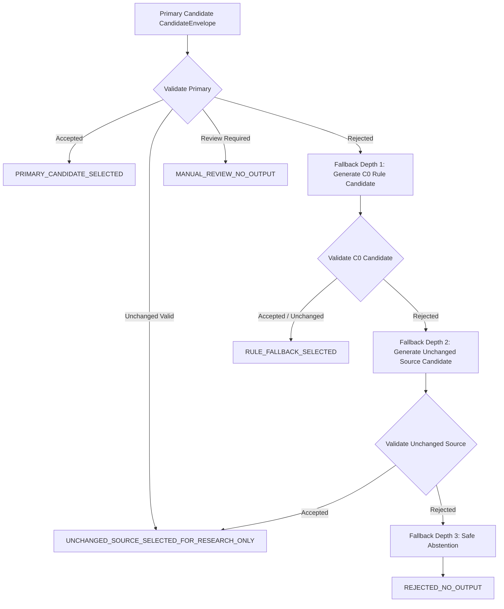

# Stage 36 — Governed Fallback, Disposition Router, and Safe Abstention Policy

**Component:** Component 3 — AI/NLP-Based Language Simplification  
**Modules:** `backend/app/sinhala_output_validation/engine.py`  

---

## 1. Fixed Precedence Disposition Ladder

When evaluating a candidate, findings are mapped to exactly one mutually exclusive terminal disposition in strict left-to-right precedence:

1. `REJECTED_CONFIGURATION_OR_PROVENANCE` (V0 critical findings)
2. `REJECTED_INVALID_UNICODE` (V1 or V7 orthographic critical findings)
3. `REJECTED_PROTECTED_SPAN_VIOLATION` (V3 critical findings)
4. `REJECTED_NUMERICAL_OR_POLARITY_DRIFT` (V4 critical findings)
5. `REJECTED_UNSUPPORTED_INSERTION` (V5 critical findings)
6. `REJECTED_CRITICAL_SEMANTIC_RISK` (V2 or V6 critical findings)
7. `MANUAL_REVIEW_REQUIRED` (V3, V5, or V7 review findings)
8. `VALID_UNCHANGED_NO_SIMPLIFICATION` (Valid output identical to source text)
9. `ACCEPTED_TECHNICAL_RESEARCH_CANDIDATE` (All gates passed, distinct text)

---

## 2. Bounded Fallback Ladder Orchestration

The `GovernedFallbackOrchestrator` implements an automated, bounded fallback progression:

### Depth and Loop Prevention Rules
- Maximum transitions permitted: **3**.
- Cyclic transitions (`from_candidate_id == to_candidate_id`) are prohibited.
- Failed candidates are never selected as valid output.
- Reverting to `C0_RULE_BASELINE` or unchanged source does not imply child-delivery approval (`approved_for_child_delivery` remains `False`).
